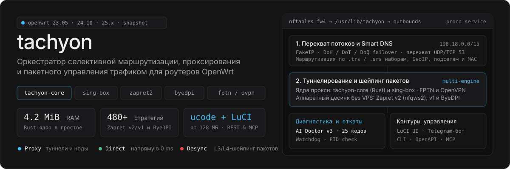
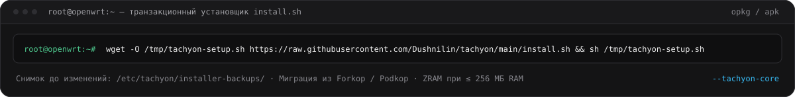
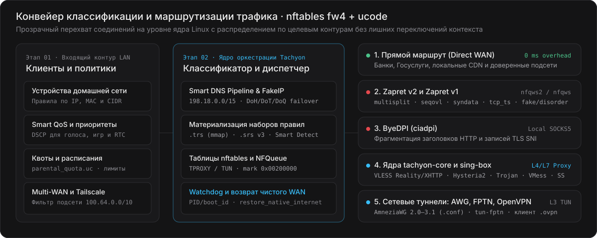
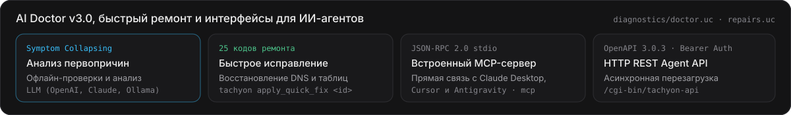
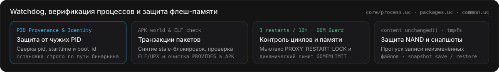
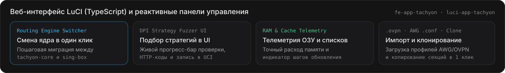
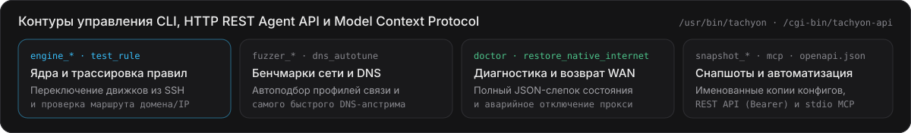

<p align="center">
  
</p>

<p align="center">
  <a href="https://github.com/Dushnilin/tachyon/releases"></a>
  <a href="https://openwrt.org/"></a>
  <a href="https://github.com/Dushnilin/tachyon-core"></a>
  <a href="https://github.com/Dushnilin/tachyon-lists"></a>
  <a href="https://t.me/tachyon_proxy"></a>
  <a href="./LICENSE"></a>
</p>

<p align="center">
  <sub><a href="README.md">Русский</a> · <b>English</b> · <a href="https://github.com/Dushnilin/tachyon-core">tachyon-core</a> · <a href="https://github.com/Dushnilin/tachyon-lists">tachyon-lists</a> · <a href="https://boosty.to/tachyon">Boosty</a></sub>
</p>

---

**Tachyon** is a network routing, selective proxy orchestration, and L3/L4 traffic-shaping package for **OpenWrt** routers (`23.05`, `24.10`, `25.x`, and `SNAPSHOT`). It builds upon **[Forkop (@ushan0v)](https://github.com/ushan0v/forkop)** and the original **[Podkop (@itdoginfo)](https://github.com/itdoginfo/podkop)** architecture.

The package integrates multi-engine routing (native Rust **[tachyon-core](https://github.com/Dushnilin/tachyon-core)** and **sing-box**), **AmneziaWG / WireGuard**, **OpenVPN (`.ovpn`)**, and **FPTN** L3 tunnels, local packet desynchronization (**Zapret v2 / Zapret v1 / ByeDPI**) with a combinatorial strategy fuzzer, as well as **AI Doctor v3.0** self-diagnostics, a **Telegram management bot**, an **HTTP REST Agent API (OpenAPI 3.0)**, and an **MCP server**. All backend logic is implemented in **ucode** — OpenWrt's native C interpreter — running on routers with 128 MB RAM or more without external language runtimes.

---

<p align="center">
  
</p>

<p align="center">
  
</p>

Run the transactional installer in a single SSH command on the router:

```bash
wget -O /tmp/tachyon-setup.sh https://raw.githubusercontent.com/Dushnilin/tachyon/main/install.sh && sh /tmp/tachyon-setup.sh
```

To install non-interactively with the native Rust `tachyon-core` engine preselected:

```bash
sh /tmp/tachyon-setup.sh -y --tachyon-core
```

| Option or Mechanism | Behavior |
|:---|:---|
| `--tachyon-core` | Installs the native Rust `tachyon-core` engine (~4.2 MiB idle RAM) instead of the Go-based `sing-box` binary |
| Interactive selection | When run without flags, prompts for the target routing engine (`tachyon-core`, `sing-box` `stable`/`extended`/`tiny`/`lx`) and release version |
| Transactional snapshots | Saves a configuration backup in `/etc/tachyon/installer-backups/` and records `apk-world` state before changes; automatically rolls back on failure |
| Memory protection (`zram-swap`) | On devices with ≤ 256 MB RAM, inspects available memory and offers to enable `zram-swap` |
| Automatic migration | Migrates existing rules and sections from `forkop`, `podkop-plus`, and `podkop` into `/etc/config/tachyon` |
| `--repair` / `--reinstall` | Rebuilds network tables, firewall hooks, and reinstalls packages over the current setup |
| `--channel beta` / `--tag X.Y.Z` | Switches to pre-release builds or installs a specific tagged version |

<details>
<summary><b>Installation mirrors (when direct access to raw.githubusercontent.com is throttled or blocked)</b></summary>

<br>

```bash
# Mirror 1 (jsdelivr.net CDN):
wget -O /tmp/tachyon-setup.sh https://cdn.jsdelivr.net/gh/Dushnilin/tachyon@main/install.sh && sh /tmp/tachyon-setup.sh

# Mirror 2 (gh-proxy.com):
wget -O /tmp/tachyon-setup.sh https://gh-proxy.com/raw.githubusercontent.com/Dushnilin/tachyon/main/install.sh && sh /tmp/tachyon-setup.sh

# Mirror 3 (ghfast.top):
wget -O /tmp/tachyon-setup.sh https://ghfast.top/https://raw.githubusercontent.com/Dushnilin/tachyon/main/install.sh && sh /tmp/tachyon-setup.sh
```

</details>

---

<p align="center">
  
</p>

<p align="center">
  
</p>

Tachyon classifies flows via kernel **nftables** (`fw4`) and dispatches traffic across five outbound contours without unnecessary userspace hops:

| Processing Contour | Kernel & Daemon Mechanism | Purpose |
|:---|:---|:---|
| **1. Direct WAN** | Direct routing bypassing TPROXY/TUN (`0 ms overhead`) | Domestic banking, government portals, local CDNs, and trusted subnets |
| **2. Zapret v1 / v2** | Initial packet interception via Netfilter queue (`nfqws` / `nfqws2`) | Hardware-level TCP/UDP desynchronization (`multisplit`, `seqovl`, `wsize`, `syndata`, PAWS `tcp_ts`, binary `blobs`, `fake`/`disorder`) directly on the router without a VPS |
| **3. ByeDPI (`ciadpi`)** | Local SOCKS5 desynchronization daemon | HTTP payload and TLS ClientHello / SNI record fragmentation |
| **4. Proxy Engines** | `tachyon-core` / `sing-box` | Selective routing by domains, `.trs`/`.srs`/`.lst` rule-sets, subnets, and LAN clients over VLESS Reality/XHTTP, Hysteria2, Trojan, VMess, and Shadowsocks |
| **5. L3 Tunnels** | Kernel `tun` / WireGuard interfaces (table `4249` for FPTN) | Packet-level tunneling via AmneziaWG (`AWG 2.0/3.0/3.1`), WireGuard, built-in OpenVPN (`.ovpn`), and `fptn-client-cli` over WebSocket/TLS |
| **6. Smart DNS** | FakeIP (`198.18.0.0/15`) + UDP/TCP port 53 interception | Isolated name resolution over DoH, DoT, DoQ, and HTTP/3 with continuous upstream health checks (`dns_failover.uc`) and ISP anti-hijack protection |

---

<p align="center">
  
</p>

### 1. Multi-Engine Routing Architecture

Tachyon switches between independent routing engines via LuCI or CLI (`tachyon engine_set <name>`) while automatically reconfiguring `nftables` rules, network interfaces, and DNS pipelines:

| Engine | Runtime Stack | Key Technical Characteristics |
|:---|:---|:---|
| **`tachyon-core`** | Pure Rust (Zero-C-Crypto, no Go runtime or GC) | Around **4.2 MiB RAM** idle footprint; 100% configuration and CLI compatibility with `sing-box`; zero-copy `mmap` `.trs` rule-sets; built-in Outbound Desync (TCP/TLS/HTTP split) in the core network stack; asynchronous XHTTP transport (`packet-up`, `auto`); Brutal CC congestion control for Hysteria2; integrated FPTN L3 tunnel; automatic rollback to `fallback.json` on validation errors; builds for `aarch64`, `armv7`, `armv6`, `x86-64`, and `MIPS/MIPSEL soft-float` (MT7620/MT7621/MT7628) |
| **`sing-box`** | Go (`stable`, `tiny`, `extended`, `extended-compressed`, `lx`) | Supports `1.11–1.14+`; full protocol suite, `urltest` groups (including `mode`, `balancer`, `passive_check` on `lx`/`extended` builds), FakeIP, and built-in OpenVPN client (`>= 1.14.0`) |

---

### 2. Protocols, Subscriptions, and Selective Routing

* **AmneziaWG `2.0 / 3.0 / 3.1` (`.conf`) Import**: a dedicated named list between Connection URL and text links in section settings. Upload, editing, and removal are available on `tachyon-core` and `sing-box lx`. Original configurations are stored in the UCI option `selector_amnezia_configs` (up to 64 KiB including name, one `Interface` and one `Peer`; DNS and command hooks in the file are ignored). Switching to an engine without AWG support hides the entries without deleting them from UCI.
* **Built-in OpenVPN Client (`.ovpn`)**: direct upload and validation of `.ovpn` profiles in LuCI for `sing-box >= 1.14.0` and `tachyon-core`.
* **FPTN Tunnel (`fptn-client-cli`)**: L3 packet tunneling over WebSocket/TLS camouflaged as standard HTTPS traffic (`tun-fptn` interface, routing table `4249`).
* **Subscription Processing**:
  * **Happ (`crypt2`–`crypt5`)** encrypted subscription decryption.
  * **Dual HWID** client header emulation.
  * **TLS Certificate SHA-256 Pinning** (`pcs` parameter validation).
  * **Anti-Collapse Shrink Guard**: preserves the working node cache when upstream subscription servers return empty or temporary error responses.
* **Cloudflare WARP / AmneziaWG Profile Generator**: built-in `tachyon generate_warp` command.
* **Smart Detect Exclusions (`smart_detect_exclude_lists`)**: under Settings → Services and access, manual domain exclusions can be combined with service presets in Default and Plus modes. Decoded caches are stored in `/etc/tachyon/smart-detect-exclusions/` and refreshed during scheduled list updates using `sing-box rule-set decompile` or `tachyon-core`. When root domain expansion would overlap an excluded subdomain, only the specific detected hostname is retained.

---

### 3. Smart DNS Stack and Leak Protection

* **FakeIP Pool (`198.18.0.0/15`)**: immediate connection establishment without waiting for remote DNS round-trips.
* **Encrypted Transports**: DNS over HTTPS (DoH), DNS over TLS (DoT), DNS over QUIC (DoQ), and DNS over HTTP/3.
* **Autonomous DNS Failover (`dns_failover.uc`)**: continuous upstream health monitoring and zero-downtime switching to backup resolvers.
* **Kernel Anti-DNS Hijack**: transparent interception of UDP/TCP port 53 via `nftables`.
* **DNS Leak Checker ([`docs/DNS_LEAK_CHECK.md`](docs/DNS_LEAK_CHECK.md))**: verifies active resolvers while filtering internal service records; **Plus** mode additionally tests the router's local DNS, unencrypted WAN queries, and an independent DoH/TLS probe.
* **Hosts Engine (`dns_hosts`)**: static hostname overrides and remote blocklist ingestion (AdAway, StevenBlack, Antizapret) with automatic GitHub mirror fallback (`jsdelivr`, `gh-proxy`).
* **DNS Benchmark & Autotune**: resolver latency benchmarking (`tachyon dns_benchmark`) and automated fastest-upstream selection (`tachyon dns_autotune --apply`).

---

### 4. Packet Shaping Strategy Generator and Fuzzer (Packet Fuzzer v2)

* **Modular Architecture (`fuzzer/*`)**: dedicated modules for network profiling, probe execution, stability scoring, and strategy generation.
* **Two-Stage Verification (Probe v2 & Stable Scoring)**: eliminates false positives on lossy or unstable links.
* **480+ Curated Strategies**: **286+** presets for `Zapret v2 (nfqws2)`, **130** for `Zapret v1 (nfqws)`, and **65** for `ByeDPI (ciadpi)`, incorporating field-tested configurations from `zapret4rocket`, `homeproxy-hiddify`, and `Flowseal` patterns.
* **Desynchronization Techniques**:
  * **PAWS TCP Timestamp Spoofing** (`tcp_ts=-600000:tcp_ts_up` per RFC 7323).
  * **Exact Sequence Overlap (SeqOvl)** and **TCP SYN Data (`syndata`)**.
  * **Authentic Binary Protocol Blobs**: `tls_max`, `tls_google`, `tls_gosuslugi`, `tls_sber`, `quic_google`, `discord_udp`.
* **Isolated Netfilter Queue**: benchmarks run in an isolated queue (`mark 0x00200000`) across custom multi-domain targets without interrupting active LAN traffic.

---

### 5. AI Doctor v3.0 Self-Diagnostics, REST Agent API, and MCP Server

<p align="center">
  
</p>

* **Modular Diagnostics (`diagnostics/doctor.uc`, `repairs.uc`, `system_info.uc`, `routing.uc`, `dns.uc`)**:
  * Runs offline local checks (`tachyon doctor`) or LLM-assisted root-cause analysis (**OpenAI**, **Claude**, **DeepSeek**, **Gemini**, **OpenRouter**, **Ollama**) via `tachyon ai_doctor`.
  * **Symptom Collapsing**: deduplicates cascading network failures into primary root causes.
* **Conflict-Resilient Rollback**: automatically reverts to the last known valid configuration if syntax errors occur in `dnsmasq` or `nftables`.
* **Emergency WAN Recovery**: `tachyon restore_native_internet` immediately disables traffic interception and restores direct WAN connectivity.
* **Model Context Protocol (`tachyon mcp`)**: standard JSON-RPC 2.0 `stdio` server for connecting the router to Claude Desktop, Cursor, and Antigravity.
* **HTTP REST Agent API (`/cgi-bin/tachyon-api`)**: OpenAPI 3.0.3 schema, Bearer token authentication with granular read/write scopes, and asynchronous service reloads without dropping client HTTP connections.

<details>
<summary><b>All 25 quick-fix repair codes in <code>diagnostics/repairs.uc</code> (<code>tachyon apply_quick_fix &lt;code&gt;</code>)</b></summary>

<br>

| Category | Automated Repair Codes |
|:---|:---|
| **Services & Memory (7)** | `start_singbox`, `restart_singbox_dns`, `start_watchdog`, `restart_providers`, `restart_zapret`, `optimize_memory`, `upgrade_to_singbox_extended` |
| **Network & DNS (13)** | `rebuild_rules`, `fix_dnsmasq`, `fix_resolv_symlink`, `clear_dns_cache`, `fix_wan_interface`, `fix_gateway`, `reset_firewall`, `restart_network`, `switch_to_doh`, `fix_bootstrap_dns`, `heal_network_stack`, `enable_safe_bypass`, `restore_native_internet` |
| **Config & Platform (5)** | `fix_uci_config`, `update_subscriptions`, `fix_system_time`, `flush_conntrack`, `optimize_mtu` |

</details>

---

### 6. Interactive Telegram Control Bot

<p align="center">
  
</p>

* **Clash API Integration**: authenticated control via Secret Token, extended system telemetry (`/info`), and on-the-fly proxy node and section switching.
* **Active Connection Monitor**: paginated list of open connections (`/connections`) and instant session termination (`/close_connections`).
* **Dedicated Worker Process**: heartbeat grace periods, zombie process prevention, and instance deduplication.
* **LAN Access Control**: quiet hours (`/qh`) and per-device access toggling by MAC address.
* **Supported Commands**: `/doctor`, `/ai_doctor`, `/heal`, `/speed`, `/ping`, `/test`, `/logs`, `/info`, `/export_config`, `/restart`, `/lang`.

---

### 7. Watchdog, Process Identity, and Flash Wear Protection

<p align="center">
  
</p>

* **PID Provenance & Identity (`core/process.uc`)**: verifies `pid`, `starttime`, and `boot_id` before sending signals, preventing accidental termination of recycled system PIDs. The same module defines the `procd` service contract and generates `/etc/init.d/tachyon-core`, stopping the daemon by executable path rather than calling `killall` on its own command name.
* **Transactional Package Manager (`core/packages.uc`)**: cleans stale locks, verifies ELF headers on UPX-compressed binaries, and scrubs `/etc/apk/world` to prevent `PROVIDES/REPLACES` conflicts during upgrades.
* **NAND Flash Wear Guard (`core/common.uc`)**: all file helpers (`write_file`, `write_json_file`, `copy_file`) check `content_unchanged()` before writing so identical rule-sets or configs never trigger redundant flash writes; runtime state stays in `tmpfs` (`/tmp`, `/var/run`).
* **Restart-Loop & OOM Protection**: caps restarts at 3 per 10 minutes under the `PROXY_RESTART_LOCK` mutex, scales `GOMEMLIMIT` dynamically, and supports configuration snapshots (`snapshot_save` / `snapshot_restore`).

---

### 8. Parental Controls, Traffic Quotas, and Smart QoS

* **Per-Device Schedules**: time-of-day and day-of-week internet access rules for LAN devices.
* **Traffic Quotas (`parental_quota.uc`)**: ingress/egress volume caps per device with automated `cron` resets.
* **Smart QoS & Priority Daemon**: DSCP packet tagging in `nftables` to prioritize latency-sensitive voice, gaming, and RTC flows while mitigating Bufferbloat.

---

### 9. LuCI Web Interface (TypeScript)

<p align="center">
  
</p>

* **Real-Time Memory Telemetry**: displays exact RAM consumption by Tachyon daemons and estimated `dnsmasq` cache size on the dashboard.
* **Step-by-Step Update Progress**: structured step indicator for list and subscription updates instead of raw log dumps.
* **1-Click Section Cloning (`Copy`)**: duplicates complex routing rules and section parameters.
* **Integrated Modals**: routing engine switcher with live migration progress, strategy fuzzer modal with HTTP status codes, and streaming terminal for component installation and version rollbacks.

---

<p align="center">
  
</p>

<p align="center">
  
</p>

```bash
# Multi-Engine Routing Controls
tachyon engine_list                             # List available routing engines (tachyon-core, sing-box)
tachyon engine_get                              # Show current active engine
tachyon engine_set <tachyon-core|sing-box>      # Switch engine with automated reconfiguration
tachyon engine_status                           # Full active engine runtime status (JSON)

# Packet Strategy Fuzzer & Benchmarks
tachyon fuzzer_start youtube_suite zapret2      # Start YouTube connectivity benchmark on Zapret2
tachyon fuzzer_start discord_suite zapret2      # Start Discord benchmark (voice + UDP RTC)
tachyon fuzzer_status                           # Current fuzzer progress & results (JSON)
tachyon fuzzer_stop                             # Terminate fuzzer & clean test Netfilter queue
tachyon fuzzer_apply <strategy_id>              # Apply winning strategy to UCI configuration

# DNS Testing & Route Tracing
tachyon dns_benchmark                           # Benchmark latency & reachability of DNS resolvers
tachyon dns_autotune --apply                    # Auto-select and apply the fastest DNS resolver
tachyon test_rule google.com                    # Test which routing section matches a domain or IP

# Local & LLM Diagnostics
tachyon doctor                                  # Run local offline diagnostics without LLM
tachyon ai_doctor                               # Run AI Doctor analysis with LLM
tachyon ai_doctor_last                          # View last saved diagnostic report
tachyon apply_quick_fix clear_dns_cache         # Execute a quick-fix code from diagnostics/repairs.uc
tachyon diagnose_json                           # Output full diagnostic state snapshot (JSON)
tachyon restore_native_internet                 # Emergency stop proxy interception and restore pure WAN

# Telegram Bot & Watchdog Management
tachyon telegram_status                         # Check Telegram bot daemon state
tachyon telegram_diagnose                       # Run Telegram API connection diagnostics (JSON)
tachyon telegram_start                          # Start Telegram bot worker
tachyon telegram_stop                           # Stop Telegram bot worker
tachyon ai_heal                                 # Trigger manual Watchdog self-healing cycle
tachyon ai_status                               # Concise Watchdog status
tachyon ai_status_full                          # Extended Watchdog metrics (JSON)

# Configuration Snapshots, Lists & Generators
tachyon snapshot_list                           # List saved configuration snapshots
tachyon snapshot_save my_working_setup          # Save a named configuration snapshot
tachyon snapshot_restore /etc/config/snap.json  # Restore configuration from snapshot file
tachyon backup                                  # Create full configuration backup archive
tachyon list_update                             # Force update and compile domain/subnet lists
tachyon subscription_update                     # Refresh all proxy subscriptions
tachyon hosts_list_update                       # Update remote Hosts blocklists
tachyon generate_warp                           # Generate Cloudflare WARP / AmneziaWG configuration
tachyon generate_reality_keypair                # Generate X25519 keypair for VLESS Reality

# AI Integration (MCP & HTTP REST API)
tachyon mcp                                     # Start Model Context Protocol server (JSON-RPC 2.0 stdio)
curl http://192.168.1.1/cgi-bin/tachyon-api/health
curl http://192.168.1.1/cgi-bin/tachyon-api/openapi.json
```

### Clean Uninstallation (`uninstall.sh`)

The uninstaller stops active services, flushes `nftables` rules, restores default DNS settings, and saves a configuration backup to `/etc/config/tachyon.backup-<timestamp>`:

```bash
wget -O /tmp/tachyon-uninstall.sh https://raw.githubusercontent.com/Dushnilin/tachyon/main/uninstall.sh && sh /tmp/tachyon-uninstall.sh
```

| Flag | Action |
|:---|:---|
| `-y`, `--yes` | Non-interactive execution without confirmation prompts |
| `-p`, `--purge` | Remove all package files including configurations and backups |
| `--keep-binaries` | Preserve installed binaries (`tachyon-core`, `sing-box`, `zapret`, `byedpi`) on the system |

<details>
<summary><b>Uninstallation commands via mirrors</b></summary>

<br>

```bash
# Mirror 1 (jsdelivr.net CDN):
wget -O /tmp/tachyon-uninstall.sh https://cdn.jsdelivr.net/gh/Dushnilin/tachyon@main/uninstall.sh && sh /tmp/tachyon-uninstall.sh

# Mirror 2 (gh-proxy.com):
wget -O /tmp/tachyon-uninstall.sh https://gh-proxy.com/raw.githubusercontent.com/Dushnilin/tachyon/main/uninstall.sh && sh /tmp/tachyon-uninstall.sh
```

</details>

---

## Upstream Projects and Credits

* **[Forkop (@ushan0v)](https://github.com/ushan0v/forkop)** — direct parent repository (formerly Podkop Plus).
* **[Podkop (@itdoginfo)](https://github.com/itdoginfo/podkop)** — original project that established the core routing design.
* **[tachyon-core](https://github.com/Dushnilin/tachyon-core)** — pure-Rust proxy engine (~4.2 MiB idle RAM, zero Go runtime or C dependencies).
* **[tachyon-lists](https://github.com/Dushnilin/tachyon-lists)** — automated multi-source compiler and deduplicator for 143 domain and subnet categories (`.trs`, `.srs`, `.json`, `.lst`).
* **[sing-box (SagerNet)](https://github.com/SagerNet/sing-box)** — universal proxy platform.
* **[zapret / zapret2 (@bol-van)](https://github.com/bol-van/zapret2)** — DPI packet desynchronization tools (`nfqws` / `nfqws2`).
* **[ByeDPI (@hrbrmstr)](https://github.com/hrbrmstr/byedpi)** — local SOCKS desynchronization proxy (`ciadpi`).
* **[FPTN (@fptn-project)](https://github.com/fptn-project/fptn)** — L3 packet tunnel over WebSocket/TLS.

---

## Support Development

If Tachyon is useful in your network setup, you can support ongoing development:

* **Boosty:** [boosty.to/tachyon](https://boosty.to/tachyon)
* **Bank Cards / SBP (CloudTips):** [pay.cloudtips.ru/p/449c5ef9](https://pay.cloudtips.ru/p/449c5ef9)
* **Bitcoin (BTC):** `bc1q9ehdv7y9g948jejyflkq7xmau3tytgunxgh35h`
* **Ethereum (ETH / ERC-20):** `0x6CB7a4547eD62EF64990D5C6B5D9fdA58EB223E6`
* **TON:** `UQDPhLRjMz5KltDLACAT3YXXHDVEtIDOHky2i33ZIOtsMEoR`
* **Solana (SOL):** `3csTGaNeU9KjhCKHEKAU3XLS5UfVjEeBVhXihpsETZwh`

---

## Legal Notice & Disclaimer

**Disclaimer:**

1. **Purpose of the Software.** `Tachyon` is a general-purpose technical networking utility designed for network traffic routing, load balancing, network diagnostics, information security, and establishing secure corporate or personal communication channels (VPN) on OpenWrt routers.
2. **Compliance with Applicable Laws.** The Software was not created, is not intended, and is not distributed for the purpose of violating the laws of the Russian Federation (including Federal Law No. 149-FZ) or any other jurisdiction, nor for obtaining unauthorized access to restricted information resources.
3. **Use at Your Own Risk.** The author and copyright holder do not provide any proxy/VPN servers, network nodes, subscriptions, access keys, or routing lists. The Software is provided `"AS IS"` without warranty of any kind. Any installation, configuration, and operation of the Software is performed by the user strictly on their own initiative, at their own risk, and under their sole responsibility. The copyright holder assumes no liability for user actions, configurations, or any consequences arising from the use of the Software.
