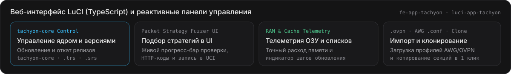

<p align="center">
  
</p>

<p align="center">
  <a href="https://github.com/Dushnilin/tachyon/releases"></a>
  <a href="https://openwrt.org/"></a>
  <a href="https://github.com/Dushnilin/tachyon-core"></a>
  <a href="https://github.com/Dushnilin/tachyon-lists"></a>
  <a href="https://t.me/tachyon_proxy"></a>
  <a href="./LICENSE"></a>
</p>

<p align="center">
  <sub><a href="README.md">Русский</a> · <b>English</b> · <a href="docs/en/README.md">Documentation</a> · <a href="https://github.com/Dushnilin/tachyon-core">tachyon-core</a> · <a href="https://github.com/Dushnilin/tachyon-lists">tachyon-lists</a> · <a href="https://boosty.to/tachyon">Boosty</a></sub>
</p>

---

**Tachyon 2.0** is a network routing, selective proxy orchestration, and L3/L4 traffic-shaping package for **OpenWrt** routers (`23.05`, `24.10`, `25.x`, and `SNAPSHOT`). Branch `2.0` runs on a unified **Pure Rust** stack (`zero-c-crypto`, zero C/FFI dependencies and zero external script runtimes).

A single control daemon (`/usr/bin/tachyon`) provides the web UI (`:1680` + LuCI launcher), routing & `nftables` compiler, autonomous Watchdog with Last-Known-Good (`LKG`) confirmation, **AI Doctor** self-diagnostics, a **Telegram management bot**, an **HTTP REST Agent API (OpenAPI 3.1.0)**, and an **MCP server**. Connection handling, DNS resolution, and built-in packet desynchronization (`Outbound Desync`) run natively inside **[tachyon-core](https://github.com/Dushnilin/tachyon-core)** (~4.2 MiB idle RAM) without third-party proxy engines or external desync daemons.

---

## Documentation

Complete user and engineering documentation for **Tachyon 2.0** with Web UI screenshots is available in English and Russian: **[Browse Documentation Index (EN)](docs/en/README.md)** · **[Русская документация](docs/ru/README.md)**.

<p align="center">
  
</p>

| Chapter | Summary |
|:---|:---|
| [01 — Installation & 1.x Migration](docs/en/01-installation.md) | OpenWrt requirements (`opkg` / `apk`), `install.sh` flags, migrating via `import-legacy`, release cycle |
| [02 — Quick Start](docs/en/02-quickstart.md) | Accessing LuCI and `:1680`, Dashboard tour, Quick Connection Wizard, route tracing |
| [03 — Outbound Sources & Protocols](docs/en/03-outbounds-protocols.md) | Subscriptions, URIs (`VLESS`, `Hysteria2`, `WDTT`), `AmneziaWG 2.0–3.1`, `WARP`, `FPTN`, `TrustTunnel`, `AnyTLS` |
| [04 — Routing Sections, Conditions, .trs & Balancers](docs/en/04-routing-sections-balancers.md) | Priority ordering, Fail-Closed / Kill-Switch, `AND/OR/NOT` conditions, `.trs` lists, all 14 balancer modes |
| [05 — DNS, FakeIP, Hosts & AdGuard Home](docs/en/05-dns-hosts-adguard.md) | DoH/DoT/DoQ, Bootstrap & Fallback DNS, caches, FakeIP, DNS interception, DNS Speed Test |
| [06 — Inbound Servers & Tailscale](docs/en/06-inbound-servers-tailscale.md) | Hosting VPN/proxy servers on the router, QR/subscriptions, automatic firewall rules, embedded Tailscale |
| [07 — Packet Desynchronization & Fuzzer](docs/en/07-desync-fuzzer.md) | Native `desync` in `tachyon-core`, splitting/fooling flags, `auto_tune`, and strategy fuzzer |
| [08 — Devices, Parental Control, Guest Mode & QoS](docs/en/08-devices-parental-guest-qos.md) | Family profiles, SafeSearch, DoH/DoT blocking, schedules, guest isolation, Smart Queue (SQM) |
| [09 — Monitoring, Diagnostics & AI](docs/en/09-monitoring-diagnostics-ai.md) | Live connections, DNS block stats, System Doctor, AI Doctor + RAG, Flight Recorder |
| [10 — Telegram Bot & Fleet Management](docs/en/10-telegram-bot.md) | Bot token setup, notifications, quiet hours, `managed_routers`, full command reference |
| [11 — Updates, Channels & System Settings](docs/en/11-updates-settings.md) | `auto`/`stable`/`beta` (`rc`) channels, notifications, backups/rollback, NAND wear guard, TProxy/TUN, IPv6 |
| [12 — Troubleshooting & FAQ](docs/en/12-troubleshooting-faq.md) | Quarantined sections, DNS/leak checks, `LKG` rollback, RAM/Flash tuning, `support_bundle` |
| [13 — CLI & Configuration Reference](docs/en/13-cli-and-config.md) | `/usr/bin/tachyon` subcommands, `/etc/tachyon/tachyon.json` schema, and `tmpfs` paths |
| [14 — Agent REST API & MCP Server](docs/en/14-api-and-mcp.md) | `/api/agent/v1/*` endpoints, OpenAPI spec, `stdio` & HTTP MCP setup across all 11 tools |

---

<p align="center">
  
</p>

<p align="center">
  
</p>

Run the transactional installer in a single SSH command on the router (branch `2.0`):

```bash
wget -O /tmp/tachyon-setup.sh https://raw.githubusercontent.com/Dushnilin/tachyon/2.0/install.sh && sh /tmp/tachyon-setup.sh
```

To install `2.0` pre-release builds (`--channel beta`) or stable builds non-interactively:

```bash
# Non-interactive install from the 2.0 beta/rc channel:
sh /tmp/tachyon-setup.sh -y --channel beta

# Dry run (resolve release and print plan without modifying router):
sh /tmp/tachyon-setup.sh --dry-run --channel beta
```

| Option or Mechanism | Behavior |
|:---|:---|
| `--channel <auto\|stable\|beta>` | Selects `2.0` release channel: `auto` prefers stable `2.x` and falls back to the latest `2.x` prerelease; `--prerelease` aliases `--channel beta` |
| `--tag <vX.Y.Z>` | Installs an exact release tag (e.g. `v2.0.0-rc.1` or `v2.0.0`) |
| `--format <auto\|apk\|ipk>` | Selects package format: auto-detects `apk` (OpenWrt 25+) / `opkg` (23.05–24.10) |
| `--arch <arch>` | Overrides target OpenWrt architecture instead of auto-detection |
| `--reinstall` / `--repair` | Reinstalls packages over existing configs, restarts services, and rebuilds network hooks |
| `--skip-core` | Installs or updates `tachyon` without downloading `/usr/bin/tachyon-core` |
| Integrity verification (`sha256`) | Verifies downloaded archives against the release `SHA256SUMS` file prior to installation |
| `1.x -> 2.0` migration | Backs up existing `/etc/config/tachyon` to `/etc/tachyon/backup-pre-2.0/tachyon.uci`; `import-legacy` imports sections and subscriptions into `/etc/tachyon/tachyon.json` |

### Supported OpenWrt Architectures

Branch `2.0` builds statically linked binaries for 8 target architectures strictly in `.apk` and `.ipk` formats:

| Architecture (`--arch`) | Rust Target Triple (`musl`) | Typical Devices |
|:---|:---|:---|
| `x86_64` | `x86_64-unknown-linux-musl` | Mini-PCs, VMs, x86 gateways |
| `i386_pentium4` | `i686-unknown-linux-musl` | Legacy 32-bit x86 routers |
| `aarch64` | `aarch64-unknown-linux-musl` | `aarch64_cortex-a53`, `cortex-a72`, Filogic 820/830, RPi 4/5, NanoPi R4S/R5S |
| `armv7` | `armv7-unknown-linux-musleabihf` | `arm_cortex-a7`, `cortex-a9`, `cortex-a15`, IPQ40xx |
| `armv6` | `arm-unknown-linux-musleabi` | `arm_arm1176jzf-s_vfp` devices (EABI soft-float) |
| `riscv64` | `riscv64gc-unknown-linux-musl` | 64-bit RISC-V boards and routers |
| `mipsel` | `mipsel-unknown-linux-musl` | MT7620 / MT7621 / MT7628 (`mipsel_24kc`, little-endian soft-float) |
| `mips` | `mips-unknown-linux-musl` | Atheros / Qualcomm `mips_24kc` (big-endian soft-float) |

> [!NOTE]
> `mips64` targets are not supported by the native `tachyon 2.0` OpenWrt build matrix.

<details>
<summary><b>Installation mirrors (when direct access to raw.githubusercontent.com is restricted)</b></summary>

<br>

```bash
# Mirror 1 (jsdelivr.net CDN):
wget -O /tmp/tachyon-setup.sh https://cdn.jsdelivr.net/gh/Dushnilin/tachyon@2.0/install.sh && sh /tmp/tachyon-setup.sh

# Mirror 2 (gh-proxy.com):
wget -O /tmp/tachyon-setup.sh https://gh-proxy.com/raw.githubusercontent.com/Dushnilin/tachyon/2.0/install.sh && sh /tmp/tachyon-setup.sh

# Mirror 3 (ghfast.top):
wget -O /tmp/tachyon-setup.sh https://ghfast.top/https://raw.githubusercontent.com/Dushnilin/tachyon/2.0/install.sh && sh /tmp/tachyon-setup.sh
```

</details>

---

<p align="center">
  
</p>

<p align="center">
  
</p>

Tachyon 2.0 compiles a single **nftables** ruleset (`table inet TachyonTable`) and Policy Routing rules (`ip rule` / `ip route` table `100` for TProxy `:1602`, marks `0x04000000` for LAN and `0x10000000` for router output). No `NFQUEUE` chains or secondary local desync proxies are required — `tachyon-core` handles all traffic contours directly:

| Processing Contour | Kernel & Core Mechanism | Purpose |
|:---|:---|:---|
| **1. Direct WAN** | Direct routing bypassing TProxy (`0x40000000`, `0 ms overhead`) | Domestic banking, government portals, local CDNs, and trusted subnets |
| **2. Built-in Outbound Desync** | Native stack handling inside `tachyon-core` (TCP/TLS/HTTP & UDP) | Adaptive packet segmentation and desynchronization (`fake_disorder`, `fake_split`, `tlsrec`, `disorder`, `split`, `oob`, `seqovl`, `syndata`, `ipfrag`) without external daemons |
| **3. L4/L7 Proxy Protocols** | Native clients and load-balancing groups inside `tachyon-core` | Selective routing by sections, `.trs`/`.srs` rule-sets, subnets, and MACs over VLESS (Reality/XHTTP/Vision), VMess, Trojan, Shadowsocks 2022, Hysteria2, TUIC, AnyTLS, NaiveProxy, Mieru, Snell, ShadowTLS, MASQUE, TrustTunnel, TewFai, OpenConnect, Tor |
| **4. L3 / UDP Tunnels** | Built-in `wireguard`, `awg`, `warp`, `fptn`, `openvpn` clients | AmneziaWG (`.conf`, `vpn://`, CPS `i1`–`i5`/`j1`–`j3`), WireGuard, Cloudflare WARP, and FPTN (`fwmark 0x00300000`) |
| **5. Mesh & Special Transports** | `tailscale`, `wdtt`, `socks5`, `http` | Tailscale (`100.64.0.0/10` + MagicDNS `100.100.100.100`, bypass mask `0x00340000`) and WDTT (`csqtt`/`raw`/`wg`) |
| **6. Smart DNS** | `dnsmasq` -> `127.0.0.42#53` + FakeIP pool (`198.18.0.0/15`, `fc00::/18`) | Encrypted resolution over DoH, DoT, DoQ, and HTTP/3 with direct Bootstrap DNS and ISP hijack protection |

---

<p align="center">
  
</p>

### 1. Unified Pure Rust Stack (`/usr/bin/tachyon` + `/usr/bin/tachyon-core`)

* **Zero C/FFI dependencies**: statically linked against `musl` (`zero-c-crypto` — no `openssl`, `ring`, `aws-lc`, or `cc`), avoiding shared library conflicts across OpenWrt upgrades.
* **Low RAM footprint**: `tachyon-core` idles around **4.2 MiB RAM** and uses `mmap` zero-copy lookup for `.trs` rule-sets.
* **Safe config transitions**: validates generated core JSON prior to apply, writes atomically, maintains `fallback.json`, and supports Last-Known-Good (`LKG`) rollback.

---

### 2. Protocols, Subscriptions & Section Balancers

* **Supported outbound protocols**: VLESS (Reality, XHTTP, Vision), VMess, Trojan, Shadowsocks (including `2022-blake3-*`), Hysteria2, TUIC, AnyTLS, ShadowTLS, NaiveProxy, Mieru (`TCP`/`UDP`), Snell, MASQUE, TrustTunnel, TewFai, OpenConnect, Tor, OpenVPN, WireGuard, AmneziaWG (`2.0–3.1` `.conf`, `vpn://`, obfuscation params `jc`/`jmin`/`jmax`/`s1`–`s4`/`h1`–`h4`/`i1`–`i5`/`j1`–`j3`), Cloudflare WARP, FPTN, WDTT (`csqtt`/`raw`/`wg`), Tailscale, SOCKS5, and HTTP.
* **Subscription ingestion**: fetches HTTP/HTTPS subscriptions (with DoH fallback), parses `happ://` links, proxy URI lists, `.conf` files, and extracts `subscription-userinfo` traffic/expiration metadata.
* **Node groups & balancers**: `urltest`, `fallback`, `random`, and bandwidth quota balancing (`quota` with `quota_mib`).
* **Built-in key generators (`crypto_gen`)**: `tachyon generate_warp`, `tachyon generate_reality_keypair`, `tachyon generate_wg_keypair`, `tachyon generate_tls_keypair`, and `POST /api/crypto/keygen`.

---

### 3. Smart DNS & Hosts Engine

* **FakeIP pool (`198.18.0.0/15` and `fc00::/18`)**: instant connection setup without waiting for remote DNS RTT.
* **Core-managed DNS routing**: forwards `dnsmasq` queries to `127.0.0.42#53` over DoH, DoT, DoQ, or HTTP/3 while routing local zones and Tailscale MagicDNS (`100.100.100.100`) cleanly.
* **`.trs` & `.srs` rule-sets**: integrates `tachyon-lists` (143 curated categories), `geosite`/`geoip` rule-sets, and Smart Detect exclusions.
* **DNS benchmarking & Hosts**: built-in `tachyon dns_benchmark` latency tester plus static mappings and remote Hosts list updates (`tachyon hosts_list_update`).

---

### 4. Built-in Outbound Desync & Packet Fuzzer

* **Core-native processing (`"type": "desync"`)**: first-packet segmentation and desynchronization run inside `tachyon-core` outbound sockets with zero `NFQUEUE` rules or helper daemons.
* **Desync capabilities**: `fake_disorder`, `fake_split`, `tlsrec`, `disorder`, `split`, `oob`; configurable `split_pos` (`sni`, `midsld`, `1,sni`, `sni,endhost-1`), `fooling` (`badseq`), `fake_ttl`, `fake_sni` / `sni_pool`, `repeats`, `split_delay_ms`, `tlsrec_first`, `seqovl`, `syndata`, `wsize`, `wscale`, `host_fake`, `ipfrag`, and UDP options (`udp_fake`, `udp_repeats`, `udp_fake_ttl`, `udplen`).
* **Strategy fuzzer (`fuzzer`)**: 24 built-in `ds_*` presets plus a combinatorial strategy matrix (`ds_matrix_*`) and custom profiles, driven via `tachyon fuzzer_start`.

---

### 5. AI Doctor, REST Agent API & MCP Server

<p align="center">
  
</p>

* **Local & LLM Diagnostics (`src/diagnostics.rs`)**:
  * **15 local health checks** (`tachyon doctor` / `tachyon global_check` / `tachyon explain` / `tachyon route_explain`) covering `tachyon-core` liveness, `inet TachyonTable`, Bootstrap DNS, available RAM, clock sanity (critical for TLS 1.3 / Reality / WireGuard), empty subscription caches, and conflicting `Flow Offloading`.
  * Optional LLM-assisted analysis via `tachyon ai_doctor` and `tachyon ai_doctor_last`.
* **Emergency Recovery & Tracing**: `tachyon quick_fix restore_native_internet` drops interception rules for direct WAN restoration; `tachyon rollback` restores the LKG snapshot.
* **HTTP REST Agent API (`/api/agent/v1/*`)**: built-in HTTP API with Bearer token authentication, auto-generated **OpenAPI 3.1.0** schema (`/api/agent/v1/openapi.json`), and `/cgi-bin/tachyon-agent/*` route aliases.
* **Model Context Protocol (`MCP`)**: exposed over HTTP (`POST /api/agent/v1/mcp` and `POST /mcp`) and `stdio` (`tachyon mcp`).

<details>
<summary><b>Quick-fix identifiers in <code>src/diagnostics.rs</code> (<code>tachyon quick_fix &lt;id&gt;</code>)</b></summary>

<br>

| Category | Quick-Fix IDs |
|:---|:---|
| **Service & Memory** | `restart_core` (alias `start_core`), `start_watchdog`, `optimize_memory`, `upgrade_core` |
| **Network & DNS** | `heal_network_stack` (`rebuild_rules`, `reset_firewall`), `fix_bootstrap_dns`, `switch_to_doh`, `clear_dns_cache` (`restart_core_dns`), `fix_dnsmasq`, `fix_resolv_symlink`, `fix_wan_interface` (`fix_gateway`, `restart_network`), `optimize_mtu`, `flush_conntrack`, `disable_flow_offloading`, `restore_native_internet` (`enable_safe_bypass`, `flush_nftables`) |
| **Config & System** | `fix_system_time`, `update_subscriptions` (`restart_providers`), `enable_autostart`, `enable_default_desync`, `rollback_known_good` (`fix_uci_config`, `restore_lkg`) |

</details>

---

### 6. Interactive Telegram Management Bot

<p align="center">
  
</p>

* **Telemetry & core control**: `/status` (`/sysinfo`, `/core`), `/start_core`, `/stop_core`, `/restart` (`/reload`), `/trim_ram`, `/close_conns`, `/watchdog`.
* **Routing & nodes**: `/sections` (`/sec`, `/rules`), `/fptn`, `/sources` (`/subs`, `/outbounds`), `/ping`, `/servers` (`/srv`).
* **LAN & devices**: `/devices`, `/wol`, `/parental`, `/guest`, `/schedules`.
* **Diagnostics, tracing & snapshots**: `/doctor`, `/fix`, `/ai_doctor`, `/logs`, `/support`, `/trace`, `/dns`, `/leak`, `/failover`, `/fuzzer`, `/updates`, `/update_lists`, `/snapshots`, `/backup`, `/lkg`, `/rollback`.
* **Bot preferences**: `/start`, `/menu`, `/help`, `/bot_settings`, `/lang`, `/name`, `/quiet`, `/notify`.

---

### 7. Watchdog, LKG Rollback & NAND Flash Protection

<p align="center">
  
</p>

* **Autonomous Watchdog & Reconciler (`src/core_mgr.rs`)**: continuously verifies `tachyon-core` process health and `inet TachyonTable` integrity, repairing drift automatically.
* **Last-Known-Good (`LKG`) observer**: monitors router health after configuration changes and automatically rolls back if connectivity fails confirmation.
* **NAND wear prevention (`write_file_if_changed`)**: compares content before writing to flash so identical configs and lists are never rewritten; transient caches and runtime state stay in `tmpfs` (`/tmp`, `/var/run`).
* **Snapshots & 1.x import**: named configuration snapshots (`snapshot_save`, `snapshot_restore`, `snapshot_list`) and `import-legacy` from `/etc/config/tachyon`.

---

### 8. Parental Control, Time Quotas & Smart QoS

* **Device profiles & schedules**: L2 MAC access policies, 7 content categories, SafeSearch enforcement, bypass DoH blocking, and weekly schedules.
* **Daily quotas & pause**: per-device daily minute quotas (`daily_quota_minutes`, `used_minutes_today`) and instant pause toggles (`/api/profiles/quota` and `/parental`).
* **Traffic prioritization (Smart QoS / DSCP)**: DSCP marking per section/condition plus queueing discipline tuning (`tc qdisc` / `net.core.default_qdisc = fq`).

---

### 9. Web Interface & LuCI Integration (TypeScript)

<p align="center">
  
</p>

* **Embedded UI on `:1680` & LuCI entry**: served directly by `/usr/bin/tachyon` on port `1680` and linked from the OpenWrt LuCI menu.
* **Interactive workflows**: memory and process telemetry dashboard, connection wizard (`happ://`, URL subscriptions, URI lists, `.conf`), section/rule editor, `desync` strategy fuzzer, component updater, and parental quota controls.

---

<p align="center">
  
</p>

<p align="center">
  
</p>

```bash
# Service & version management
tachyon --version                               # Binary & build version
tachyon status                                  # Daemon, core, and section status
tachyon start | stop | reload | restart         # Lifecycle and rule reloads
tachyon import-legacy                           # Import 1.x /etc/config/tachyon into JSON

# Diagnostics, tracing & rollback
tachyon doctor                                  # Full local health check (15 checks)
tachyon global_check                            # Summary report (supports masked flag)
tachyon ai_doctor                               # LLM-assisted diagnostics
tachyon ai_doctor_last                          # Show last saved diagnostic report
tachyon quick_fix restore_native_internet       # Emergency flush to pure direct WAN
tachyon quick_fix clear_dns_cache               # Run a specific quick-fix handler
tachyon rollback                                # Roll back to Last-Known-Good (LKG) config
tachyon explain                                 # Human-readable routing pipeline summary
tachyon route_explain <host_or_ip>              # Explain routing decision for host/IP
tachyon config_plan                             # Preview generated config plan
tachyon compile_config | compile_nft            # Output tachyon-core JSON / nftables ruleset
tachyon support_bundle                          # Collect redacted diagnostics bundle

# Desync fuzzer & DNS benchmarking
tachyon fuzzer_strategies                       # List built-in (24+) and matrix strategies
tachyon fuzzer_start <suite>                    # Start desync strategy probe
tachyon fuzzer_status | fuzzer_stop             # Probe progress / stop fuzzer
tachyon fuzzer_apply <strategy_id>              # Apply winning strategy
tachyon fuzzer_history                          # View fuzzer run history
tachyon dns_benchmark                           # Benchmark configured DNS upstreams

# Snapshots, rule-sets, key generators & Telegram bot
tachyon snapshot_list                           # List configuration snapshots
tachyon snapshot_save my_working_setup          # Save named snapshot
tachyon snapshot_restore <file_or_name>         # Restore from snapshot
tachyon list_update                             # Update .trs / .srs rule-sets
tachyon subscription_update                     # Refresh provider subscriptions
tachyon hosts_list_update                       # Refresh remote Hosts blocklists
tachyon generate_warp                           # Generate Cloudflare WARP / WireGuard profile
tachyon generate_reality_keypair                # Generate X25519 keypair for VLESS Reality
tachyon generate_wg_keypair | generate_tls_keypair
tachyon telegram_status | telegram_diagnose | telegram_start | telegram_stop

# AI Agent interfaces (MCP & HTTP REST Agent API :1680)
tachyon mcp                                     # Model Context Protocol server (JSON-RPC 2.0 stdio)
curl http://192.168.1.1:1680/api/agent/v1/health
curl http://192.168.1.1:1680/api/agent/v1/openapi.json
```

### Clean Uninstallation (`uninstall.sh`)

The uninstaller stops active services, deletes `inet TachyonTable`, removes Policy Routing table `100` rules (`0x04000000` / `0x10000000`), clears `tc qdisc`, restores default `dnsmasq` settings, and saves a configuration backup to `/etc/config/tachyon.backup-<timestamp>`:

```bash
wget -O /tmp/tachyon-uninstall.sh https://raw.githubusercontent.com/Dushnilin/tachyon/2.0/uninstall.sh && sh /tmp/tachyon-uninstall.sh
```

| Flag | Action |
|:---|:---|
| `-y`, `--yes` | Non-interactive execution without confirmation prompts |
| `-p`, `--purge` | Remove all package files including configurations, caches, and backups |
| `--keep-binaries` | Preserve `/usr/bin/tachyon-core` on the system |

<details>
<summary><b>Uninstallation commands via mirrors</b></summary>

<br>

```bash
# Mirror 1 (jsdelivr.net CDN):
wget -O /tmp/tachyon-uninstall.sh https://cdn.jsdelivr.net/gh/Dushnilin/tachyon@2.0/uninstall.sh && sh /tmp/tachyon-uninstall.sh

# Mirror 2 (gh-proxy.com):
wget -O /tmp/tachyon-uninstall.sh https://gh-proxy.com/raw.githubusercontent.com/Dushnilin/tachyon/2.0/uninstall.sh && sh /tmp/tachyon-uninstall.sh
```

</details>

---

## Upstream Projects and Credits

* **[tachyon-core](https://github.com/Dushnilin/tachyon-core)** — pure-Rust proxy engine (~4.2 MiB idle RAM, Zero-C-Crypto, built-in Outbound Desync).
* **[tachyon-lists](https://github.com/Dushnilin/tachyon-lists)** — automated multi-source compiler and deduplicator for 143 domain and subnet categories (`.trs`, `.srs`, `.json`, `.lst`).
* **[FPTN (@fptn-project)](https://github.com/fptn-project/fptn)** — L3 packet tunnel protocol over WebSocket/TLS.

---

## Support Development

If Tachyon is useful in your network setup, you can support ongoing development:

* **Boosty:** [boosty.to/tachyon](https://boosty.to/tachyon)
* **SBP (Ozon Bank):** [finance.ozon.ru/apps/sbp/ozonbankpay/019af2ed-d158-77a9-a698-2805a5e61be5](https://finance.ozon.ru/apps/sbp/ozonbankpay/019af2ed-d158-77a9-a698-2805a5e61be5)
* **Bank Cards / SBP (CloudTips):** [pay.cloudtips.ru/p/449c5ef9](https://pay.cloudtips.ru/p/449c5ef9)
* **Bitcoin (BTC):** `bc1q9ehdv7y9g948jejyflkq7xmau3tytgunxgh35h`
* **Ethereum (ETH / ERC-20):** `0x6CB7a4547eD62EF64990D5C6B5D9fdA58EB223E6`
* **TON:** `UQDPhLRjMz5KltDLACAT3YXXHDVEtIDOHky2i33ZIOtsMEoR`
* **Solana (SOL):** `3csTGaNeU9KjhCKHEKAU3XLS5UfVjEeBVhXihpsETZwh`

---

## Legal Notice & Disclaimer

**Disclaimer:**

1. **Purpose of the Software.** `Tachyon` is a general-purpose technical networking utility designed for network traffic routing, load balancing, network diagnostics, information security, and establishing secure corporate or personal communication channels (VPN) on OpenWrt routers.
2. **Compliance with Applicable Laws.** The Software was not created, is not intended, and is not distributed for the purpose of violating the laws of the Russian Federation (including Federal Law No. 149-FZ) or any other jurisdiction, nor for obtaining unauthorized access to restricted information resources.
3. **Use at Your Own Risk.** The author and copyright holder do not provide any proxy/VPN servers, network nodes, subscriptions, access keys, or routing lists. The Software is provided `"AS IS"` without warranty of any kind. Any installation, configuration, and operation of the Software is performed by the user strictly on their own initiative, at their own risk, and under their sole responsibility. The copyright holder assumes no liability for user actions, configurations, or any consequences arising from the use of the Software.

<p align="center">
  
</p>
