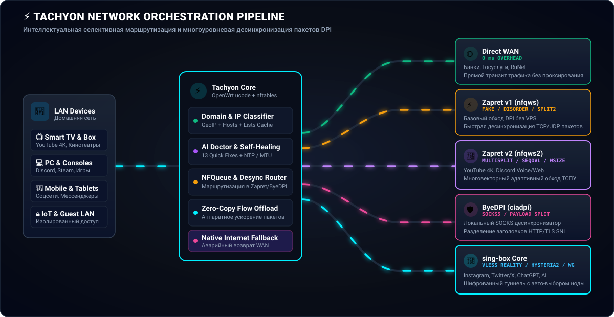
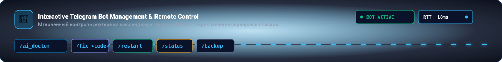
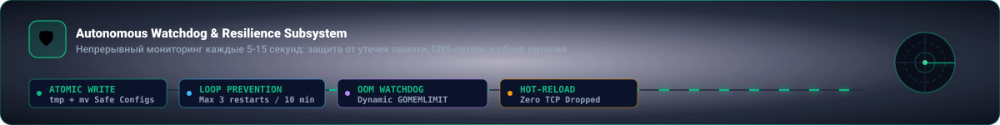
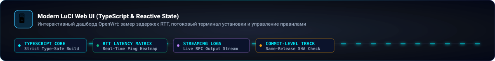
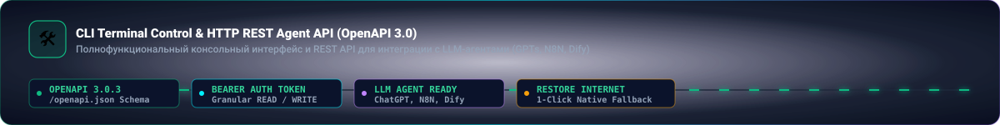

<div align="center">



[](https://github.com/Dushnilin/tachyon/stargazers)
[](https://github.com/Dushnilin/tachyon/releases)
[](https://openwrt.org/)
[](https://t.me/tachyon_proxy)
[](https://boosty.to/tachyon)
[](LICENSE)

[**🇷🇺 Русский**](README.md) | [**🇬🇧 English**](README.en.md)

</div>

<p align="center">
  
</p>

## ⚡ О проекте

**Tachyon** — это высокопроизводительное, автономное и бескомпромиссное решение для оркестрации сетевого трафика, проксирования и обхода цензуры на роутерах под управлением **OpenWrt** (полная совместимость с **OpenWrt 23.05, 24.10, 25.x и SNAPSHOT**). Прямой форк и развитие проекта **[Forkop от @ushan0v](https://github.com/ushan0v/forkop)** (ранее **Podkop Plus**).

Tachyon объединяет мульти-движковую маршрутизацию: флагманское нативное Rust-ядро **[tachyon-core](https://github.com/Dushnilin/tachyon-core)** (~4.2 МБ RAM в простое, Zero-C-Crypto, встроенный L4/L7 Desync для обхода DPI) и полнофункциональный **sing-box**. В систему встроены поддержка **OpenVPN (.ovpn)**, высокоскоростной туннель **FPTN** (Fast Packet Tunnel Network), локальный аппаратный обход DPI (**Zapret v1 / Zapret v2 / ByeDPI**), комбинаторный **DPI Strategy Fuzzer v2**, защищённый **Telegram-бот управления**, а также передовой **AI Stack** (автономный **AI Doctor v3.0**, **HTTP REST Agent API / OpenAPI 3.0** и **MCP Server** для подключения ИИ-агентов).

Вся внутренняя логика реализована на скриптовом движке **ucode** — нативном C-интерпретаторе OpenWrt, обеспечивающем ультранизкое потребление RAM (от 128 МБ ОЗУ) и мгновенный отклик.

<p align="center">
  
</p>

## 🚀 Быстрый старт и установка через Tachyon Installer

<div align="center">



</div>

Установка Tachyon выполняется в 1 команду через универсальный транзакционный установщик **Tachyon Installer**:

```bash
wget -O /tmp/tachyon-setup.sh https://raw.githubusercontent.com/Dushnilin/tachyon/main/install.sh && sh /tmp/tachyon-setup.sh
```

> [!TIP]
> **Зеркала установки (при замедлении или блокировках GitHub):**
> ```bash
> # Зеркало 1 (jsdelivr.net CDN):
> wget -O /tmp/tachyon-setup.sh https://cdn.jsdelivr.net/gh/Dushnilin/tachyon@main/install.sh && sh /tmp/tachyon-setup.sh
> 
> # Зеркало 2 (gh-proxy.com):
> wget -O /tmp/tachyon-setup.sh https://gh-proxy.com/raw.githubusercontent.com/Dushnilin/tachyon/main/install.sh && sh /tmp/tachyon-setup.sh
> 
> # Зеркало 3 (ghfast.top):
> wget -O /tmp/tachyon-setup.sh https://ghfast.top/https://raw.githubusercontent.com/Dushnilin/tachyon/main/install.sh && sh /tmp/tachyon-setup.sh
> ```

### 🛠️ Преимущества и возможности Tachyon Installer

* 🦀 **Нативное ядро tachyon-core из коробки**:
  Вы можете сразу установить нативное Rust-ядро вместо тяжеловесного Go-бинарника ключом `--tachyon-core`:
  ```bash
  sh /tmp/tachyon-setup.sh -y --tachyon-core
  ```
* 🧭 **Интерактивный выбор движков и версий**:
  При интерактивном запуске инсталлятор предложит выбрать желаемый движок (`tachyon-core`, `sing-box stable / extended / tiny / lx`), а также нужную версию релиза.
* 🛡️ **Транзакционная безопасность и Snapshots**:
  Перед любыми изменениями установщик автоматически создаёт снимок конфигурации (`/etc/tachyon/installer-backups/`) и файл состояния `apk-world`. В случае ошибки или прерывания связи транзакция автоматически откатывается без потери связи с роутером.
* 💾 **Автоматический ZRAM для роутеров с малым объемом ОЗУ**:
  Инсталлятор анализирует доступную память роутера и на устройствах с ≤ 256 МБ RAM предлагает автоматически включить `zram-swap` для защиты от OOM.
* 🔄 **Режимы обслуживания и ремонта**:
  - `--repair` — переустановка Tachyon и полное восстановление интеграций с сетью и файрволом.
  - `--reinstall` — принудительная переустановка поверх текущей системы.
  - `--channel beta` — установка последних бета-версий.
  - `--tag X.Y.Z` — установка конкретной опубликованной версии.
* 📦 **Бесшовная миграция**:
  Автоматический перенос настроек из устаревших пакетов **Forkop**, **Podkop Plus** и **Podkop** с очисткой устаревших зависимостей.

---


## 🌐 Архитектура и конвейер трафика

<div align="center">



</div>

Tachyon перехватывает сетевой стек через ядро **nftables** и распределяет запросы без лишних задержек:
1. **Прямой трафик (Direct WAN)**: Отечественные сервисы, банки, Госуслуги и доверенные ресурсы идут без прокси с нулевой задержкой (`0 ms overhead`).
2. **Zapret v1 (`nfqws`)**: Базовая десинхронизация TCP/UDP (`fake`, `disorder`, `split2`) прямо на роутере без VPS.
3. **Zapret v2 (`nfqws2`)**: Адаптивный многовекторный обход ТСПУ (`multisplit`, `seqovl`, `wsize`, PAWS `tcp_ts`, аутентичные `blobs`) для YouTube 4K, Discord и стриминга.
4. **ByeDPI (`ciadpi`)**: Локальный SOCKS5-десинхронизатор с фрагментацией полезной нагрузки HTTP/TLS SNI.
5. **Мульти-движковое туннелирование и прокси (tachyon-core / sing-box / FPTN / OpenVPN)**: Заблокированные ресурсы и приватный трафик направляются через защищённые протоколы (VLESS Reality, Hysteria2, WireGuard, AmneziaWG, OpenVPN) или высокоскоростной туннель **FPTN** (`tun-fptn` поверх WebSocket/TLS с маскировкой под веб-трафик). Для максимальной производительности и экономии памяти без накладных расходов Go работает нативный Rust-рантайм **tachyon-core**.
6. **Smart DNS Pipeline**: Изолированная обработка DNS через FakeIP (`198.18.0.0/15`), DoH/DoT/DoQ с защитой от перехвата провайдером и автоматическим отказоустойчивым переключением (DNS Failover).

<p align="center">
  
</p>

## 🔥 Главные возможности и подсистемы

### 🧭 1. Мульти-движковая маршрутизация (Multi-Engine Architecture)
* **Гибкий выбор движка маршрутизации**:
  * **sing-box Engine**: Полнофункциональный шлюз со всеми современными прокси-протоколами, селективной маршрутизацией по доменам/IP/устройствам и FakeIP.
  * **tachyon-core Engine (Рекомендовано)**: Флагманское нативное прокси-ядро на чистом **Rust** (Zero-C-Crypto, без Go-рантайма и GC, рекордные **~4.2 МБ RAM в простое**):
    * **100% совместимость**: Полный drop-in replacement для конфигураций и CLI sing-box (работает со всеми правилами, Clash API, DNS и инбаундами).
    * **Нативный Outbound Desync**: Встроенный обход DPI (TCP-сплит, фрагментация TLS ClientHello, HTTP-сплит) прямо в сетевом стеке ядра без запуска сторонних демонов ByeDPI/Zapret.
    * **Полноценный XHTTP транспорт**: Оптимизированные режимы `packet-up` и `auto` с асинхронным пайплайном отправки без блокировок и буферизацией TLS.
    * **Поддержка любых роутеров**: Оптимизированные сборки под `aarch64`, `armv7`, `armv6`, `x86-64`, а также гарантированный **Soft-float для MIPS/MIPSEL** без аппаратного FPU (MediaTek MT7620/MT7621/MT7628) с защитой от `SIGILL`.
    * **Отказоустойчивость**: Автоматический откат на резервный рабочий конфиг (`fallback.json`) при ошибках валидации и софт-старт rule-set при старте без сети.
    * **Полный стек протоколов**: VLESS (Reality, XHTTP, gRPC, WS), VMess, Trojan, Shadowsocks, Hysteria2 с контроллером перегрузки **Brutal CC**, WireGuard / AmneziaWG (AWG 3.1) и встроенный L3-туннель **FPTN**.
* **Переключение движка в 1 клик**:
  * Интерактивная карточка Routing Engine в LuCI и CLI (`tachyon engine_set <name>`) с модальным окном реального прогресса переключения.
  * Автоматическая реконфигурация DNS, интерфейсов и правил nftables при смене движка.
* **Материализация списков и нативные `rule_set`**:
  * Прямая загрузка и компиляция списков `.lst`/`.txt` в нативные `rule_set`.

---

### 🛡️ 2. Мультипротокольное проксирование и продвинутые подписки
* **Ядро sing-box Engine (v1.11 - v1.14+)**:
  * Нативная поддержка: **VLESS (Reality / gRPC / WS)**, **VMess**, **Shadowsocks**, **Trojan**, **Hysteria2**, **WireGuard / AmneziaWG (AWG 3.1)**.
  * **Импорт `.conf` AmneziaWG 2.0 / 3.0 / 3.1**: отдельный список «Amnezia конфиги» между URL и текстовыми ссылками в настройках подключения. Загрузка, имя, редактирование и удаление доступны с sing-box LX и tachyon-core. Исходный конфиг хранится в UCI `selector_amnezia_configs`; генератор использует общий WG/AWG-парсер и создаёт нативный endpoint. При смене на неподдерживаемое ядро поле скрывается, сохранённые записи не удаляются; применять их на таком ядре нельзя. Поддерживается один Interface и один Peer, до 64 КиБ вместе с именем. DNS и командные hooks из файла не применяются. Приватные ключи остаются в конфигурации роутера; не публикуйте её.
  * **Нативный OpenVPN Endpoint и загрузка `.ovpn`**: Полноценный встроенный OpenVPN-клиент в sing-box (>= 1.14.0) с возможностью прямой загрузки и валидации файлов `.ovpn` в LuCI.
* **Высокоскоростной туннель FPTN Engine (`fptn-client-cli`)**:
  * L3-туннелирование IP-пакетов поверх WebSocket/TLS с маскировкой под стандартный HTTPS-трафик (`tun-fptn`, таблица маршрутизации `4249`).
* **Продвинутый движок подписок и Happ Crypt4**:
  * **Дешифрование Happ Crypt4**: Поддержка зашифрованных подписок провайдеров.
  * **Эмуляция Dual HWID**: Корректная подмена заголовков аппаратного идентификатора клиента.
  * **Пиннинг сертификатов (TLS Certificate SHA-256)**: Валидация хэшей сертификатов узлов (`pcs`).
  * **Anti-Collapse Shrink Guard**: Сохранение кэша рабочих нод при временных сбоях или пустых ответах серверов подписки.
* **Генератор профилей Cloudflare WARP / AmneziaWG (`generate_warp`)**.
* **Многомерная селективная маршрутизация**: по доменам, IP-сетям, MAC/IP клиентских устройств и странам (GeoIP).
* **Исключения Smart Detect**: в «Настройки → Сервисы и доступ» можно объединить ручные домены с готовыми списками сервисов (`smart_detect_exclude_lists`). Исключения действуют на домены и поддомены в Default и Plus; ручные маршруты и ранее добавленные правила сохраняются. Если расширение до основного домена затронет исключённый поддомен, сохраняется только обнаруженный hostname. Списки обновляются штатным механизмом; декодированный кэш хранится в `/etc/tachyon/smart-detect-exclusions/`. При отсутствии выбранного кэша автоматическое обнаружение ждёт обновления списков; сбой обновления сохраняет прежний кэш. IP-only наборы недоступны, из смешанных наборов используются только доменные записи. Для подготовки кэша нужен `sing-box rule-set decompile` или совместимый `tachyon-core`; дополнительных пакетов не требуется.

---

### 🌐 3. Умный сетевой стек DNS, DoH/DoT и защита от утечек
* **FakeIP-пул (`198.18.0.0/15`)**: Мгновенный коннект без ожидания удалённого DNS.
* **Современные протоколы DNS**: DoH (HTTPS), DoT (TLS), DoQ (QUIC), DNS over HTTP/3.
* **Автономный DNS Failover (`dns_failover.uc`)**: Непрерывный мониторинг и бесшовное переключение апстримов.
* **Анти-перехват DNS**: Прозрачный перехват портов 53 UDP/TCP в ядре nftables.
* **Детектор утечек DNS (DNS Leak Checker)**: Проверка резолверов с фильтрацией служебных записей. Режим **Plus** дополнительно проверяет DNS роутера, открытые тестовые DNS-запросы на WAN и независимый DoH/TLS-запрос. Результаты и ограничения описаны в [руководстве проверки IP/DNS](docs/DNS_LEAK_CHECK.md).
* **Изоляция Multi-WAN и Tailscale**: Исключение внутренних туннелей и Tailscale (`100.64.0.0/10`) из проверок публичного WAN без ложных срабатываний.
* **Секции Hosts и Списки DNS-блокировок (Hosts Engine)**: Статическое переопределение IP (`dns_hosts`), загрузка сторонних реестров (AdAway, StevenBlack, Антизапрет) с автопереключением на зеркала (GitHub Mirror Retry: `jsdelivr`, `gh-proxy`).
* **Интерактивный DNS Benchmark (`tachyon dns_benchmark`)** с автотюнингом (`dns_autotune`).

---

### ⚡ 4. God-Tier Генератор и Фаззер стратегий обхода ТСПУ (DPI Fuzzer v2)
* **Модульная архитектура фаззера (`fuzzer/*`)**: Разделение на специализированные модули профилирования, раннера, бенчмаркинга и стратегий.
* **Фаззинг нового поколения (Probe v2 & Stable Scoring)**: Двухстадийная верификация, защищающая от ложноположительных срабатываний на нестабильных каналах.
* **Кураторские пресеты из zapret4rocket и homeproxy-hiddify**: Проверенные на практике стратегии против актуальных блокировок.
* **Поддержка стратегий Flowseal**: Интеграция паттернов Flowseal для стабильного обхода DPI.
* **Кастомные мульти-доменные цели**: Тестирование стратегий одновременно по набору целевых доменов пользователя.
* **PAWS TCP Timestamp Spoofing (`tcp_ts=-600000:tcp_ts_up`)**: RFC 7323 десинхронизация с устаревшими timestamp TCP.
* **Аутентичные бинарные дампы (Blobs)**: `tls_max`, `tls_google`, `tls_gosuslugi`, `tls_sber`, `quic_google`, `discord_udp` и др.
* **Точное перекрытие последовательностей (SeqOvl Pattern Overlap)** & **TCP SYN Data (`syndata`)**.
* **286+ стратегий Zapret2, 130 для Zapret v1, 65 для ByeDPI**.
* **Изолированная очередь nftables (`0x00200000`) & применение в 1 клик (`🏆 Best Match`)**.

---

### 🤖 5. ИИ-Доктор v3.0, REST Agent API и MCP Server (AI Stack)
<div align="center">


</div>

* **Tachyon AI Doctor (v3.0)**: Глубокая модульная архитектура (`doctor.uc`, `repairs.uc`, `system_info.uc`, `routing.uc`, `dns.uc`).
  * Анализ через облачные LLM (**OpenAI**, **Claude**, **DeepSeek**, **Gemini**) или локальные модели (через OpenRouter / Ollama).
  * **Схлопывание симптомов (Symptom Collapsing)**: Интеллектуальное объединение каскадных сбоев в первопричины.
* **25 кодов быстрого ремонта** в `diagnostics/repairs.uc` (`tachyon apply_quick_fix`):
  * Сервисы: `start_singbox`, `restart_singbox_dns`, `start_watchdog`, `restart_providers`, `restart_zapret`, `optimize_memory`, `upgrade_to_singbox_extended`.
  * Сеть и DNS: `rebuild_rules`, `fix_dnsmasq`, `fix_resolv_symlink`, `clear_dns_cache`, `fix_wan_interface`, `fix_gateway`, `reset_firewall`, `restart_network`, `switch_to_doh`, `fix_bootstrap_dns`, `heal_network_stack`, `enable_safe_bypass`, `restore_native_internet`.
  * Конфиг и платформа: `fix_uci_config`, `update_subscriptions`, `fix_system_time`, `flush_conntrack`, `optimize_mtu`.
* **Конфликт-устойчивый откат и восстановление**: Автоматический откат к стабильной конфигурации при обнаружении ошибок синтаксиса dnsmasq или nftables.
* **🚨 Аварийное восстановление интернета (Native Internet Fallback)** (`tachyon restore_native_internet`).
* **🔌 Model Context Protocol (MCP) Server (`tachyon mcp`)**: Подключение роутера к Claude Desktop, Cursor, Antigravity через JSON-RPC 2.0 stdio.
* **🌐 HTTP REST Agent API (OpenAPI 3.0)**: Авторизация по Bearer token, асинхронный перезапуск (`async reload`) без разрыва HTTP-сессий, CGI-шлюз (`/cgi-bin/tachyon-api`).

---

### 📱 6. Интерактивный Telegram-бот управления
<div align="center">



</div>

* **Аутентификация Clash API**: Защищённое управление через Secret Token.
* **Расширенная телеметрия (`/info`)** и управление секциями и нодами прямо из мессенджера.
* **Мониторинг активных соединений (`/connections`)** с постраничным выводом и кнопкой сброса (`/close_connections`).
* **Выделенный воркер**: Grace period для heartbeat, защита от зомби-процессов и дублирования.
* **Тихие часы (`/qh`)** и управление устройствами LAN по MAC-адресам.
* **Команды**: `/doctor`, `/ai_doctor`, `/heal`, `/speed`, `/ping`, `/test`, `/logs`, `/info`, `/export_config`, `/restart`, `/lang`.

---

### 🛡️ 7. Watchdog, Процесс-менеджер и Транзакционная стабильность
<div align="center">



</div>

* **Процесс-менеджер с валидацией происхождения (PID Provenance & Identity)**: Модуль `core/process.uc` валидирует `pid`, `starttime` и `boot_id`, гарантируя, что системные демоны не затронут переиспользованные системой PID. Тот же модуль хранит контракт ядра (procd-имя `tachyon-core`, бинарники, pid-файлы, UCI-пакет) и единственный генератор `/etc/init.d/tachyon-core`. Скрипт останавливает демон по пути исполняемого файла и не вызывает `killall` своего comm: в BusyBox такой `killall` снимает сам init-скрипт.
* **Транзакционный менеджер пакетов (`core/packages.uc`)**: Защита от stale lock, верификация ELF-сигнатур сжатых UPX бинарников, автоматическая очистка файла `world` в APK для разрешения конфликтов `PROVIDES/REPLACES` при обновлении пакетов.
* **Единый структурированный логгер (`core/logging.uc`)**: Ротируемые структурированные логи.
* **Защита от зацикливания перезапусков (Restart-Loop Prevention)**: Лимит 3 перезапусков за 10 минут, мьютекс `PROXY_RESTART_LOCK`.
* **Оптимизация памяти (OOM Watchdog)**: Динамическое управление `GOMEMLIMIT` с уведомлениями в Telegram.
* **Мягкая перезагрузка (Hot-Reload)** & **Снапшоты конфигурации (Snapshots & Rollback)** (`snapshot_save` / `snapshot_restore`).

---

### 👶 8. Родительский контроль, квоты и Smart QoS
* **Поустройственные расписания** интернет-доступа (часы и дни недели).
* **Квотирование трафика**: Лимиты входящего/исходящего трафика со сбросом по cron (`parental_quota.uc`).
* **Smart QoS & Priority Daemon**: DSCP-маркировка трафика в nftables для голоса, игр и стримов с предотвращением Bufferbloat.
* **Мгновенная изоляция**: Блокировка и разблокировка доступа устройства в 1 клик.

---

### 🖥️ 9. Современный Web-интерфейс LuCI (TypeScript)
<div align="center">



</div>

* **Мониторинг ОЗУ в реальном времени**: Точное отображение потребления памяти процессами Tachyon и расчетного размера DNS-кэша dnsmasq прямо на дашборде.
* **Индикатор шагов обновления (Step Indicator)**: Наглядный пошаговый прогресс обновления списков вместо сырого лог-вывода.
* **Клонирование секций в 1 клик ("Copy")**: Быстрое дублирование сложных правил обхода.
* **Управление движками**: Переключение `tachyon-core` / `sing-box` с информативным модальным окном.
* **Загрузчик файлов `.ovpn`** для OpenVPN-секций.
* **Встроенный модал Фаззера стратегий** с прогресс-баром, HTTP-статусами и `🏆 Best Match`.
* **Потоковый терминал установки и отката версий компонентов**.

<p align="center">
  
</p>

## 🛠️ Справочник консоли (CLI & REST Agent API)

<div align="center">



</div>

```bash
# === Управление движками маршрутизации (Multi-Engine) ===
tachyon engine_list                             # Список доступных движков (tachyon-core, sing-box)
tachyon engine_get                              # Текущий активный движок
tachyon engine_set <tachyon-core|sing-box>      # Переключение движка с автоматической реконфигурацией
tachyon engine_status                           # Расширенный статус активного движка (JSON)

# === Фаззер и тестирование стратегий обхода DPI ===
tachyon fuzzer_start youtube_suite zapret2      # Запуск бенчмарка для YouTube на Zapret2
tachyon fuzzer_start discord_suite zapret2      # Запуск бенчмарка для Discord (голос + UDP)
tachyon fuzzer_status                           # Текущий прогресс и результаты фаззера (JSON)
tachyon fuzzer_stop                             # Немедленная остановка фаззера и очистка Netfilter
tachyon fuzzer_apply <strategy_id>              # Применение найденной стратегии в конфигурацию UCI

# === Тестирование DNS и Сетевой стек ===
tachyon dns_benchmark                           # Замер задержки и доступности DNS-резолверов
tachyon dns_autotune --apply                    # Автоматический выбор и применение лучшего DNS
tachyon test_rule google.com                    # Проверка, под какое правило маршрутизации попадает домен

# === Системная и офлайн-диагностика ===
tachyon doctor                                  # Запуск локальной диагностики без LLM
tachyon ai_doctor                               # Запуск анализа AI Doctor (с LLM)
tachyon ai_doctor_last                          # Просмотр последнего сохранённого отчёта ИИ
tachyon apply_quick_fix clear_dns_cache         # Применение выбранного кода исправления
tachyon diagnose_json                           # Вывод полного снимка состояния в формате JSON

# === Аварийное восстановление интернета ===
tachyon restore_native_internet                 # Мгновенная остановка прокси и возврат чистого WAN

# === Управление Telegram-ботом ===
tachyon telegram_status                         # Проверка статуса демона Telegram-бота
tachyon telegram_diagnose                       # Диагностика подключения бота (JSON)
tachyon telegram_start                          # Запуск воркера Telegram-бота
tachyon telegram_stop                           # Остановка воркера Telegram-бота

# === Снапшоты и резервные копии ===
tachyon snapshot_list                           # Список сохранённых снимков конфигурации
tachyon snapshot_save my_working_setup          # Создание именованного снапшота
tachyon snapshot_restore /etc/config/snap.json  # Восстановление конфигурации из снимка
tachyon backup                                  # Создание полного архива конфигурации

# === Обновление списков и подписок ===
tachyon list_update                             # Принудительное обновление списков доменов/IP
tachyon subscription_update                     # Обновление всех прокси-подписок
tachyon hosts_list_update                       # Загрузка и обновление сторонних Hosts-листов

# === Управление службами и Watchdog ===
tachyon ai_heal                                 # Принудительный цикл самовосстановления
tachyon ai_status                               # Краткий статус Watchdog
tachyon ai_status_full                          # Расширенные метрики Watchdog (JSON)

# === Генераторы профилей ===
tachyon generate_warp                           # Генерация конфигурации Cloudflare WARP
tachyon generate_reality_keypair                # Генерация пары ключей для VLESS Reality

# === Интеграция с ИИ (MCP & HTTP REST API) ===
tachyon mcp                                     # Запуск Model Context Protocol сервера (stdio)
curl http://192.168.1.1/cgi-bin/tachyon-api/health
curl http://192.168.1.1/cgi-bin/tachyon-api/openapi.json
```

<p align="center">
  
</p>

## 🗑️ Удаление (Clean Uninstall & Backup)

Для полного и чистого удаления Tachyon с возвратом штатного DNS, очисткой правил nftables и сохранением вашей конфигурации в `/etc/config/tachyon.backup-<timestamp>`:

```bash
wget -O /tmp/tachyon-uninstall.sh https://raw.githubusercontent.com/Dushnilin/tachyon/main/uninstall.sh && sh /tmp/tachyon-uninstall.sh
```

*Через зеркала:*
```bash
# Зеркало 1 (jsdelivr.net CDN):
wget -O /tmp/tachyon-uninstall.sh https://cdn.jsdelivr.net/gh/Dushnilin/tachyon@main/uninstall.sh && sh /tmp/tachyon-uninstall.sh

# Зеркало 2 (gh-proxy.com):
wget -O /tmp/tachyon-uninstall.sh https://gh-proxy.com/raw.githubusercontent.com/Dushnilin/tachyon/main/uninstall.sh && sh /tmp/tachyon-uninstall.sh
```

**Опции и флаги:**
* `-y`, `--yes` — автоматическое выполнение без интерактивного подтверждения.
* `-p`, `--purge` — полное удаление всех файлов вместе с конфигурациями и бэкапами.
* `--keep-binaries` — сохранить бинарники sing-box / zapret / byedpi.

<p align="center">
  
</p>

## 🤝 Оригинальные проекты и благодарности

Tachyon опирается на фундаментальные разработки открытого сообщества:

* 🍴 **[Forkop (ushan0v)](https://github.com/ushan0v/forkop)** — прямой родительский проект (ранее Podkop Plus).
* 🐕 **[Podkop (itdoginfo)](https://github.com/itdoginfo/podkop)** — оригинальный проект, заложивший основу архитектуры.
* 🦀 **[tachyon-core](https://github.com/Dushnilin/tachyon-core)** — нативное высокопроизводительное прокси-ядро на чистом Rust (без рантайма Go, 4.2 МБ RAM в простое), разработанное специально для Tachyon и встраиваемых систем.
* 📦 **[sing-box](https://github.com/SagerNet/sing-box)** — универсальная прокси-платформа.
* 🚀 **[zapret (bol-van)](https://github.com/bol-van/zapret2)** — средства локального обхода DPI (`nfqws` / `nfqws2`).
* 🌐 **[ByeDPI](https://github.com/hrbrmstr/byedpi)** — локальный SOCKS-прокси для десинка пакетов.
* 🛡️ **[FPTN (fptn-project)](https://github.com/fptn-project/fptn)** — высокоскоростной VPN/туннель пакетов через WebSocket/TLS с обходом блокировок.

<p align="center">
  
</p>

## 💖 Поддержать разработку

Если Tachyon помогает вам и делает работу в сети комфортной, вы можете поддержать проект и автора! ☕ 🧀 🌭

⭐ **Boosty (подписки, донаты, эксклюзив):**  
👉 [**Поддержать на Boosty**](https://boosty.to/tachyon)

💳 **Карты РФ / СБП / Tinkoff Pay:**  
👉 [**Поддержать проект на CloudTips**](https://pay.cloudtips.ru/p/48c57581)

🪙 **Криптовалюта:**
* **Bitcoin (BTC):** `bc1q9ehdv7y9g948jejyflkq7xmau3tytgunxgh35h`
* **Ethereum (ETH / ERC-20):** `0x6CB7a4547eD62EF64990D5C6B5D9fdA58EB223E6`
* **TON:** `UQDPhLRjMz5KltDLACAT3YXXHDVEtIDOHky2i33ZIOtsMEoR`
* **Solana (SOL):** `3csTGaNeU9KjhCKHEKAU3XLS5UfVjEeBVhXihpsETZwh`

<p align="center">
  
</p>

<div align="center">


</div>
