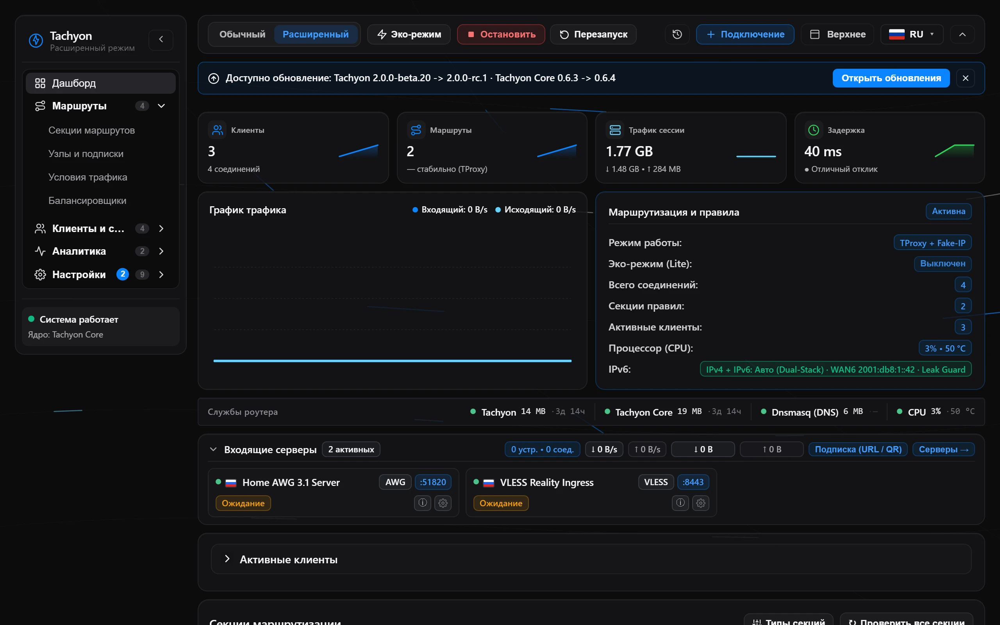
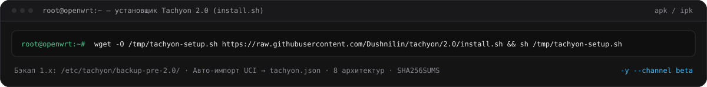
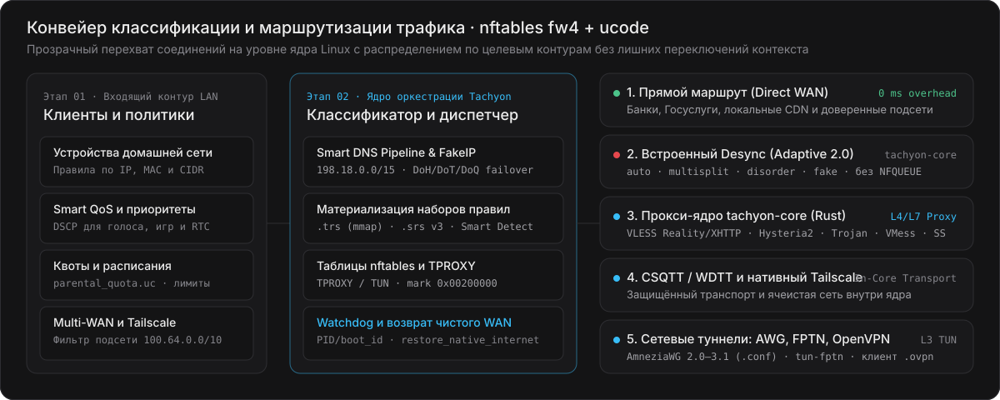
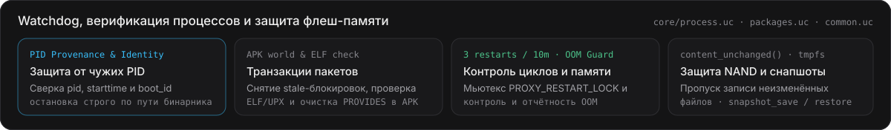
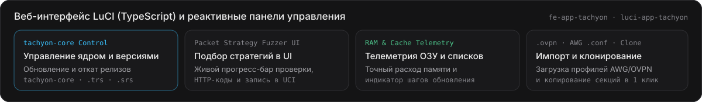

<p align="center">
  
</p>

<p align="center">
  <a href="https://github.com/Dushnilin/tachyon/releases"></a>
  <a href="https://openwrt.org/"></a>
  <a href="https://github.com/Dushnilin/tachyon-core"></a>
  <a href="https://github.com/Dushnilin/tachyon-lists"></a>
  <a href="https://t.me/tachyon_proxy"></a>
  <a href="./LICENSE"></a>
</p>

<p align="center">
  <sub><b>Русский</b> · <a href="README.en.md">English</a> · <a href="docs/ru/README.md">Документация</a> · <a href="https://github.com/Dushnilin/tachyon-core">tachyon-core</a> · <a href="https://github.com/Dushnilin/tachyon-lists">tachyon-lists</a> · <a href="https://boosty.to/tachyon">Boosty</a></sub>
</p>

---

**Tachyon 2.0** — пакет оркестрации сетевого трафика, селективной маршрутизации и защищённого туннелирования для роутеров под управлением **OpenWrt** (`23.05`, `24.10`, `25.x` и `SNAPSHOT`). Ветка `2.0` полностью переведена на единый стек **Pure Rust** (`zero-c-crypto`, без C/FFI-зависимостей и внешних интерпретаторов).

Единый управляющий демон `/usr/bin/tachyon` объединяет веб-панель (`:1680` + лаунчер в LuCI), конфигуратор маршрутизации и `nftables`, автономный Watchdog с подтверждением Last-Known-Good (`LKG`), подсистему самодиагностики **AI Doctor**, **Telegram-бота**, **HTTP REST Agent API (OpenAPI 3.1.0)** и **MCP-сервер**. Обработку сетевых соединений, DNS и пакетной десинхронизации (`Outbound Desync`) выполняет нативное ядро **[tachyon-core](https://github.com/Dushnilin/tachyon-core)** (~4.2 MiB RAM в простое) без сторонних прокси-движков и внешних демонов сегментации.

---

## Документация

Полное руководство пользователя и инженера для **Tachyon 2.0** со скриншотами веб-интерфейса доступно на русском и английском языках: **[Открыть оглавление документации (RU)](docs/ru/README.md)** · **[English Documentation](docs/en/README.md)**.

<p align="center">
  
</p>

| Раздел | Описание |
|:---|:---|
| [01 — Установка и миграция с 1.x](docs/ru/01-installation.md) | Требования OpenWrt (`opkg` / `apk`), флаги `install.sh`, импорт из 1.x (`import-legacy`), политика релизов |
| [02 — Быстрый старт](docs/ru/02-quickstart.md) | Первый вход в LuCI и `:1680`, обзор дашборда, мастер подключения и проверка маршрута |
| [03 — Исходящие источники и протоколы](docs/ru/03-outbounds-protocols.md) | Подписки, ссылки (`VLESS`, `Hysteria2`, `WDTT`), `AmneziaWG 2.0–3.1`, `WARP`, `FPTN`, `TrustTunnel`, `AnyTLS` |
| [04 — Секции, условия, списки .trs и балансировщики](docs/ru/04-routing-sections-balancers.md) | Приоритет правил, Fail-Closed / Kill-Switch, условия `AND/OR/NOT`, наборы `.trs`, 14 режимов балансировки |
| [05 — DNS, FakeIP, Hosts и AdGuard Home](docs/ru/05-dns-hosts-adguard.md) | DoH/DoT/DoQ, Bootstrap и Fallback DNS, кэши, FakeIP, перехват DNS и DNS Speed Test |
| [06 — Входящие серверы и Tailscale](docs/ru/06-inbound-servers-tailscale.md) | Поднятие VPN/прокси-серверов на роутере, QR/подписки, автооткрытие портов, встроенный Tailscale |
| [07 — Десинхронизация пакетов и фаззер](docs/ru/07-desync-fuzzer.md) | Нативный `desync` в `tachyon-core`, параметры фрагментации/фулинга, `auto_tune` и фаззер |
| [08 — Устройства, родительский контроль, гостевой режим и QoS](docs/ru/08-devices-parental-guest-qos.md) | Семейные профили, SafeSearch, блокировка DoH/DoT, расписания, гостевая изоляция, Smart Queue (SQM) |
| [09 — Мониторинг, диагностика и ИИ](docs/ru/09-monitoring-diagnostics-ai.md) | Живые сессии, статистика блокировок DNS, System Doctor, AI Doctor + RAG, Flight Recorder |
| [10 — Telegram-бот и управление парком](docs/ru/10-telegram-bot.md) | Настройка токена, уведомления, тихие часы, `managed_routers`, полный справочник команд |
| [11 — Обновления, каналы и системные настройки](docs/ru/11-updates-settings.md) | Каналы `auto`/`stable`/`beta` (`rc`), уведомления, бэкапы/откат, защита NAND-флеш, TProxy/TUN, IPv6 |
| [12 — Устранение неполадок и FAQ](docs/ru/12-troubleshooting-faq.md) | Карантин секций, диагностика DNS/утечек, откат `LKG`, экономия RAM/Flash, `support_bundle` |
| [13 — Справочник CLI и конфигурации](docs/ru/13-cli-and-config.md) | Подкоманды `/usr/bin/tachyon`, схема `/etc/tachyon/tachyon.json` и пути `tmpfs` |
| [14 — Agent REST API и MCP-сервер](docs/ru/14-api-and-mcp.md) | Эндпоинты `/api/agent/v1/*`, OpenAPI, подключение по `stdio` и HTTP к 11 инструментам MCP |

---

<p align="center">
  
</p>

<p align="center">
  
</p>

Установка выполняется одной командой в SSH-сессии роутера через транзакционный скрипт `install.sh` (ветка `2.0`):

```bash
wget -O /tmp/tachyon-setup.sh https://raw.githubusercontent.com/Dushnilin/tachyon/2.0/install.sh && sh /tmp/tachyon-setup.sh
```

Для неинтерактивной установки тестовых пре-релизов `2.0` (`--channel beta`) или стабильных сборок:

```bash
# Установка актуальной сборки 2.0 (beta / rc / stable) без вопросов:
sh /tmp/tachyon-setup.sh -y --channel beta

# Предварительная проверка без внесения изменений на роутере:
sh /tmp/tachyon-setup.sh --dry-run --channel beta
```

| Параметр или механизм | Назначение и поведение |
|:---|:---|
| `--channel <auto\|stable\|beta>` | Выбор канала релизов `2.0`: `auto` устанавливает стабильный `2.x` (или последний пре-релиз, если стабильный ещё не вышел); `--prerelease` эквивалентен `--channel beta` |
| `--tag <vX.Y.Z>` | Установка точного тега релиза (например, `v2.0.0-rc.1` или `v2.0.0`) |
| `--format <auto\|apk\|ipk>` | Выбор формата установки: автоматическое определение пакетного менеджера (`apk` в OpenWrt 25+ / `opkg` в 23.05–24.10) |
| `--arch <arch>` | Явное переопределение архитектуры вместо автоопределения |
| `--reinstall` / `--repair` | Повторная установка поверх существующей конфигурации, перезапуск служб и восстановление таблиц |
| `--skip-core` | Установка или обновление только пакета `tachyon` без загрузки `/usr/bin/tachyon-core` |
| Контроль целостности (`sha256`) | Автоматическая сверка скачанного архива по файлу `SHA256SUMS` релиза перед установкой |
| Автоимпорт `1.x -> 2.0` | При обновлении с `Tachyon 1.x` сохраняет копию `/etc/config/tachyon` в `/etc/tachyon/backup-pre-2.0/tachyon.uci`; команда `import-legacy` переносит секции и подписки в `/etc/tachyon/tachyon.json` |

### Поддерживаемые архитектуры OpenWrt

Релизы ветки `2.0` собираются статически под 8 целевых платформ строго в форматах `.apk` и `.ipk`:

| Архитектура (`--arch`) | Целевой triple Rust (`musl`) | Типичные устройства |
|:---|:---|:---|
| `x86_64` | `x86_64-unknown-linux-musl` | Мини-ПК, виртуальные машины, x86-шлюзы |
| `i386_pentium4` | `i686-unknown-linux-musl` | Устаревшие 32-битные шлюзы x86 |
| `aarch64` | `aarch64-unknown-linux-musl` | `aarch64_cortex-a53`, `cortex-a72`, Filogic 820/830, RPi 4/5, NanoPi R4S/R5S |
| `armv7` | `armv7-unknown-linux-musleabihf` | `arm_cortex-a7`, `cortex-a9`, `cortex-a15`, IPQ40xx |
| `armv6` | `arm-unknown-linux-musleabi` | Устройства `arm_arm1176jzf-s_vfp` (EABI soft-float) |
| `riscv64` | `riscv64gc-unknown-linux-musl` | Платы и роутеры архитектуры RISC-V 64 |
| `mipsel` | `mipsel-unknown-linux-musl` | MT7620 / MT7621 / MT7628 (`mipsel_24kc`, little-endian soft-float) |
| `mips` | `mips-unknown-linux-musl` | Atheros / Qualcomm `mips_24kc` (big-endian soft-float) |

> [!NOTE]
> Устройства `mips64` не поддерживаются нативным инструментарием сборки OpenWrt `tachyon 2.0`.

<details>
<summary><b>Резервные зеркала установки (при ограничении доступа к raw.githubusercontent.com)</b></summary>

<br>

```bash
# Зеркало 1 (jsdelivr.net CDN):
wget -O /tmp/tachyon-setup.sh https://cdn.jsdelivr.net/gh/Dushnilin/tachyon@2.0/install.sh && sh /tmp/tachyon-setup.sh

# Зеркало 2 (gh-proxy.com):
wget -O /tmp/tachyon-setup.sh https://gh-proxy.com/raw.githubusercontent.com/Dushnilin/tachyon/2.0/install.sh && sh /tmp/tachyon-setup.sh

# Зеркало 3 (ghfast.top):
wget -O /tmp/tachyon-setup.sh https://ghfast.top/https://raw.githubusercontent.com/Dushnilin/tachyon/2.0/install.sh && sh /tmp/tachyon-setup.sh
```

</details>

---

<p align="center">
  
</p>

<p align="center">
  
</p>

Tachyon 2.0 компилирует единую таблицу **nftables** (`table inet TachyonTable`) и правила Policy Routing (`ip rule` / `ip route` в таблице `100` с портом TProxy `:1602`, метками `0x04000000` для LAN и `0x10000000` для трафика роутера). Очереди `NFQUEUE` и дополнительные локальные прокси-демоны не используются — всю маршрутизацию и обработку соединений выполняет `tachyon-core`:

| Контур обработки | Механизм в ядре и демоне | Назначение |
|:---|:---|:---|
| **1. Direct WAN** | Прямой выход мимо TProxy (байпас-метка `0x40000000`, `0 ms overhead`) | Банковские сервисы, государственные порталы, локальные CDN и доверенные подсети |
| **2. Встроенный Outbound Desync** | Интеграция в сетевом стеке `tachyon-core` (TCP/TLS/HTTP и UDP) | Адаптивная фрагментация и десинхронизация пакетов (`fake_disorder`, `fake_split`, `tlsrec`, `disorder`, `split`, `oob`, `seqovl`, `syndata`, `ipfrag`) без внешних демонов |
| **3. Прокси-протоколы L4/L7** | Клиенты и группы балансировки в `tachyon-core` | Селективное туннелирование по секциям, спискам `.trs`/`.srs`, подсетям и MAC через VLESS (Reality/XHTTP/Vision), VMess, Trojan, Shadowsocks 2022, Hysteria2, TUIC, AnyTLS, NaiveProxy, Mieru, Snell, ShadowTLS, MASQUE, TrustTunnel, TewFai, OpenConnect, Tor |
| **4. Сетевые туннели L3/UDP** | Встроенные клиенты `wireguard`, `awg`, `warp`, `fptn`, `openvpn` | Подключение конфигураций AmneziaWG (`.conf`, `vpn://`, CPS-параметры `i1`–`i5`/`j1`–`j3`), WireGuard, Cloudflare WARP и FPTN (`fwmark 0x00300000`) |
| **5. Mesh и спецтранспорты** | `tailscale`, `wdtt`, `socks5`, `http` | Сети Tailscale (`100.64.0.0/10` и MagicDNS `100.100.100.100`, маска байпаса `0x00340000`) и транспорты WDTT (`csqtt`/`raw`/`wg`) |
| **6. Smart DNS** | `dnsmasq` -> `127.0.0.42#53` + пул FakeIP (`198.18.0.0/15`, `fc00::/18`) | Изолированное разрешение имён по DoH, DoT, DoQ и HTTP/3, резервный bootstrap DNS и защита от подмены ответов на транзитном участке |

---

<p align="center">
  
</p>

### 1. Единый стек Pure Rust (`/usr/bin/tachyon` + `/usr/bin/tachyon-core`)

* **Полный отказ от скриптовых и C-зависимостей**: бинарники собираются статически против `musl` (Zero-C-Crypto — без `openssl`, `ring`, `aws-lc` и `cc`), что исключает конфликты разделяемых библиотек при обновлении прошивки OpenWrt.
* **Низкое потребление ОЗУ**: `tachyon-core` потребляет около **4.2 MiB RAM** в простое и использует отображение в память (`mmap`) для скомпилированных списков `.trs`.
* **Защищённое применение конфигурации**: перед переключением конфигурация проходит валидацию, записывается атомарно и сопровождается резервным `fallback.json` и механизмом Last-Known-Good (`LKG`).

---

### 2. Протоколы, подписки и балансировка секций

* **Широкий набор исходящих протоколов**: VLESS (Reality, XHTTP, Vision), VMess, Trojan, Shadowsocks (включая `2022-blake3-*`), Hysteria2, TUIC, AnyTLS, ShadowTLS, NaiveProxy, Mieru (`TCP`/`UDP`), Snell, MASQUE, TrustTunnel, TewFai, OpenConnect, Tor, OpenVPN, WireGuard, AmneziaWG (`2.0–3.1` `.conf`, `vpn://` и параметры обфускации `jc`/`jmin`/`jmax`/`s1`–`s4`/`h1`–`h4`/`i1`–`i5`/`j1`–`j3`), Cloudflare WARP, FPTN, WDTT (`csqtt`/`raw`/`wg`), Tailscale, SOCKS5 и HTTP.
* **Обработка подписок и провайдерских ссылок**: загрузка по HTTP/HTTPS (с резервным обращением через DoH), поддержка ссылок `happ://`, списков прокси-URI, конфигураций `.conf`, а также извлечение метаданных квот и срока действия из заголовков ответа подписки.
* **Группы и балансировщики**: автоматический выбор узлов по задержке (`urltest`), `fallback`, `random` и квотированный режим (`quota` с параметром `quota_mib`).
* **Встроенные генераторы ключей (`crypto_gen`)**: генерация профилей Cloudflare WARP (`tachyon generate_warp`), ключевых пар X25519 для VLESS Reality (`tachyon generate_reality_keypair`), ключей WireGuard/AmneziaWG (`tachyon generate_wg_keypair`) и TLS-ключей (`tachyon generate_tls_keypair`), а также эндпоинт `/api/crypto/keygen`.

---

### 3. Стек Smart DNS и подсистема Hosts

* **Пул FakeIP (`198.18.0.0/15` и `fc00::/18`)**: мгновенный старт TCP/UDP-сессий без блокирующего ожидания внешнего DNS-запроса.
* **Маршрутизация DNS через `tachyon-core`**: перенаправление запросов `dnsmasq` на `127.0.0.42#53` с поддержкой DoH, DoT, DoQ и HTTP/3, разделением локальных доменов (включая Tailscale MagicDNS `100.100.100.100`) и прямым Bootstrap DNS.
* **Наборы правил `.trs` и `.srs`**: интеграция каталога `tachyon-lists` (143 категории), списков `geosite`/`geoip` и исключений Smart Detect.
* **Замер задержек DNS**: встроенная команда `tachyon dns_benchmark` для проверки доступности и отклика резолверов, а также статические привязки и внешние списки Hosts (`tachyon hosts_list_update`).

---

### 4. Встроенный Outbound Desync и Packet Fuzzer

* **Обработка внутри ядра (`"type": "desync"`)**: в отличие от схем с внешними процессами и очередями `NFQUEUE`, сегментация и модификация первых пакетов выполняются прямо в исходящем контуре `tachyon-core`.
* **Поддерживаемые техники**: режимы `fake_disorder`, `fake_split`, `tlsrec`, `disorder`, `split`, `oob`; настройка `split_pos` (`sni`, `midsld`, `1,sni`, `sni,endhost-1`), `fooling` (`badseq`), `fake_ttl`, `fake_sni` / `sni_pool`, `repeats`, `split_delay_ms`, `tlsrec_first`, `seqovl`, `syndata`, `wsize`, `wscale`, `host_fake`, `ipfrag` и UDP/QUIC (`udp_fake`, `udp_repeats`, `udp_fake_ttl`, `udplen`).
* **Фаззер стратегий (`fuzzer`)**: 24 встроенных пресета `ds_*` и генератор комбинаторной матрицы `ds_matrix_*` (плюс пользовательские профили) с проверкой прохождения соединения по заданному домену через `tachyon fuzzer_start`.

---

### 5. Самодиагностика AI Doctor, REST Agent API и MCP Server

<p align="center">
  
</p>

* **Локальная и LLM-диагностика (`src/diagnostics.rs`)**:
  * Локальный аудит по **15 проверкам** (`tachyon doctor` / `tachyon global_check` / `tachyon explain` / `tachyon route_explain`) проверяет процесс `tachyon-core`, активность `inet TachyonTable`, Bootstrap DNS, объём ОЗУ, системные часы (критично для TLS 1.3 / Reality / WireGuard), кэш подписок и конфликтный `Flow Offloading`.
  * Опциональный разбор отчёта через настроенные языковые модели (`tachyon ai_doctor` и `tachyon ai_doctor_last`).
* **Аварийное восстановление и трассировка**: `tachyon quick_fix restore_native_internet` мгновенно сбрасывает перехват `nftables` и возвращает прямой доступ в WAN; `tachyon rollback` откатывает конфигурацию к снимку LKG.
* **HTTP REST Agent API (`/api/agent/v1/*`)**: встроенный HTTP-сервер с авторизацией по Bearer-токену, автогенерируемой спецификацией **OpenAPI 3.1.0** (`/api/agent/v1/openapi.json`) и псевдонимом `/cgi-bin/tachyon-agent/*` для совместимости сценариев.
* **Model Context Protocol (`MCP`)**: доступен как по HTTP (`POST /api/agent/v1/mcp` и `POST /mcp`), так и через `stdio` (`tachyon mcp`) для подключения ИИ-клиентов.

<details>
<summary><b>Коды автоматического ремонта в <code>src/diagnostics.rs</code> (<code>tachyon quick_fix &lt;id&gt;</code>)</b></summary>

<br>

| Категория | Идентификаторы быстрого ремонта |
|:---|:---|
| **Служба и память** | `restart_core` (псевд. `start_core`), `start_watchdog`, `optimize_memory`, `upgrade_core` |
| **Сетевой стек и DNS** | `heal_network_stack` (`rebuild_rules`, `reset_firewall`), `fix_bootstrap_dns`, `switch_to_doh`, `clear_dns_cache` (`restart_core_dns`), `fix_dnsmasq`, `fix_resolv_symlink`, `fix_wan_interface` (`fix_gateway`, `restart_network`), `optimize_mtu`, `flush_conntrack`, `disable_flow_offloading`, `restore_native_internet` (`enable_safe_bypass`, `flush_nftables`) |
| **Конфигурация и система** | `fix_system_time`, `update_subscriptions` (`restart_providers`), `enable_autostart`, `enable_default_desync`, `rollback_known_good` (`fix_uci_config`, `restore_lkg`) |

</details>

---

### 6. Интерактивный Telegram-бот управления

<p align="center">
  
</p>

* **Телеметрия и управление ядром**: `/status` (`/sysinfo`, `/core`), `/start_core`, `/stop_core`, `/restart` (`/reload`), `/trim_ram`, `/close_conns`, `/watchdog`.
* **Маршрутизация и серверы**: `/sections` (`/sec`, `/rules`), `/fptn`, `/sources` (`/subs`, `/outbounds`), `/ping`, `/servers` (`/srv`).
* **Сеть и устройства LAN**: `/devices`, `/wol`, `/parental`, `/guest`, `/schedules`.
* **Диагностика, трассировка и обслуживание**: `/doctor`, `/fix`, `/ai_doctor`, `/logs`, `/support`, `/trace`, `/dns`, `/leak`, `/failover`, `/fuzzer`, `/updates`, `/update_lists`, `/snapshots`, `/backup`, `/lkg`, `/rollback`.
* **Настройки бота**: `/start`, `/menu`, `/help`, `/bot_settings`, `/lang`, `/name`, `/quiet`, `/notify`.

---

### 7. Watchdog, LKG-откат и защита флеш-памяти

<p align="center">
  
</p>

* **Автономный Watchdog & Reconciler (`src/core_mgr.rs`)**: отслеживает живучесть `tachyon-core` и актуальность таблицы `inet TachyonTable`, автоматически восстанавливая контур маршрутизации при сбоях.
* **Наблюдение Last-Known-Good (`LKG`)**: после применения рискованных правок запускает таймер подтверждения; при отсутствии подтверждения или потере связности автоматически откатывает состояние к проверенной конфигурации.
* **Защита NAND-памяти от износа (`write_file_if_changed`)**: перед записью конфигураций и списков выполняется сравнение байтов — идентичное содержимое на флеш-память не перезаписывается. Оперативные кэши и состояния хранятся в `tmpfs` (`/tmp`, `/var/run`).
* **Снимки и миграция**: именованные снимки конфигурации (`snapshot_save`, `snapshot_restore`, `snapshot_list`) и автоматический импорт секций `1.x` (`import-legacy`).

---

### 8. Родительский контроль, квоты времени и Smart QoS

* **Профили устройств и расписания**: правила доступа по L2 MAC-адресу, 7 категорий фильтрации, режим SafeSearch, блокировка стороннего DoH и гибкие расписания.
* **Суточные квоты и мгновенная пауза**: учёт использованных минут в сутки (`daily_quota_minutes`, `used_minutes_today`) и принудительная пауза доступа для выбранного устройства (`/api/profiles/quota` и команды бота `/parental`).
* **Приоритизация трафика (Smart QoS / DSCP)**: разметка DSCP в правилах секций и условий маршрутизации плюс управление дисциплинами очередей (`tc qdisc` / `net.core.default_qdisc = fq`).

---

### 9. Веб-интерфейс и интеграция с LuCI (TypeScript)

<p align="center">
  
</p>

* **Единый интерфейс `:1680` и лаунчер LuCI**: панель управления обслуживается самим бинарником `/usr/bin/tachyon` на порту `1680` и встраивается в меню OpenWrt LuCI.
* **Визуальные инструменты**: дашборд с телеметрией памяти и статусом ядра, мастер подключения (подписки, `happ://`, URI, `.conf`), редактор секций маршрутизации, интерактивный фаззер стратегий `desync`, менеджер обновлений компонентов и настройка родительского контроля.

---

<p align="center">
  
</p>

<p align="center">
  
</p>

```bash
# Управление службой и версией
tachyon --version                               # Версия бинарника и сборки
tachyon status                                  # Состояние демона, ядра и секций
tachyon start | stop | reload | restart         # Управление контуром и правилами
tachyon import-legacy                           # Импорт /etc/config/tachyon (1.x) в JSON

# Локальная и ИИ-диагностика, трассировка и откат
tachyon doctor                                  # Полная локальная диагностика (15 проверок)
tachyon global_check                            # Сводный отчёт здоровья (поддерживает флаг masked)
tachyon ai_doctor                               # Анализ состояния с участием LLM
tachyon ai_doctor_last                          # Вывод последнего сохранённого отчёта
tachyon quick_fix restore_native_internet       # Аварийный сброс перехвата и возврат прямого WAN
tachyon quick_fix clear_dns_cache               # Выполнение быстрого ремонта по идентификатору
tachyon rollback                                # Откат к последней рабочей конфигурации (LKG)
tachyon explain                                 # Пошаговое объяснение текущей схемы маршрутизации
tachyon route_explain <host_or_ip>              # Трассировка решения маршрутизации для домена/IP
tachyon config_plan                             # Просмотр плана компиляции конфигурации
tachyon compile_config | compile_nft            # Генерация JSON tachyon-core / правил nftables
tachyon support_bundle                          # Сбор архива диагностики с редактированием секретов

# Фаззер Outbound Desync и тестирование DNS
tachyon fuzzer_strategies                       # Список пресетов (24+) и матричных стратегий
tachyon fuzzer_start <suite>                    # Запуск фаззера стратегий
tachyon fuzzer_status | fuzzer_stop             # Статус и остановка фаззера
tachyon fuzzer_apply <strategy_id>              # Применение выбранной стратегии
tachyon fuzzer_history                          # История запусков фаззера
tachyon dns_benchmark                           # Замер задержки и доступности DNS-резолверов

# Снимки, списки, генераторы ключей и Telegram-бот
tachyon snapshot_list                           # Список сохранённых снимков
tachyon snapshot_save my_working_setup          # Сохранение именованного снимка
tachyon snapshot_restore <file_or_name>         # Восстановление конфигурации из снимка
tachyon list_update                             # Обновление правил .trs / .srs
tachyon subscription_update                     # Обновление провайдерских подписок
tachyon hosts_list_update                       # Обновление списков Hosts
tachyon generate_warp                           # Генерация профиля Cloudflare WARP / WireGuard
tachyon generate_reality_keypair                # Генерация ключей X25519 для VLESS Reality
tachyon generate_wg_keypair | generate_tls_keypair
tachyon telegram_status | telegram_diagnose | telegram_start | telegram_stop

# Интерфейсы для ИИ-агентов (MCP и HTTP REST Agent API :1680)
tachyon mcp                                     # Сервер Model Context Protocol (JSON-RPC 2.0 stdio)
curl http://192.168.1.1:1680/api/agent/v1/health
curl http://192.168.1.1:1680/api/agent/v1/openapi.json
```

### Чистое удаление (`uninstall.sh`)

Скрипт удаления останавливает службы, очищает таблицу `inet TachyonTable`, удаляет правила Policy Routing таблицы `100` (`0x04000000` / `0x10000000`), сбрасывает `tc qdisc`, восстанавливает штатные настройки `dnsmasq` и сохраняет резервную копию настроек в `/etc/config/tachyon.backup-<timestamp>`:

```bash
wget -O /tmp/tachyon-uninstall.sh https://raw.githubusercontent.com/Dushnilin/tachyon/2.0/uninstall.sh && sh /tmp/tachyon-uninstall.sh
```

| Флаг | Действие |
|:---|:---|
| `-y`, `--yes` | Неинтерактивное удаление без запроса подтверждения |
| `-p`, `--purge` | Полное удаление пакета вместе с конфигурационными файлами, кэшем и резервными копиями |
| `--keep-binaries` | Сохранить установленный бинарный файл `/usr/bin/tachyon-core` в системе |

<details>
<summary><b>Команды удаления через резервные зеркала</b></summary>

<br>

```bash
# Зеркало 1 (jsdelivr.net CDN):
wget -O /tmp/tachyon-uninstall.sh https://cdn.jsdelivr.net/gh/Dushnilin/tachyon@2.0/uninstall.sh && sh /tmp/tachyon-uninstall.sh

# Зеркало 2 (gh-proxy.com):
wget -O /tmp/tachyon-uninstall.sh https://gh-proxy.com/raw.githubusercontent.com/Dushnilin/tachyon/2.0/uninstall.sh && sh /tmp/tachyon-uninstall.sh
```

</details>

---

## Связанные проекты и благодарности

* **[tachyon-core](https://github.com/Dushnilin/tachyon-core)** — нативное прокси-ядро на чистом Rust (~4.2 MiB RAM в простое, Zero-C-Crypto, встроенный Outbound Desync).
* **[tachyon-lists](https://github.com/Dushnilin/tachyon-lists)** — автоматический компилятор и дедупликатор 143 категорий доменов и подсетей в форматах `.trs`, `.srs`, `.json` и `.lst`.
* **[FPTN (@fptn-project)](https://github.com/fptn-project/fptn)** — протокол и экосистема L3-туннелирования поверх WebSocket/TLS.

---

## Поддержать разработку

Если Tachyon помогает в работе, вы можете поддержать развитие проекта:

* **Boosty:** [boosty.to/tachyon](https://boosty.to/tachyon)
* **СБП (Ozon Банк):** [finance.ozon.ru/apps/sbp/ozonbankpay/019af2ed-d158-77a9-a698-2805a5e61be5](https://finance.ozon.ru/apps/sbp/ozonbankpay/019af2ed-d158-77a9-a698-2805a5e61be5)
* **Карты РФ и СБП (CloudTips):** [pay.cloudtips.ru/p/449c5ef9](https://pay.cloudtips.ru/p/449c5ef9)
* **Bitcoin (BTC):** `bc1q9ehdv7y9g948jejyflkq7xmau3tytgunxgh35h`
* **Ethereum (ETH / ERC-20):** `0x6CB7a4547eD62EF64990D5C6B5D9fdA58EB223E6`
* **TON:** `UQDPhLRjMz5KltDLACAT3YXXHDVEtIDOHky2i33ZIOtsMEoR`
* **Solana (SOL):** `3csTGaNeU9KjhCKHEKAU3XLS5UfVjEeBVhXihpsETZwh`

---

## Правовая информация и отказ от ответственности

**Отказ от ответственности:**

1. **Назначение программного обеспечения.** `Tachyon` является универсальным техническим средством маршрутизации сетевого трафика, балансировки нагрузки, диагностики сетевых соединений, обеспечения информационной безопасности и построения защищённых корпоративных и личных каналов связи (VPN) для маршрутизаторов OpenWrt.
2. **Соблюдение законодательства.** Программное обеспечение не создавалось, не предназначено и не распространяется для целей нарушения законодательства Российской Федерации (включая ФЗ № 149-ФЗ «Об информации, информационных технологиях и о защите информации») или законодательства любой иной юрисдикции, а равно для неправомерного получения доступа к информационным ресурсам, доступ к которым ограничен в соответствии с законом.
3. **Использование на собственный страх и риск.** Автор и правообладатель не предоставляют никаких прокси/VPN-серверов, узлов связи, подписок, ключей доступа или готовых списков маршрутизации. Программное обеспечение поставляется по принципу «КАК ЕСТЬ» (`AS IS`). Любая установка, настройка и эксплуатация программы осуществляются пользователем исключительно по собственной инициативе, на свой страх и риск и под свою полную единоличную ответственность. Правообладатель не несёт ответственности за действия пользователя, выбранные им конфигурации и любые последствия использования программного обеспечения.

<p align="center">
  
</p>
