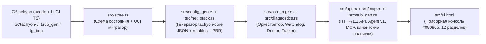

# Роадмап полного переноса функционала в `tachyon-rs` (100% Feature Parity)

Документ фиксирует пошаговый план переноса **всего существующего функционала** из классического пакета [G:\tachyon](file:///g:/tachyon) (`fe-app-tachyon` + `usr/lib/**/*.uc`, ~2.8 МБ исходного кода) и наработок [G:\tachyon-ui](file:///g:/tachyon-ui) в единый автономный Rust-оркестратор [G:\tachyon-rs](file:///g:/tachyon-rs) с сохранением текущего приборного дизайна [src/ui.html](file:///g:/tachyon-rs/src/ui.html) (`#09090b`, монохромная иконографика `stroke-width="1.5"`, табличные числа `tabular-nums`, нулевой внешних JS/CSS-зависимостей).

---

## Архитектурные и визуальные инварианты («вот в этот дизайн что есть»)

> [!IMPORTANT]
> Все переносимые экраны, модальные окна, таблицы и виджеты верстаются строго в существующей дизайн-системе [src/ui.html](file:///g:/tachyon-rs/src/ui.html#L1-L820):
> - **Палитра:** `--bg: #09090b`, `--bg-elev: #111114`, `--surface: #141418`, `--border: #222228`, `--signal: #3b82f6`, статусы `--ok: #10b981`, `--warn: #f59e0b`, `--err: #ef4444`.
> - **Типографика и плотность:** `Inter` + `JetBrains Mono`, `font-variant-numeric: tabular-nums`, строгие сетки `.grid-2 / .grid-3 / .grid-4`, компактные `.badge`, `.chip-picker`, `.node-grid`, `.subtabs`.
> - **Иконографика:** только встроенные монохромные векторные SVG (`stroke="currentColor"`, `stroke-width="1.5"`) и векторные флаги стран (`flagSvg`), без эмодзи и декоративных градиентов.
> - **User-Friendly UX без потери функционала (Главный принцип):** интерфейс должен быть максимально понятным и дружелюбным для пользователя (Мастер быстрой настройки `Connection Wizard` с пресетами в 1 клик, понятные русские/английские подписи, подсказки, переключатель режимов `Basic / Advanced`), сохраняя при этом 100% инженерных настроек, приоритетов секций, всех 24 протоколов и прямое использование возможностей движка `tachyon-core` (`/tachyon/*`, `/providers/proxies`).
> - **Ресурсный бюджет роутера и защита флеш-памяти (Zero Flash Wear Credo):**
  - Один статический musl-бинарник `tachyon`, пиковое потребление ОЗУ оркестратора `<= 4–6 МБ`.
  - **Строгая защита NAND/NOR-флеша маршрутизатора от износа:**
    1. Все высокочастотные данные, телеметрия, логи, счётчики трафика клиентов/устройств, поминутный учёт экранного времени (`parental_quota`), измерения RTT, состояние Watchdog/Failover, рабочий `config.json` ядра и дампы пакетов живут **исключительно в ОЗУ и `tmpfs` (`/tmp/tachyon/*`)**.
    2. Запись в энергонезависимую память (`/etc/tachyon/store.json`) допускается **только** через `write_json_if_changed` (побайтовое сравнение в памяти перед открытием файла) при явном изменении настроек администратором или реальном обновлении состава узлов подписки.
    3. Кэш ядра `cache.db` по умолчанию размещается в `/tmp/tachyon/cache.db` (либо при включённом энергонезависимом хранении синхронизируется с флеш-разделом только по дебаунсу/при штатной остановке и только при наличии реальных изменений).
    4. Базы правил `.srs`, GeoIP/GeoSite и списки Hosts перезаписываются на флеш только при несовпадении `ETag` / `SHA-256` скачанного файла с уже лежащим на диске.

---

## Этап 0. Глобальная оболочка UI, локализация и режимы отображения
**Источники:** [tachyon.ts](file:///g:/tachyon/fe-app-tachyon/src/views/tachyon.ts), [i18n.uc](file:///g:/tachyon/tachyon/files/usr/lib/service/i18n.uc), [ui.html](file:///g:/tachyon-rs/src/ui.html)

- [ ] **0.1. Двуязычный словарь `RU / EN` в `ui.html` и `diagnostics.rs`:**
  - Перенос ключей локализации (`lang: "ru" | "en"`) с переключателем в верхней панели (`topbar`) без перезагрузки страницы.
- [ ] **0.2. Режимы `Basic / Advanced` и `Lite Mode`:**
  - В режиме `Basic` скрываются низкоуровневые поля (`fwmark`, тонкие тайминги, ручной JSON), оставляя быстрые пресеты; в `Advanced` доступны все инженерные настройки.
- [ ] **0.3. Кастомизация навигации и рабочего пространства:**
  - Сворачивание боковой панели (`sidebar_collapsed`), смена стороны (`left / right`), настройка порядка и видимости вкладок (`tab_order`, `hidden_tabs`), выбор акцентного цвета (`blue / emerald / amber / zinc`).
- [ ] **0.4. Глобальный баннер транзакций LKG (`Last Known Good`) и окно авторизации:**
  - Всплывающий таймер подтверждения конфигурации в `topbar` после опасных сетевых изменений (с кнопками «Подтвердить» / «Откатить сейчас»).
  - Полноценная форма входа (`/api/login`) при открытии панели из внешней сети или при включённой парольной защите в LAN, с поддержкой выхода из сессии и смены пароля.

---

## Этап 1. Обзор и статус (`dashboard`)
**Источники:** [section.ts](file:///g:/tachyon/fe-app-tachyon/src/views/section.ts), [status.uc](file:///g:/tachyon/tachyon/files/usr/lib/diagnostics/status.uc), [system_info.uc](file:///g:/tachyon/tachyon/files/usr/lib/diagnostics/system_info.uc), [ui.html](file:///g:/tachyon-rs/src/ui.html#L1311-L1517)

- [ ] **1.1. Конструктор виджетов дашборда (`dashboard_widgets_json`, пресеты `standard / compact / noc`):**
  - Включение, скрытие и изменение порядка карточек дашборда с сохранением в `store.settings`.
- [ ] **1.2. Расширенная телеметрия оборудования и процессов:**
  - Карточка процессов: статус, PID, RSS-память и аптайм `tachyon-core`, `dnsmasq`, `nftables`, вспомогательных контуров (`wdtt`, `fptn`, `tailscale`), индикатор ZRAM / Swap и температуры SoC (`/sys/class/thermal`).
  - Кнопка принудительной очистки памяти ядра (`POST /api/core/memory-trim`) прямо с карточки ОЗУ.
- [ ] **1.3. Карточка мульти-WAN и отказоустойчивости (`WAN & Failover Status`):**
  - Текущий активный WAN-интерфейс, публичный IP/ASN, пинг до контрольных узлов, статус резервного канала (`wan2` / USB-модем) и счётчик переключений.
- [ ] **1.4. Живая таблица секций с трафиком и мгновенным управлением:**
  - Отображение объёма переданных данных (`RX / TX`) и числа активных сессий по каждой секции в реальном времени (из Clash API `/connections`).
  - Быстрый переключатель выходного узла/страны, переключатель активности секции, изменение приоритета (`#1..#N`) и строка быстрого добавления домена с проверкой `Route Explain`.

---

## Этап 2. Студия маршрутизации (`section` — 5 вкладок)
**Источники:** [section.ts](file:///g:/tachyon/fe-app-tachyon/src/views/section.ts), [outbounds.ts](file:///g:/tachyon/fe-app-tachyon/src/views/outbounds.ts), [conditions.ts](file:///g:/tachyon/fe-app-tachyon/src/views/conditions.ts), [balancers.ts](file:///g:/tachyon/fe-app-tachyon/src/views/balancers.ts), [connections.uc](file:///g:/tachyon/tachyon/files/usr/lib/config/connections.uc), [generator_outbounds.uc](file:///g:/tachyon/tachyon/files/usr/lib/tachyon_core/generator_outbounds.uc), [generator_routes.uc](file:///g:/tachyon/tachyon/files/usr/lib/tachyon_core/generator_routes.uc)

### 2.1. Вкладка «Секции и приоритеты» (`sections`)
- [ ] **2.1.1. Три режима представления (`Cards / Table / Pipeline`):**
  - Переключатель вида в тулбаре: подробные карточки с сеткой узлов, плотная таблица для десятков секций или визуальная схема конвейера.
- [ ] **2.1.2. Полный набор типов секций (`connection_type`) и провайдеров:**
  - `proxy`, `desync` (встроенный адаптивный движок `tachyon-core` + пресеты из `dpi-presets.json`), `wdtt`, `fptn`, `tailscale`, `direct` (с выбором конкретного выходного WAN-интерфейса), `block`, `hosts`, `dns`.
- [ ] **2.1.3. Умный каталог сервисов и списков (`catalog.uc`):**
  - Группировка `COMMUNITY_SERVICES` по категориям (Видео и стриминг, Соцсети и мессенджеры, ИИ-сервисы, Игры и лаунчеры, Разработка и облака, Голосовые вызовы) с поиском и счётчиком доменов в каждом списке.
- [ ] **2.1.4. Расширенная карточка выбора узлов внутри секции:**
  - Фильтрация по странам (кнопки-чипы с флагами), протоколам, тексту; сортировка по RTT или алфавиту; индивидуальный замер задержки одного узла по клику; индикация `Last Alive` и текущего лидера балансировщика.
- [ ] **2.1.5. Индивидуальный DNS секции (`routed_dns_enabled`) и каскадирование (`outbound_detour`):**
  - Выбор пресета DNS для секции (Cloudflare, Google, Quad9, AdGuard, Яндекс, кастомный DoH/DoT/UDP) и привязка секции в цепочку через другую секцию (`detour`).

### 2.2. Вкладка «Источники и подписки» (`sources`)
- [ ] **2.2.1. Универсальный парсер подписок и крипто-контейнеров ([parser.uc](file:///g:/tachyon/tachyon/files/usr/lib/subscription/parser.uc), [crypt4.uc](file:///g:/tachyon/tachyon/files/usr/lib/subscription/crypt4.uc), [amnezia.uc](file:///g:/tachyon/tachyon/files/usr/lib/subscription/amnezia.uc)):**
  - Поддержка Base64, Plain URI, JSON (`sing-box` / `xray`), YAML (`Clash` / `Mihomo`), зашифрованных ссылок `happ://crypt...` (`happ-keys.json`), контейнеров `vpn://` (Amnezia) и `.conf` файлов WireGuard/AWG.
  - Извлечение и отображение в карточке подписки HTTP-заголовков провайдера: `Subscription-Userinfo` (остаток трафика в ГБ, дата истечения тарифа, прогресс-бар квоты), `Profile-Title`, `Support-Url`, `announce`.
- [ ] **2.2.2. Визуальные конструкторы для всех 24 исходящих протоколов:**
  - `VLESS` (`xtls-rprx-vision`, `encryption: mlkem768x25519plus` `0rtt/1rtt`, `REALITY` X25519 и PQ, `TLS`, `ECH`, транспорты `tcp`, `ws`, `grpc`, `httpupgrade`, `h2`, `xhttp` с режимами `stream-one / stream-up / packet-up` и `xmux`).
  - `VMess`, `Trojan`, `Shadowsocks` (AEAD, `2022-blake3-*`, плагины и `UoT`).
  - `Hysteria2` (лимиты Мбит/с, `Salamander`, `Gecko / finalmask`, `server_ports` + `hop_interval`), `TUIC v5` (`bbr / cubic`, `udp_relay_mode`, `zero_rtt_handshake`).
  - `AnyTLS`, `ShadowTLS v3`, `NaiveProxy` (H2 / H3 + UoT), `Mieru v3`, `Snell v3/v4/v5`, `TewFai` (профили `shaper` и `morph`), `MASQUE`, `TrustTunnel`, `OpenConnect`.
  - `WireGuard` и `AmneziaWG v1.5 / v2.0` (`Jc, Jmin, Jmax, S1..S4, H1..H4, I1..I5`, `reserved`, UDP port hopping, загрузка `.conf` файла с диска или буфера).
  - `Cloudflare WARP` (авторегистрация ключей через API, выбор endpoint и `reserved` байт).
  - `MTProto` (`telegram-ws` / `kws` с доменами DC1..DC5), `FPTN` (ввод токена `fptn://`, автовыбор сервера), `WDTT`, `Tailscale`, `SOCKS5`, `HTTP`, `interface` (привязка к `wg0 / tun1 / usb0`).
- [ ] **2.2.3. Полный визуальный редактор профиля `Desync 2.0`:**
  - Выбор пресета из библиотеки [dpi-presets.json](file:///g:/tachyon/tachyon/files/usr/share/tachyon/dpi-presets.json), настройка `mode` (`fake_split`, `fake_disorder`, `multi_split`, `multi_disorder`, `seqovl`, `oob`, `tlsrec_split`, `seven_point`, `host_fake`), `split_pos` (`1,midsld,sni_ext_start,...`), `fooling` (`badsum`, `md5`, `badseq`, `ts`, `autottl`, `ttl`, `hopbyhop`, `padencap`), `sni_pool`, `quic_mode` (`fake`, `padencap`, `burst`, `drop`), `hedged_race`, просмотр и сброс выученных рецептов `cache.db` по доменам.

### 2.3. Вкладка «Условия трафика» (`conditions`)
- [ ] **2.3.1. Дерево булевых правил (`atomic / all / any / not`):**
  - Визуальное построение вложенных условий с защитой от циклических ссылок.
- [ ] **2.3.2. Все типы предикатов:**
  - Каталог `community_lists`, ручные домены/суффиксы/ключевые слова/regex, CIDR-подсети, удалённые URL-списки (`remote_domain_lists`, `remote_subnet_lists`) с индикацией статуса загрузки и количества записей, `GeoIP` и `GeoSite` (`include / exclude`), IP/MAC клиентов LAN (`client_ips`, `exclude_client_ips`), порты источника и назначения, L4 протокол (`tcp / udp / icmp`), DSCP/fwmark, временные окна (`time_window`).
- [ ] **2.3.3. Встроенный интерактивный симулятор правил (`Route Tracer`) внизу вкладки:**
  - Пошаговая трассировка: показ всех проверенных условий, какое именно поле дало `MATCH` или `MISS`, и в какую секцию/узел уйдёт пакет.

### 2.4. Вкладки «Балансировщики» (`balancers`) и «Группы отказоустойчивости» (`groups`)
- [ ] **2.4.1. Все 11 режимов балансировки:**
  - `least_test`, `stability` (EWMA), `sticky` (`src_ip / dst_host / src_dst`), `round_robin`, `least_load`, `priority`, `hedged`, `throughput`, `passive`, `weighted` (задание весов узлам), `quota` (лимиты трафика по узлам).
- [ ] **2.4.2. Живая телеметрия балансировщика и групп:**
  - Показ текущего выбранного узла, таблицы RTT/стабильности кандидатов и истории переключений `Primary ↔ Backup`.

---

## Этап 3. Входящие серверы и генератор клиентских подписок (`server`)
**Источники:** [server.ts](file:///g:/tachyon/fe-app-tachyon/src/views/server.ts), [sub_gen.rs](file:///g:/tachyon-ui/src/sub_gen.rs), [service.uc](file:///g:/tachyon/tachyon/files/usr/lib/server/service.uc), [links.uc](file:///g:/tachyon/tachyon/files/usr/lib/server/links.uc), [server_stats.uc](file:///g:/tachyon/tachyon/files/usr/lib/diagnostics/server_stats.uc)

- [ ] **3.1. Перенос полного движка генерации клиентских профилей (`src/sub_gen.rs` из `tachyon-ui`):**
  - Автоматическая выдача подписок и профилей под конкретные клиентские приложения по `User-Agent` или query-параметру (`?app=happ|v2rayng|streisand|hiddify|clash|singbox|amnezia|wireguard|raw`):
    - **Happ / v2rayNG / Streisand / V2Box:** Base64 набор URI с мета-заголовками (`#profile-title`, `#subscription-userinfo`, `#profile-update-interval`, routing-правила Happ).
    - **Clash / Mihomo (FlClash, Clash Verge):** готовый YAML-профиль с `proxy-groups` и правилами.
    - **Sing-box / Hiddify / Nekobox:** готовый JSON-конфиг клиента.
    - **AmneziaVPN / AmneziaWG / WireGuard:** скачивание `.conf` файла и `vpn://` контейнера в один клик.
- [ ] **3.2. Индивидуальные клиентские учётные записи, учёт трафика и квоты:**
  - По каждому клиенту внутри любого из 23 протоколов: индивидуальный UUID/пароль/ключ, счётчик `upload / download` в реальном времени, лимит трафика в ГБ (`total_limit_bytes`), срок действия (`expiry_time`), лимит одновременных IP, индивидуальный QR-код и персональная ссылка подписки (`/sub/:token/:client_id`).
- [ ] **3.3. Помощник настройки `REALITY` и TLS на роутере:**
  - Встроенная кнопка «Подобрать лучший SNI» прямо в модальном окне создания сервера (вызов сканера SNI и автоподстановка `reality_handshake_server`), генератор самоподписанных TLS-сертификатов и интеграция с ACME / DDNS роутера.
- [ ] **3.4. Защита входящих серверов (`Honeypot`, `Decoy Mode`, `LAN Isolation`):**
  - Журнал срабатываний Honeypot (IP атакующего, порт, тип пробы, автоматическая блокировка в `nftables` set `tachyon_banlist`), настройка `decoy_mode` (перенаправление неавторизованных подключений на маскировочный сайт) и гранулярная изоляция подсетей LAN для выбранных клиентов.

---

## Этап 4. Клиенты локальной сети LAN (`local_devices`)
**Источники:** [local_devices.ts](file:///g:/tachyon/fe-app-tachyon/src/views/local_devices.ts), [sys_info.rs](file:///g:/tachyon-rs/src/sys_info.rs), [ui.html](file:///g:/tachyon-rs/src/ui.html#L3280-L3360)

- [ ] **4.1. Обогащённый реестр устройств LAN:**
  - Объединение данных из `/proc/net/arp`, `ip neigh`, `/tmp/dhcp.leases`, `/etc/ethers` и `/etc/config/dhcp`.
  - Пользовательские названия и заметки для устройств (сохранение по MAC-адресу в `store`), определение вендора по OUI MAC, отображение текущей скорости (`RX/TX Кбит/с`), суммарного трафика и числа открытых conntrack-сессий на каждое устройство.
- [ ] **4.2. Управление DHCP-резервацией и сетевыми профилями в один клик:**
  - Привязка статического IP (`Static Lease`) к MAC-адресу прямо из таблицы устройств.
  - Переключатель **Game Console Optimizer** (открытый NAT / UPnP / прямой UDP для PS5, Xbox, Nintendo Switch, Steam Deck) и отправка **Wake-on-LAN (WoL)**.

---

## Этап 5. Политики доступа: Родительский контроль, Расписания и Гостевой контур (`profile`, `schedule`, `guest_mode`)
**Источники:** [parental.ts](file:///g:/tachyon/fe-app-tachyon/src/views/parental.ts), [parental_quota.uc](file:///g:/tachyon/tachyon/files/usr/lib/service/parental_quota.uc), [ui.html](file:///g:/tachyon-rs/src/ui.html#L3363-L3570)

- [ ] **5.1. Счётчик экранного времени и суточных квот (`parental_quota`):**
  - Фоновый трекинг активных минут использования сети устройствами профиля, прогресс-бар израсходованной квоты (`мин / сут`), кнопка «+30 минут сегодня» и мгновенная пауза интернета на устройстве («Пауза до утра»).
- [ ] **5.2. Принудительный SafeSearch и фильтр категорий:**
  - CNAME/DNS-перезапись для Google, YouTube (`restrict.youtube.com`), Bing, DuckDuckGo, Яндекс в безопасный режим + категории фильтрации (`adult`, `gambling`, `malware`, `social`, `games`).
- [ ] **5.3. Автоматический планировщик расписаний (`schedules`):**
  - Исполнение расписаний в фоновом цикле `CoreManager`: включение/выключение секций маршрутизации, родительских профилей или блокировки по дням недели и интервалам времени (`ЧЧ:ММ–ЧЧ:ММ`, с поддержкой перехода через полночь).
- [ ] **5.4. Гостевой контур и шейпинг полосы (`guest_mode`):**
  - Автоматическая генерация правил `nftables` для изоляции гостевых IP/интерфейсов от основной сети LAN и админ-панели роутера + ограничение скорости (`bandwidth_limit_mbps`).

---

## Этап 6. Мониторинг активных сессий в реальном времени (`monitoring`)
**Источники:** [section.ts](file:///g:/tachyon/fe-app-tachyon/src/views/section.ts), [status.uc](file:///g:/tachyon/tachyon/files/usr/lib/diagnostics/status.uc), [ui.html](file:///g:/tachyon-rs/src/ui.html#L3572-L3652)

- [ ] **6.1. Полнофункциональный инспектор потоков (`Clash API + nf_conntrack`):**
  - Живой поиск и фильтрация по IP/имени клиента LAN, целевому домену/IP, протоколу (`TCP / UDP / QUIC`), сработавшему правилу и выходному контуру (`outbound`).
  - Сортировка по текущей скорости (`↓/↑ КБ/с`), суммарному объёму данных или времени жизни сессии; пауза автообновления таблицы.
- [ ] **6.2. Агрегированная аналитика («Топ хостов» и «Топ клиентов»):**
  - Переключатель группировки: по отдельным соединениям, по доменам назначения или по устройствам LAN.
- [ ] **6.3. Действия в один клик прямо из строки соединения:**
  - Направить домен или IP в любую секцию (`proxy / desync / direct / block`), добавить в исключения или принудительно разорвать конкретную сессию (либо все сессии выбранного клиента).

---

## Этап 7. Инженерная диагностика, Doctor, Fuzzer, DNS Bench и Пакетный инспектор (`diagnostic`)
**Источники:** [doctor.uc](file:///g:/tachyon/tachyon/files/usr/lib/diagnostics/doctor.uc), [fuzzer.uc](file:///g:/tachyon/tachyon/files/usr/lib/diagnostics/fuzzer.uc), [dns_speed_test.ts](file:///g:/tachyon/fe-app-tachyon/src/views/dns_speed_test.ts), [route_explain.uc](file:///g:/tachyon/tachyon/files/usr/lib/diagnostics/route_explain.uc), [service_check.uc](file:///g:/tachyon/tachyon/files/usr/lib/diagnostics/service_check.uc), [leak_check.uc](file:///g:/tachyon/tachyon/files/usr/lib/diagnostics/leak_check.uc)

- [ ] **7.1. Структурированные приборные панели вместо сырого JSON-текста в `vDiagnostics()`:**
  - Каждый инструмент получает собственную подвкладку (`subtabs`) и наглядную табличную/карточную визуализацию в стиле `#09090b` (с возможностью открыть сырой JSON при необходимости):
    1. **Аудит 14 подсистем (`Local Doctor`):** карточки подсистем с детальным описанием, кодом проверки и индивидуальной кнопкой `Quick Fix` на каждой проблемной карточке.
    2. **Интерактивный `Desync Fuzzer`:** выбор целевого домена или набора сервисов, прогресс тестирования всех 16+ стратегий и профилей, таблица результатов (статус рукопожатия TLS 1.3, передача `>= 32 КБ` данных, RTT, найденный `fake_ttl`) и кнопка **«Применить лучшую стратегию в секцию Desync»**.
    3. **Бенчмарк `DNS Speed Test` ([dns_speed_test.ts](file:///g:/tachyon/fe-app-tachyon/src/views/dns_speed_test.ts)):** сравнение всех настроенных и публичных резолверов (DoH / DoT / UDP) по `min / avg / max` задержке и проценту успешных ответов, с кнопкой **«Сделать основным DNS»** в один клик.
    4. **Сканер `REALITY TLS SNI`:** проверка списка доменов на поддержку TLS 1.3, H2, отсутствие редиректов, географическую близость (RTT) и валидность цепочки сертификатов, с кнопкой **«Применить SNI к серверу»**.
    5. **Матрица доступности сервисов (`Service & Unlock Probe` на базе `servicecheck_profiles.json`):** проверка доступности YouTube, Discord, Telegram, OpenAI, Claude, Gemini, Netflix, Spotify, Steam через выбранную секцию или напрямую.
    6. **Проверка утечек (`IP / DNS / WebRTC / IPv6 Leak Check`) и инспектор `Config Plan / nftables`:** сравнение видимого IP/ASN в прямом и проксированном контурах + просмотр скомпилированного `config.json` и таблицы `inet TachyonTable`.
    7. **Сетевые утилиты и захват трафика (`Ping / TCP Connect / Traceroute / PCAP`):** встроенный запуск `ping`, `traceroute` и захват дампа пакетов (`tcpdump` с фильтром по хосту/порту и скачиванием `.pcap` файла в браузер).
    8. **ИИ-диагност (`AI Doctor` + локальная база знаний `rag_index.json`):** чат-интерфейс с локальным поиском по документации и генерацией точных кнопок автоисправления.

---

## Этап 8. Центр обновлений, гео-баз и пакетов (`updates`)
**Источники:** [updates.uc](file:///g:/tachyon/tachyon/files/usr/lib/components/updates.uc), [updater.uc](file:///g:/tachyon/tachyon/files/usr/lib/components/updater.uc), [installer.uc](file:///g:/tachyon/tachyon/files/usr/lib/components/installer.uc), [verifier.uc](file:///g:/tachyon/tachyon/files/usr/lib/components/verifier.uc)

- [ ] **8.1. Менеджер версий бинарного ядра `tachyon-core` и оркестратора `tachyon`:**
  - Определение архитектуры маршрутизатора (`aarch64`, `x86_64`, `mipsel_24kc`, `mips_24kc`, `armv7` и др.), проверка релизов на GitHub (с поддержкой `github_mirror`), скачивание через прокси-секцию или напрямую, проверка контрольной суммы `SHA256SUMS`, атомарная замена бинарника и безопасный перезапуск с откатом при ошибке `check`.
- [ ] **8.2. Таблица всех баз правил (`.srs`), GeoIP, GeoSite и списков Hosts:**
  - Отображение каждого файла набора правил в `/etc/tachyon/rulesets`, его размера, даты последнего обновления, источника и кнопки индивидуального или пакетного обновления.
- [ ] **8.3. Живой прогресс фоновых задач (`jobs`):**
  - Замена текстового JSON-поля на таблицу задач со статусами (`running / ok / error`), таймерами и логом выполнения.

---

## Этап 9. Полнофункциональный Telegram-бот управления (`telegram`)
**Источники:** [tg_bot.rs](file:///g:/tachyon-ui/src/tg_bot.rs), [commands.uc](file:///g:/tachyon/tachyon/files/usr/lib/service/telegram/commands.uc), [callbacks.uc](file:///g:/tachyon/tachyon/files/usr/lib/service/telegram/callbacks.uc), [rendering.uc](file:///g:/tachyon/tachyon/files/usr/lib/service/telegram/rendering.uc)

- [x] **9.1. Перенос полного интерактивного меню с Inline-клавиатурами в `src/tg_bot.rs`:**
  - Главное меню статуса роутера (CPU, ОЗУ, аптайм, активный WAN, статус `tachyon-core`).
  - Управление секциями маршрутизации: включение/выключение секций, переключение активного узла/страны внутри секции, быстрый замер пинга узлов, добавление домена в секцию сообщением в чат.
  - Управление входящими серверами: создание нового клиентского ключа в один клик, выдача URI-ссылки, `.conf` файла и отправка QR-кода картинкой/SVG в чат.
  - Управление клиентами LAN и родительским контролем: список онлайн-устройств, привязка устройства к секции, включение паузы интернета и отправка пакета Wake-on-LAN.
  - Диагностика и алерты из бота: запуск `Local Doctor`, `Quick Fix`, перезапуск ядра, откат к `LKG`, выгрузка резервной копии конфигурации файлом в чат.
- [ ] **9.2. Расширенная настройка уведомлений в UI (`vTelegram`):**
  - Выбор категорий оповещений (падение/восстановление WAN, переключение Failover, срабатывание Honeypot, вход в панель, критическая нехватка ОЗУ, автообновление списков) + привязка прокси-секции для работы самого Telegram Bot API в сетях с ограниченным доступом к `api.telegram.org`.

---

## Этап 10. Системные настройки, сетевой стек и полная миграция с Legacy (`settings`)
**Источники:** [settings.ts](file:///g:/tachyon/fe-app-tachyon/src/views/settings.ts), [apply.uc](file:///g:/tachyon/tachyon/files/usr/lib/nft/apply.uc), [migration.uc](file:///g:/tachyon/tachyon/files/usr/lib/config/migration.uc), [watchdog.uc](file:///g:/tachyon/tachyon/files/usr/lib/service/watchdog.uc), [wan_failover.uc](file:///g:/tachyon/tachyon/files/usr/lib/service/wan_failover.uc), [direct.uc](file:///g:/tachyon/tachyon/files/usr/lib/torrserver/direct.uc)

- [ ] **10.1. Детальная конфигурация сетевого стека (`net_stack.rs` + `vSettings`):**
  - Настройки TProxy / TUN (`tun_interface`, `tun_stack: system|gvisor|mixed`, `tun_mtu`, `source_network_interfaces`, `output_network_interface`).
  - Специализированные контуры: **TorrServer Direct** (автоопределение локального процесса TorrServer и пропуск его исходящих пиров напрямую в обход туннеля), **Изоляция P2P/BitTorrent** (`isolate_p2p`, `p2p_ports`), **Wi-Fi Calling Direct** (прямой пропуск IPSec/IKEv2 UDP `500/4500` операторов связи), **Исключение NTP**, **Direct Bypass Port**.
- [ ] **10.2. Каскадная архитектура DNS и интеграция с `dnsmasq`:**
  - Полное управление `bootstrap_dns_servers`, `fallback_dns_server`, `dns_rewrite_ttl`, `dns_local_cache`, `dns_turbo_cache`, `dns_cache_size`, безопасная перенастройка OpenWrt `dnsmasq` с автоматическим возвратом штатного конфига при остановке службы (`dont_touch_dhcp`).
- [ ] **10.3. Мульти-WAN Failover, Watchdog и автообнаружение `Smart Detect`:**
  - Настройка основного и резервного WAN-интерфейсов (`wan_failover_primary`, `wan_failover_backup`, контрольные хосты) в UI.
  - Настройка **Smart Detect** (`smart_detect_mode`, `smart_detect_expand_to_root`, целевые секции): автоматическое обнаружение доменов с деградацией соединения и предложение/автодобавление их в выбранную секцию.
  - Настройка лимитов памяти `memory_limit_mb` и параметров `Auto-Heal` (`auto_heal_enabled`, интервал).
- [x] **10.4. Полный импортер существующих конфигураций роутера (`Legacy UCI / JSON Migration`):**
  - Бесшовный импорт в один клик (и автоматически при первом запуске) всех данных из `/etc/config/tachyon` (UCI), `/etc/tachyon/subscriptions_cache.json`, `/etc/tachyon/rulesets`, `/etc/tachyon-core/config.json` — чтобы при обновлении на `tachyon-rs` пользователь сохранил 100% своих секций, подписок, серверов, клиентов, условий, родительских профилей и токенов Telegram.
- [x] **10.5. Полноценный CLI-интерфейс бинарника `tachyon` (`src/main.rs`):**
  - Поддержка всех привычных команд OpenWrt-администратора: `tachyon status`, `tachyon reload`, `tachyon restart`, `tachyon doctor`, `tachyon explain <target>`, `tachyon import-legacy`, `tachyon rollback`, `tachyon version`.

---

## Порядок реализации по спринтам

| Очередь | Модуль / Экран | Ключевые файлы в `G:\tachyon-rs` | Результат |
| :--- | :--- | :--- | :--- |
| **Фаза 1** | **Студия маршрутизации (100% паритет)** | `src/ui.html`, `src/config_gen.rs`, `src/core_mgr.rs`, `src/store.rs` | Все 24 протокола, заголовки подписок, `happ://` / `vpn://` / `.conf`, полный редактор `Desync 2.0` (`dpi-presets.json`), режимы `Cards/Table/Pipeline`, интерактивный `Route Tracer`. |
| **Фаза 2** | **Входящие серверы и `sub_gen.rs`** | `src/sub_gen.rs` (новый), `src/api.rs`, `src/ui.html`, `src/crypto_gen.rs` | Генерация профилей для Happ / v2rayNG / Clash / Sing-box / Amnezia, учёт трафика и квот по клиентам, помощник `REALITY SNI`, Honeypot-журнал. |
| **Фаза 3** | **Инженерная диагностика и Мониторинг** | `src/diagnostics.rs`, `src/ui.html`, `src/api.rs` | Визуальные панели для 14 подсистем Doctor, табличный `Desync Fuzzer`, `DNS Speed Test`, `Service Unlock Probe`, `Leak Check`, `PCAP`, топ хостов/клиентов в `Monitoring`. |
| **Фаза 4** | **Telegram-бот, LAN-клиенты и Политики** | `src/tg_bot.rs`, `src/sys_info.rs`, `src/net_stack.rs`, `src/ui.html` | Полный Inline-бот в Telegram, трекинг экранного времени в родительских профилях, активный планировщик расписаний, DHCP static leases и Game Console Optimizer. |
| **Фаза 5** | **Системный стек, Обновления, Дашборд и Мигратор** | `src/store.rs`, `src/net_stack.rs`, `src/main.rs`, `src/ui.html` | 100% импорт `/etc/config/tachyon`, TorrServer Direct, P2P/Wi-Fi Calling, менеджер `.srs`/ядра, конструктор виджетов дашборда, `RU/EN` и `Basic/Advanced`. |
