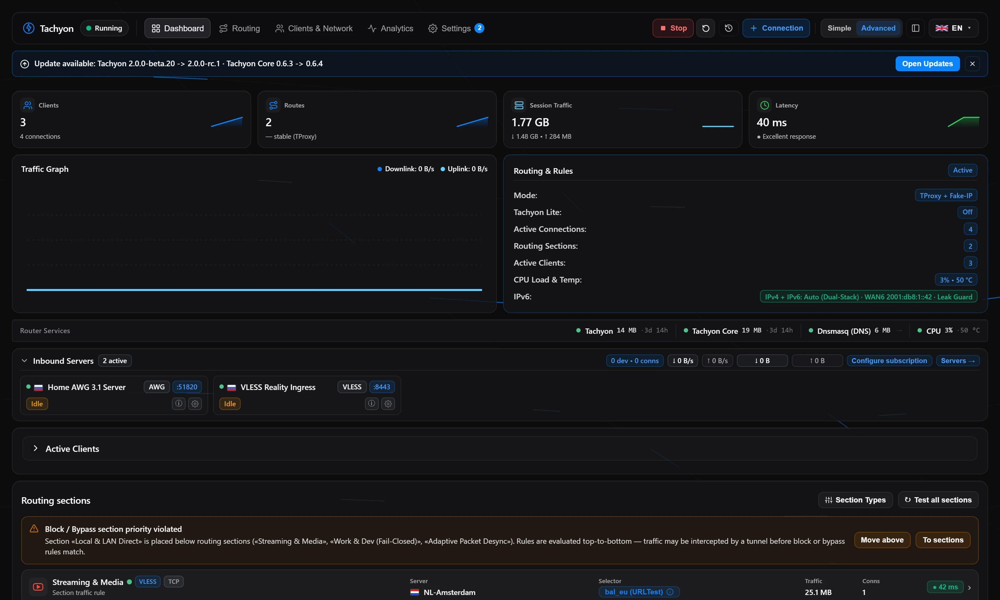
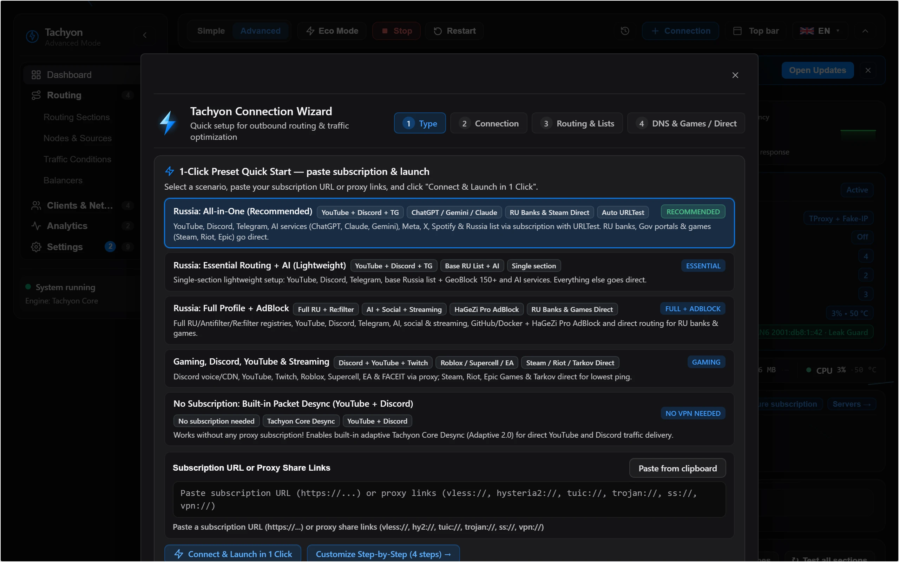

# Quick Start

[Русский](../ru/02-quickstart.md) | [Back to Index](README.md)

## Opening the Web Interface

After installation, the Web UI is reachable via two entry points:

- **LuCI**: open your OpenWrt web interface (`http://192.168.1.1`) and navigate to `Services -> Tachyon`.
- **Standalone Web UI**: open `http://192.168.1.1:1680/tachyon` (host, port, and base path are configured under `settings`).

Administration credentials match your OpenWrt `root` account.

## Dashboard Overview

The Dashboard consolidates engine telemetry, network health, leak guards, and active routing sections on a single screen.



### Top Bar Controls and Modes

- **Interface mode switch (`Simple` / `Advanced`)**: reveals or hides granular engineering parameters across views.
- **`Eco Mode` (Lite)**: reduces background telemetry polling frequency to conserve CPU resources on entry-level routers.
- **`Stop` / `Restart`**: immediate lifecycle control for `tachyon` and `tachyon-core`.
- **`+ Connection`**: launches the guided Quick Connection Wizard.
- **`Top bar` / `Sidebar`**: switches navigation layout; next to it is the live language selector (`RU` / `EN`).
- **Component Update Notifications**: when an update is available on the selected release channel, a top notification banner displays the pending versions with an **`Open Updates`** shortcut, alongside count badges in the sidebar and top bar.

### Main Dashboard Widgets

1. **KPI Cards**: active LAN clients and connection count, enabled route count, cumulative session traffic (`download` / `upload`), and average outbound latency.
2. **Traffic Graph & Routing Summary**: active interception mode (`TProxy + Fake-IP` or `TUN`), Eco Mode state, active connections, CPU load and temperature, and IPv4/IPv6 state (`Leak Guard` indicator).
3. **Router Services Bar**: running status, RAM footprint, and uptime for `Tachyon`, `Tachyon Core`, and `Dnsmasq`.
4. **Inbound Servers & Active Clients**: live summary of VPN/proxy servers hosted on the router (with subscription URL/QR shortcuts) and active LAN devices.
5. **Routing Sections**: interactive rule cards displaying current exit nodes, measured latencies, and quick failover controls.

## Using the Quick Connection Wizard

For initial setup or adding a new subscription in one pass, click **`+ Connection`** in the top bar.



The wizard completes setup in four steps:

1. **Scenario Type**: choose a preset template (full balanced profile, lightweight essential profile, gaming/streaming split profile with direct game platform routing, or proxy-free native packet desynchronization).
2. **Connection Source**: paste a subscription URL or share links (`Paste from clipboard`), or attach an existing source from the pool.
3. **Route & Rule Sets**: review target `.trs` rule sets and direct WAN exclusions.
4. **DNS & Launch**: select encrypted DNS (DoH / DoT) and apply the compiled configuration immediately.

## Manual 3-Step Route Setup

1. Go to `Routing -> Nodes & Sources`, click **`+ Add an outbound source`**, and paste a subscription URL or share link (`vless://`, `hysteria2://`, `AmneziaWG`, etc.).
2. Open `Routing -> Routing Sections`, click **`+ Add a section`**, select the source you created, and attach a condition or `.trs` rule-set preset.
3. Click **`Save & Apply`** — `tachyon` recompiles `/etc/tachyon-core/config.json` and reloads `nftables` automatically.

## Verifying Route Decisions

You can inspect how any domain or destination IP will be routed before opening real connections:

- **In the Web UI**: use **Rule Tracer** under `Routing -> Traffic Conditions` or `Analytics -> Diagnostics`.
- **Via SSH CLI**:

```sh
tachyon explain example.com 192.168.1.10
tachyon route_explain 192.168.1.10 example.com 443 tcp
tachyon status
```

`explain` and `route_explain` report the exact matching section, matched condition or `.trs` list, and resulting outbound tag.

---

[Previous: Installation and 1.x Migration](01-installation.md) | [Back to Index](README.md) | [Next: Outbound Sources and Protocols](03-outbounds-protocols.md)
