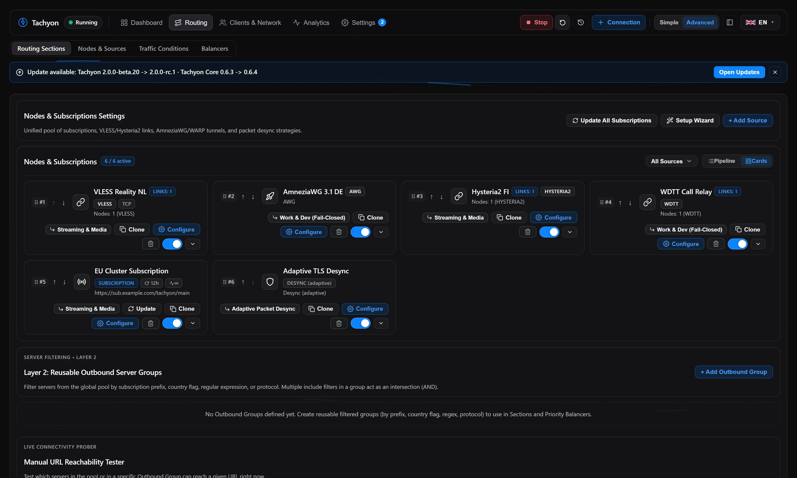
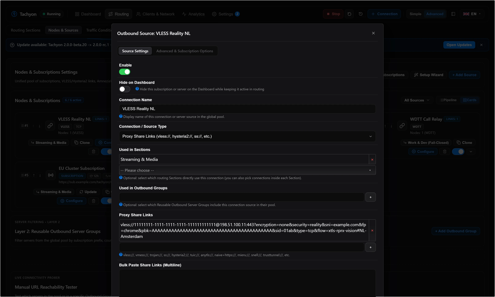

# Outbound Sources and Protocols

[Русский](../ru/03-outbounds-protocols.md) | [Back to Index](README.md)

Tachyon 2.0 manages all upstream connections in **Layer 1: Global Server Pool (`outbound_source`)** under `Routing -> Nodes & Sources`. Sources are defined once and referenced cleanly across multiple routing sections, groups, and balancers without duplicating credentials.



## Supported Source Types

All `source_type` options available in the outbound pool editor:

| `source_type` | Purpose and Capabilities |
|---|---|
| `subscription` | HTTP/HTTPS remote subscriptions (including `happ://crypt*` links). Supports configurable refresh intervals (`1h`, `12h`, `1d`), custom/automatic User-Agent selection, proxy-assisted fetching (`download_via_proxy_enabled`), quota usage display, and expiration tracking |
| `proxy_links` | Line-separated share URIs: `vless://`, `vmess://`, `trojan://`, `ss://`, `hysteria2://` (`hy2://`), `tuic://`, `socks://`, `http://`, `ssh://`, `wireguard://`, `wdtt://`, `csqtt://`, `qwdtt://` |
| `awg` | Native **AmneziaWG** client supporting versions **2.0**, **3.0**, and **3.1** (`.conf` import or manual endpoint, keys, MTU, and obfuscation fields `Jc`, `Jmin`, `Jmax`, `S1`–`S4`, `H1`–`H4`, `I1`–`I5`) |
| `warp` | Native Cloudflare WARP tunnel client with automatic key provisioning, endpoint selection, and MTU tuning |
| `fptn` | **FPTN** tunnel transport authenticated by access token |
| `openvpn` | OpenVPN client profile (`.ovpn` configuration, TLS certificates, username/password credentials) |
| `anytls` | **AnyTLS** session-multiplexed TLS transport |
| `naive` | **NaiveProxy** (HTTP/2 and HTTP/3 over Chrome-aligned TLS stack) |
| `mieru` | **Mieru** multiplexed TCP/UDP stream tunnel |
| `snell` | **Snell** v3/v4 transport with PSK and obfuscation |
| `sudoku` | **Sudoku** transport protocol |
| `masque` | **MASQUE** IP/UDP tunneling over HTTP/3 (RFC 9298) |
| `openconnect` | Compatibility with **OpenConnect / AnyConnect** SSL VPN gateways |
| `shadowtls` | **ShadowTLS** handshake wrapper utilizing a target SNI |
| `trusttunnel` | **TrustTunnel** encrypted transport |
| `desync` | Native `tachyon-core` packet desynchronization engine (local outbound packet modifier requiring no remote proxy — see [Chapter 07](07-desync-fuzzer.md)) |

## Creating and Editing a Source

Clicking **`+ Add an outbound source`** or **`Edit`** opens a two-tab modal: `Source Settings` and `Advanced & Subscription Options`.



### Core Source Fields

- **Enable**: toggles whether the source is active and compiled into `tachyon-core`.
- **Hide on Dashboard**: keeps the source active in routing while hiding its individual node cards on the Dashboard.
- **Name**: friendly label shown across sections and balancers.
- **Source Type**: switches the protocol-specific configuration form below.
- **Used in Sections / Server Groups**: direct bidirectional linking to attach this source to sections immediately.

### Protocol-Specific Notes

#### Subscriptions (`subscription`)

- Multiple URLs can be grouped inside a single source while tracking per-subscription metadata.
- **Automatic User-Agent Selection (`auto_user_agent`)**: cycles compatible client User-Agent strings if a subscription server filters responses by client type.
- **Download via Proxy Section (`download_via_proxy_enabled`)**: fetches subscription updates through an existing healthy routing section rather than directly over WAN.
- Quota usage (`used_bytes / total_bytes`), expiration date, and an immediate **`Update`** trigger are shown on the source card.

#### WDTT Call Relay (`wdtt://`, `csqtt://`, `qwdtt://`)

Call-relay transport URIs follow the format:

```text
wdtt://password@host:3478?mode=csqtt&media=vk&vk_auth_mode=cookie#WDTT-Relay
```

Key query parameters:
- `mode`: transport variant (`wdtt`, `csqtt`, `qwdtt`).
- `media`: signaling/media backend (`vk` or compatible).
- `vk_auth_mode`: authentication mode (for example, `cookie`).

#### AmneziaWG (`awg` 2.0 / 3.0 / 3.1)

Supports standard WireGuard parameters (`wg_endpoint`, `wg_local_address`, `wg_peer_public_key`, `wg_private_key`, `wg_preshared_key`, `wg_mtu`) plus AmneziaWG obfuscation versions `2.0`, `3.0`, and `3.1` (`awg_jc`, `awg_jmin`, `awg_jmax`, `awg_s1`–`awg_s4`, `awg_h1`–`awg_h4`, and `awg_i1`–`awg_i5`).

---

[Previous: Quick Start](02-quickstart.md) | [Back to Index](README.md) | [Next: Routing Sections, Conditions, .trs Lists, and Balancers](04-routing-sections-balancers.md)
