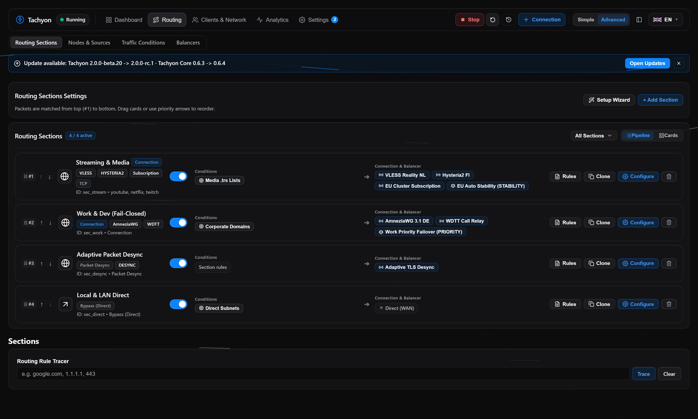
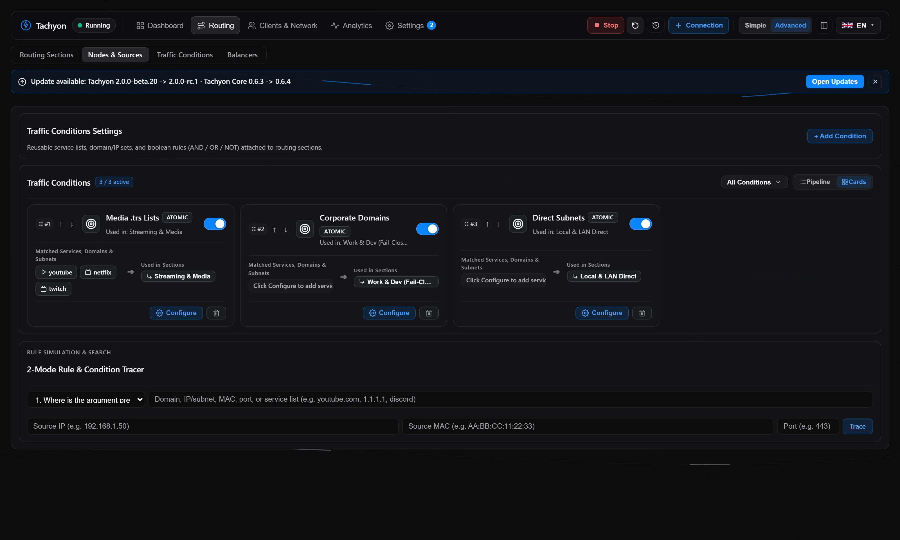
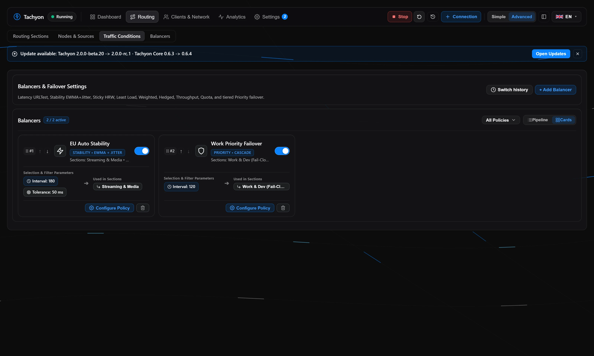

# Routing Sections, Conditions, .trs Lists, and Balancers

[Русский](../ru/04-routing-sections-balancers.md) | [Back to Index](README.md)

Routing in Tachyon 2.0 is built around four cleanly decoupled layers:

```text
Traffic Conditions (What?) ──▶ Routing Section (Priority + Action) ──▶ Balancer (Node Selection?) ──▶ Outbound Pool (Where?)
```

Decoupling these layers lets you swap upstream servers or selection policies without rewriting domain rules, and reuse domain sets across different exit pipelines.

## Routing Sections and Evaluation Order



Connections are evaluated strictly **from top to bottom (`#1 -> #N`)**. The **first** enabled section whose conditions match handles the traffic. Reorder sections via drag-and-drop handles or the `↑` / `↓` priority arrows.

### Section Actions (`action` / `connection_type`)

| Action | Behavior |
|---|---|
| `proxy` | Forwards matched traffic through the assigned outbound source or balancer |
| `desync` | Processes matched traffic via native `tachyon-core` packet desynchronization without a remote proxy server |
| `direct` / `bypass` | Sends traffic directly out the WAN interface (or a specified interface) |
| `block` / `reject` | Drops or rejects matched connections (telemetry, unwanted ports, ad filtering) |
| `dns` | Dedicated rule routing matched DNS queries to specific upstream resolvers |
| `group` | Composite policy referencing multiple child sections |

### Fail-Closed and Kill-Switch Guards

For sensitive routes (such as corporate networks), enable strict per-section guards:

- **`fail_closed`**: drops matched traffic instead of falling back to direct WAN when all configured outbounds are unreachable.
- **`kill_switch`**: blocks matched flows while the tunnel interface or engine pipeline is down or restarting.

## Traffic Conditions and Rule-Set Formats

Under `Routing -> Traffic Conditions`, you define reusable traffic matchers shared by one or more sections.



### Atomic and Composite Conditions

- **Atomic condition (`atomic`)**: matches remote rule sets, domain suffixes/keywords/regexes, IP/CIDR subnets, port ranges, L4 protocols (`tcp`/`udp`), GeoIP codes, and source LAN devices or family profiles.
- **Composite boolean condition (`AND` / `OR` / `NOT`)**: combines atomic conditions into expressive boolean trees (for example: `Profile: Office AND Corporate Subnets AND NOT Local LAN`).

Before saving or deploying changes, test any domain, IP, port, or source client with the built-in two-mode **Rule Tracer** to inspect exact condition matching and pipeline order.

### Native `.trs` Rule-Set Standard

By default, Tachyon 2.0 resolves all built-in and preset rule sets in its native compact binary **`.trs`** format:

```text
https://raw.githubusercontent.com/Dushnilin/tachyon-lists/main/release/tachyon/<name>.trs
```

> [!IMPORTANT]
> `.trs` is the standard default format across presets, UI controls, the Quick Connection Wizard, and list updaters. `.srs` is retained strictly as a compatibility fallback for third-party user-supplied URLs and files.

Update frequency and mirror settings live under `Settings -> Lists & Presets`. Flash wear protection (`content_unchanged()`) compares downloaded payloads before writing, avoiding unnecessary router NAND writes when a `.trs` list has not changed.

## Balancers (All 14 Selection Modes)

Under `Routing -> Balancers`, you define reusable selection and failover policies decoupled from specific server pools.



### Base Types and All 14 Modes

Balancers use base types **`urltest`** (dynamic selection across peer nodes), **`priority`** (ordered multi-tier failover), and manual **`selector`**. Across these, `tachyon-core` supports **14 modes**:

| Mode (`mode`) | Base Type | Selection Logic and Best Use Case |
|---|---|---|
| `urltest` / `least_test` | URLTest | Picks the node with lowest probe RTT within the `tolerance` threshold (ms) |
| `stability` | URLTest | Scores nodes using **EWMA latency**, **jitter**, and **packet loss penalty**, avoiding unstable routes with occasional fast pings |
| `priority` | Priority | Evaluates ordered outbound tier groups: stays on the highest healthy tier (`health_url`) and fails over downward only when the tier fails |
| `failover` | Priority | Strict primary-to-backup failover chain with configurable failure threshold and recovery probe interval |
| `sticky` | URLTest | Pins flows consistently via Rendezvous (HRW) hashing by **`sticky_hash`**: `source_ip`, `domain`, `dest_ip`, `dest_port`, or `process` — preventing IP changes mid-session |
| `least_load` | URLTest | Routes new streams to the healthy node carrying the fewest active concurrent connections |
| `weighted` | URLTest | Distributes streams proportionally to `1 / RTT²`, favoring faster servers while still utilizing backup capacity |
| `passive` | URLTest | Passive health telemetry: temporarily quarantines nodes that drop live connections prematurely (`< 64 KiB` transferred) |
| `hedged` | URLTest | Speculative connection racing: opens a backup handshake in parallel if the primary handshake stalls |
| `throughput` | URLTest | Ranks candidates by observed real data transfer throughput |
| `quota` | URLTest | Tracks transferred volume against `quota_mib` per node and rotates before caps are exhausted |
| `round_robin` | URLTest | Cycles sequentially across healthy nodes |
| `selector` | Selector | Manual pin controlled from the Dashboard, Telegram bot, or REST API |

### Key Balancer Settings

- **`testing_url` / `testing_urls` (or `health_url` / `health_urls`)**: single or multi-URL probe target (such as `https://cp.cloudflare.com/generate_204` or `https://www.gstatic.com/generate_204`).
- **`check_interval` and `tolerance`**: probe cadence and hysteresis window (ms) preventing constant node flapping.
- **`idle_timeout`**: reduces background probe frequency when a section carries no active traffic.
- **`interrupt_exist_connections`**: chooses whether switching nodes terminates established streams.
- **`pick_fastest` and `switch_to_faster_same_priority`** (Priority mode): picks the lowest-latency member inside the active tier and optionally re-evaluates faster peers within that same tier.
- **Node Filtering**: include/exclude by detected country, substring, or `regex`.
- **Switch History**: inspect past failover and node-selection events via **`Switch History`** in the tab header.

---

[Previous: Outbound Sources and Protocols](03-outbounds-protocols.md) | [Back to Index](README.md) | [Next: DNS, FakeIP, Hosts, and AdGuard Home](05-dns-hosts-adguard.md)
