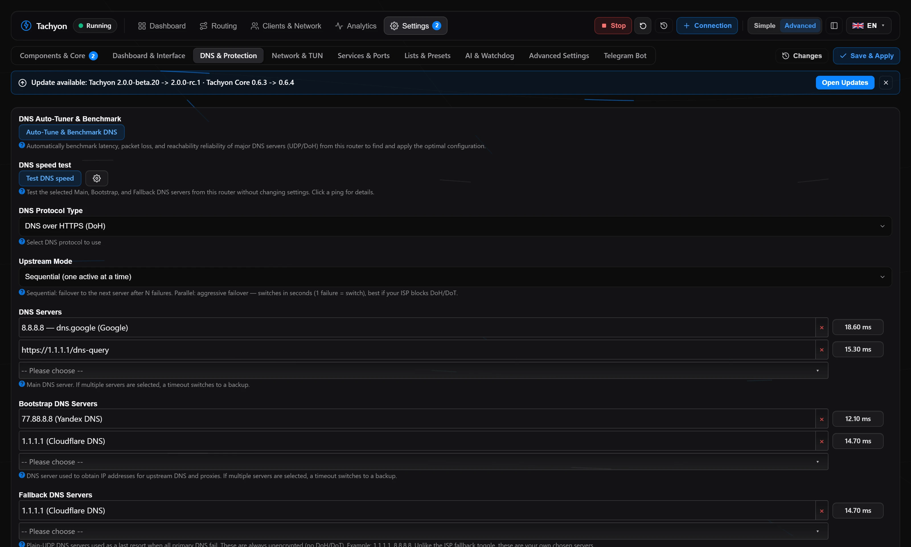
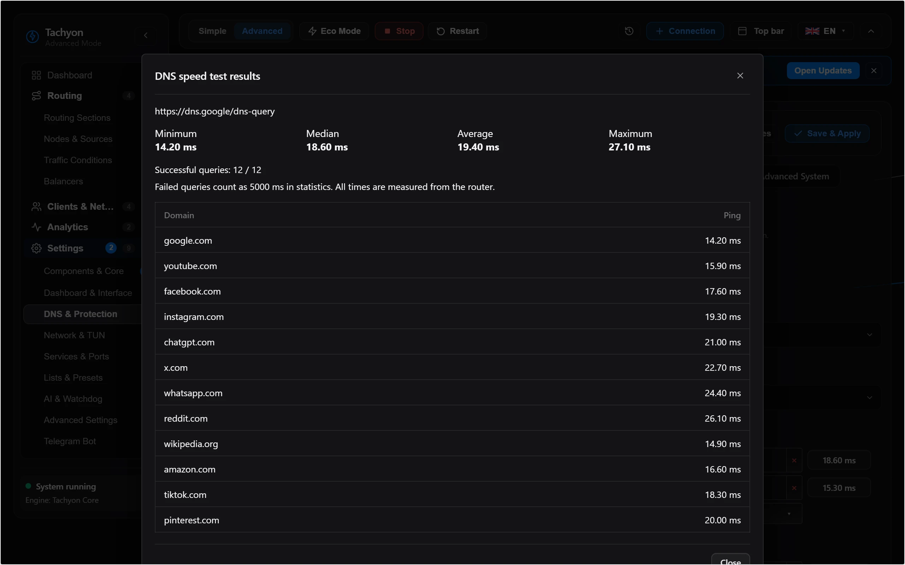

# DNS, FakeIP, Hosts, and AdGuard Home

[Русский](../ru/05-dns-hosts-adguard.md) | [Back to Index](README.md)

Reliable, low-latency DNS resolution without leaks is essential for domain-based routing. Under `Settings -> DNS & Protection`, you configure upstream resolvers, encryption protocols, caching, and the built-in `FakeIP` engine.

## DNS Transport Types and Upstream Modes

Supported outbound DNS protocols (`dns_type`):

- **DoH (`doh`)**: DNS over HTTPS (`https://dns.google/dns-query`, `https://1.1.1.1/dns-query`, custom DoH endpoints).
- **DoT (`dot`)**: DNS over TLS (`tls://...`, port `853`).
- **DoQ (`doq`)**: DNS over QUIC.
- **UDP (`udp`)**: Plain UDP DNS for local resolvers or trusted networks.

Failover and resolution resilience controls:
- **`DNS Servers` (`dns_servers`)**: primary resolvers paired with **`DNS Upstream Mode`** — *Sequential* (switches after consecutive failures) or *Parallel* (fast concurrent failover).
- **`Bootstrap DNS` (`bootstrap_dns_servers`)**: numeric IPv4/IPv6 addresses (`77.88.8.8`, `1.1.1.1`, `8.8.8.8`) used to resolve hostnames of encrypted DoH/DoT endpoints at startup.
- **`Fallback DNS` (`dns_fallback_servers`)**: backup resolvers queried if all primary servers fail.

## Caching and FakeIP

- **Local DNS Cache (`dns_local_cache`)** and **Turbo Cache (`dns_turbo_cache`)**: cache responses in router RAM to eliminate redundant external lookups and speed up page loads.
- **FakeIP (`fakeip_enabled`)**: instructs `tachyon-core` to immediately issue virtual addresses from isolated pools `198.18.0.0/15` (IPv4) and `fc00::/18` (IPv6) without blocking on external DNS queries for proxied domains. Route matching happens deterministically at packet handoff via the internal mapping table.
- **FakeIP Exclusions**: local domains, private CIDRs, and specific hosts can be excluded so clients always receive real A/AAAA records.
- **Intercept All DNS Queries (`dns_intercept_all`)**: redirects outbound client traffic targeting port 53 (such as Smart TVs or devices with hardcoded DNS) into Tachyon via `nftables`, keeping routing tables consistent and preventing DNS leaks.

## DNS Speed Test and Auto-Benchmarking

Two router-side measurement tools are built directly into `DNS & Protection`:

1. **Benchmark & Select Optimal DNS (`dns_benchmark`)**: measures latency and packet loss from the router across standard DoH/UDP resolvers and suggests an optimal primary/bootstrap/fallback combination.
2. **Test DNS Speed (`dns_speed_test`)**: tests your configured resolvers against a 12-domain probe set (`google.com`, `youtube.com`, `wikipedia.org`, etc.). Clicking the latency pill beside any DNS server opens the full statistics modal (min, median, average, max, and success ratio).

## Ad Blocking, Hosts Engine, and AdGuard Home

- **Built-in Hosts Engine (`hosts_enabled`, `hosts_block_ads`)**: loads ad-blocking and tracking domain lists natively inside `tachyon-core` without running an extra heavy process; blocked-query counters appear in `Analytics -> Live Monitoring` (`1h`, `24h`, `7d`, `All`).
- **External DNS / AdGuard Home Coexistence**: when running AdGuard Home on the router alongside Tachyon, Tachyon coordinates `Dnsmasq / AdGuard -> tachyon-core` forwarding cleanly while preserving client IP attribution and domain filtering.

---

[Previous: Routing Sections, Conditions, .trs Lists, and Balancers](04-routing-sections-balancers.md) | [Back to Index](README.md) | [Next: Inbound Servers and Tailscale](06-inbound-servers-tailscale.md)
