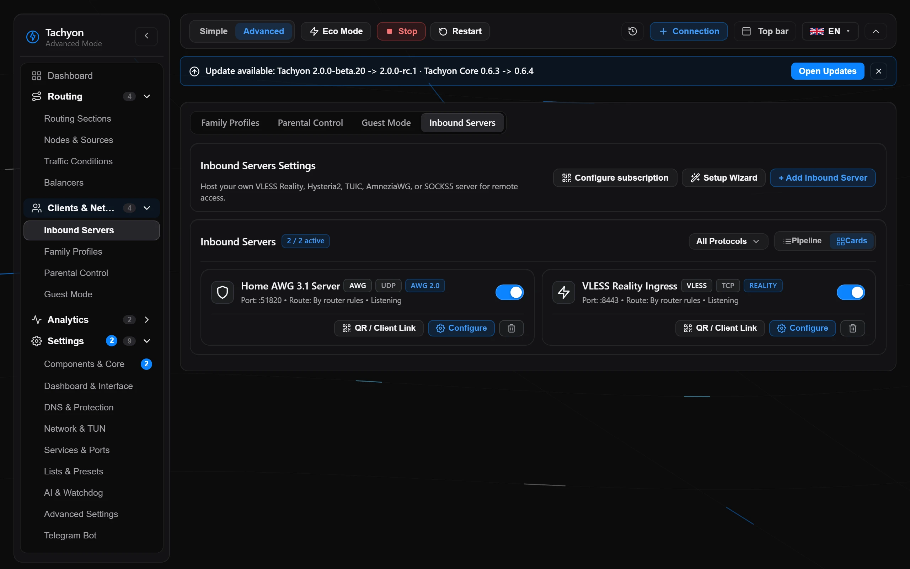

# Inbound Servers and Tailscale

[Русский](../ru/06-inbound-servers-tailscale.md) | [Back to Index](README.md)

In addition to routing outbound traffic, Tachyon 2.0 can host encrypted **Inbound Servers** directly on the router for secure remote access to your home LAN or routing sections. Manage them under `Clients & Net... -> Inbound Servers`.

## Supported Inbound Server Protocols (`server`)

`tachyon-core` supports the following server transports:

- **L3 / UDP Tunnels**: `AmneziaWG` (`awg` with obfuscation versions 2.0 / 3.0 / 3.1), `WireGuard`, built-in `Tailscale`.
- **Proxy and Modern Transports**: `VLESS` (including `Reality` + `Vision` / `gRPC` / `XHTTP`), `VMess`, `Trojan`, `Shadowsocks`, `Hysteria2`, `TUIC`, `AnyTLS`, `ShadowTLS`, `NaiveProxy`, `Mieru`, `Snell`, `OpenConnect`, `MASQUE`, `TrustTunnel`, `FPTN`, `MTProto`, `Mixed` / `SOCKS` / `HTTP`, custom `json_inbound`.

## Creating a Server and Opening Firewall Ports

1. Click **`+ Add a server inbound`** (or launch the quick server wizard).
2. Set a label, protocol, listen address (`0.0.0.0` or specific WAN interface), port (`listen_port`, or range `listen_port_range`), and public hostname/IP (`public_host`).
3. Enable **`Open firewall port`** (`open_firewall_port`) so Tachyon automatically manages `nftables` WAN ingress rules without manual `/etc/config/firewall` edits.
4. For **VLESS Reality**, specify target `sni` and generate or enter a keypair; for **AmneziaWG**, configure obfuscation parameters and client subnet allocation.

## Server Subscriptions and QR Provisioning

Two client-provisioning helpers are built directly into the Inbound Servers view:

- **`QR / Connection`** on each server card generates a client share URI or `.conf` profile along with a scannable QR code.
- **`Configure subscription`** in the header enables a hosted subscription endpoint (`server_subscription_enabled`, protected by `server_subscription_token`) that bundles all active router inbounds into a single client-updatable link.

## Built-in Tailscale Node

Under `Settings -> Services & Ports` and inbound settings, Tachyon provides native **Tailscale** integration:

- **`tailscale_enabled`**: runs the embedded Tailscale stack inside `tachyon-core` without requiring a separate standalone `tailscaled` daemon.
- **`tailscale_web_access`**: controls access to the Tachyon/LuCI management UI over your tailnet.
- Current state (`Running`), tailnet DNS hostname (`*.ts.net`), connected peers, online indicators, and RX/TX byte counters are surfaced on the Dashboard and Diagnostics pages.

---

[Previous: DNS, FakeIP, Hosts, and AdGuard Home](05-dns-hosts-adguard.md) | [Back to Index](README.md) | [Next: Packet Desynchronization and Fuzzer](07-desync-fuzzer.md)
