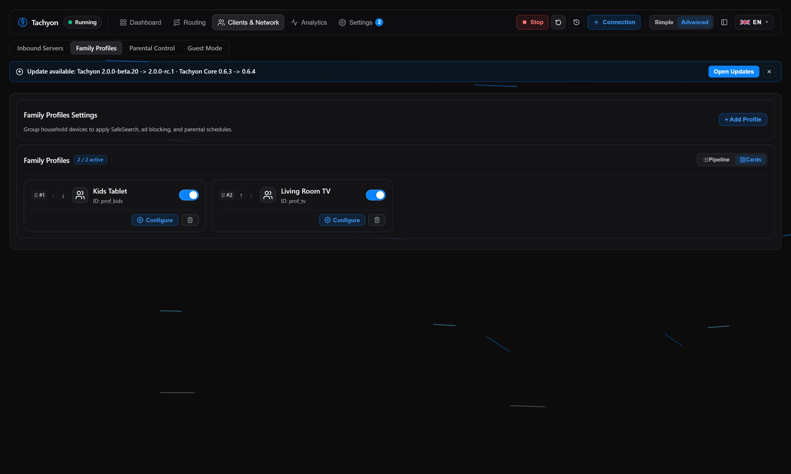
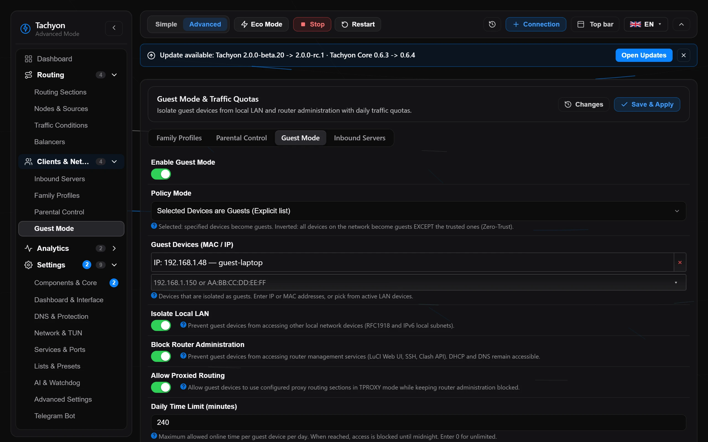

# Devices, Parental Control, Guest Mode, and QoS

[Русский](../ru/08-devices-parental-guest-qos.md) | [Back to Index](README.md)

The `Clients & Net...` menu groups LAN client tracking, family filtering and screen-time quotas, isolated guest networking, and traffic prioritization.

## Family Profiles and Parental Control

Under `Clients & Net... -> Family Profiles`, LAN devices are grouped into reusable profiles (`ParentalProfile`) so quotas and content policies apply consistently across a household member's devices.

### Family Profile Features (`profile`)

- **Device Assignment (`device_ips`)**: pick discovered LAN hosts or enter IPv4 addresses and persistent MAC addresses (`AA:BB:CC:DD:EE:FF`, resilient to DHCP lease renewals).
- **Daily Screen-Time Quota (`daily_quota_minutes`)**: daily active network allowance in minutes (`0` for unlimited); once exhausted, access is blocked until midnight.
- **SafeSearch (`safe_search`)**: enforces Google, Yandex, Bing, DuckDuckGo SafeSearch and YouTube Strict Restricted Mode via DNS rewrite.
- **Block Encrypted DNS (`block_doh`)**: drops port `853` (DoT) and known public DoH/Private Relay endpoints for devices in the profile so DNS policies cannot be bypassed.
- **Profile Blocked Sites (24/7)**: always-blocked domain list and quick category presets for the profile.
- **Telegram Alerts**: notifies parent admins when a profile hits its daily time cap or attempts to reach a blocked site.

### Schedule Rules (`schedule`)

Under `Clients & Net... -> Parental Control`, time-window rules (for example, *Kids Bedtime Window* `22:00–07:00` on weekdays) can block internet access completely or pause specific routing sections for assigned profiles or individual IP/MAC targets.

## Guest Mode (`guest_mode`)

Under `Clients & Net... -> Guest Mode`, Tachyon isolates visitor devices from your internal network and router admin interface without requiring a separate hardware VLAN.

### Guest Mode Options

- **Policy Mode (`mode`)**:
  - *Selected Devices* (`selected`): only entries in `guest_devices` are isolated.
  - *Inverted / Zero-Trust*: all LAN clients are treated as guests except those explicitly listed in `trusted_devices`.
- **Isolate Local LAN (`isolate_lan`)**: drops guest traffic targeting RFC1918 subnets and local IPv6 prefixes.
- **Block Router Admin Access (`block_router_admin`)**: denies guest access to LuCI Web UI, SSH, and Clash API ports while keeping DHCP and DNS operational.
- **Allow Proxy Routing (`allow_proxy`)**: controls whether guests can traverse TProxy routing sections or exit exclusively via direct WAN.
- **Bandwidth and Usage Quotas**:
  - Per-guest speed limit in Mbps (`bandwidth_limit_mbps`).
  - Daily time cap (`daily_time_limit`, minutes) and daily data cap (`daily_traffic_limit`, MB).
  - Active schedule window (`start_time` to `end_time`).

## Smart Queue (SQM) and TCP BBR

Under `Settings -> Network & TUN`, Tachyon provides latency protection under heavy link saturation (bufferbloat mitigation):

- **`smart_queue`**: `tachyon-core`'s integrated CAKE-lite packet scheduler prioritizing DNS queries, TLS/TCP handshakes, voice calls, and gaming flows ahead of bulk downloads. Configure the WAN interface (`sqm_interface`) and download/upload shaping rates (`sqm_download_kbps`, `sqm_upload_kbps`).
- **`tcp_bbr` and `tcp_profile`**: enables TCP BBR congestion control and kernel TCP tuning profiles to sustain throughput over high-RTT links.

---

[Previous: Packet Desynchronization and Fuzzer](07-desync-fuzzer.md) | [Back to Index](README.md) | [Next: Monitoring, Diagnostics, and AI](09-monitoring-diagnostics-ai.md)
