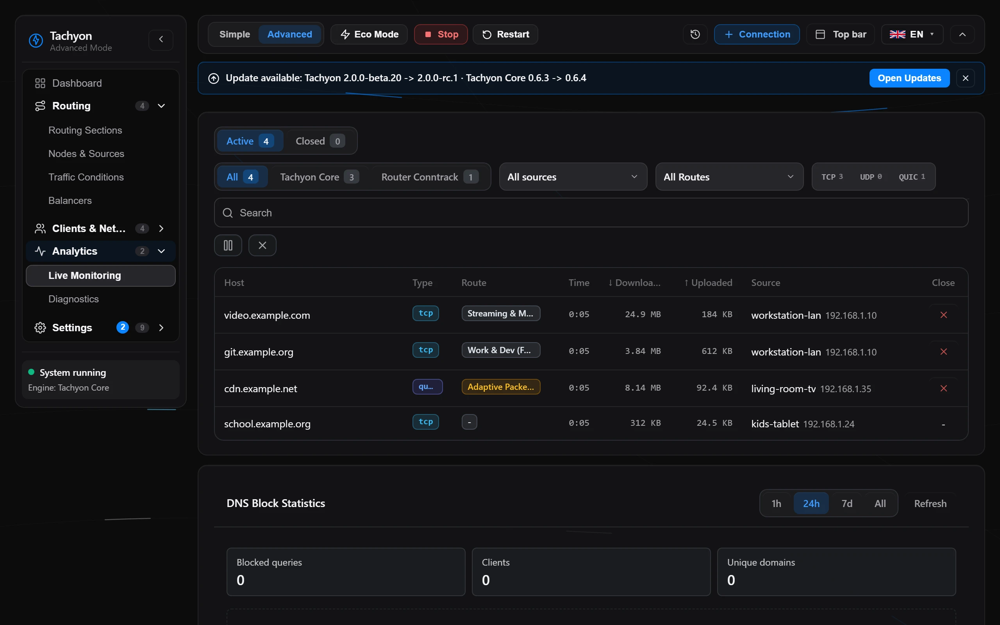
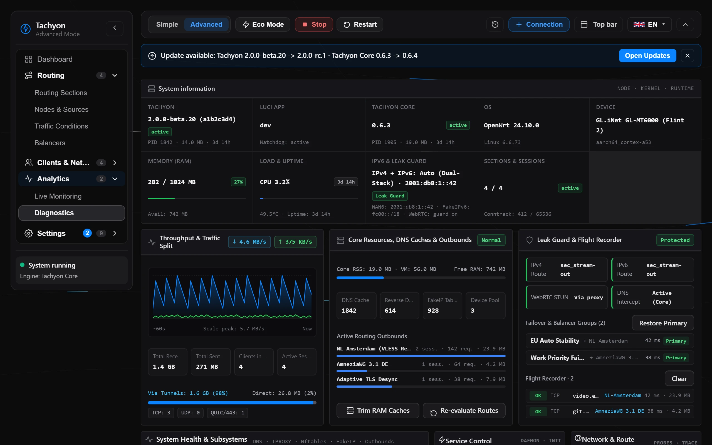

# Monitoring, Diagnostics, and AI

[Русский](../ru/09-monitoring-diagnostics-ai.md) | [Back to Index](README.md)

The `Analytics` menu brings together live session telemetry, DNS block statistics, subsystem verification, and AI-assisted root-cause diagnostics.

## Live Monitoring (`Analytics -> Live Monitoring`)

- **Active & Closed Connections**: real-time table showing target host/SNI, transport (`TCP`, `UDP`, `QUIC`), matched routing section, connection duration, download/upload byte counters, and source LAN device (hostname + IP).
- **Source Filters**: filter across `All`, `Tachyon Core` streams, or Linux kernel `Router Conntrack` direct flows, plus filters by client device, route, protocol, and search query.
- **Stream Control**: close individual stale connections (`×`) or pause live updates while inspecting a snapshot.
- **DNS Block Statistics**: period breakdown (`1h`, `24h`, `7d`, `All`) showing blocked query count, unique clients, top blocked domains, matched rules, and source lists.

## Diagnostics, Core Resources, and Flight Recorder (`Analytics -> Diagnostics`)

### Live Telemetry Cards

1. **System Information**: installed versions of `Tachyon`, `LuCI App`, `Tachyon Core`, OpenWrt release and router model, RAM (`used / total MB`), CPU load, uptime, active/total sections, `conntrack` usage, and `IPv6 + Leak Guard + FakeIPv6 + WebRTC` state.
2. **Throughput & Traffic Split**: 60-second TX/RX throughput graph and ratio of tunneled vs direct WAN traffic.
3. **Core Resources, DNS Caches & Outbounds**: `tachyon-core` RSS and VM footprint, DNS cache / Reverse DNS / FakeIP table entry counts, device pool size, and per-outbound active sessions, hit counts, and transferred volume. Instant buttons for **`Trim RAM Caches`** and **`Re-evaluate Routes`**.
4. **Leak Guard & Flight Recorder**:
   - Contour leak checks across `IPv4`, `IPv6`, `WebRTC STUN`, and DNS interception.
   - Balancer health and failover groups with a **`Restore Primary`** trigger.
   - **Flight Recorder** tracing recent connections, matched rules, latencies, and handshake failures.

### System Doctor and Subsystem Probes

The lower section provides one-click verification suites:
- **`check_dns_available`**, **`check_fakeip`**, **`check_nft`**, **`check_tachyon_core`**, **`check_inbounds`**, **`check_dns_leak`**, and **`check_ip_leak`**.
- Unified **`Doctor` (`diagnose_json`)** audit and automated remediation via **`Apply Quick Fix` (`apply_quick_fix`)**.

## AI Doctor and Local RAG

When **`enable_ai_doctor`** is enabled under `Settings -> AI & Watchdog`, Tachyon compiles an anonymized state snapshot (service health, routing summary, quarantined sections, engine logs, and DNS/IPv6/nftables probe results) for automated analysis:

- **Local RAG Mode (`enable_rag`)**: matches observed failure patterns against the built-in OpenWrt/Tachyon knowledge base and computes a `0–100` health score and actionable fix list without sending sensitive credentials off the router.
- **External LLM Providers**: optionally pair with an OpenAI-compatible provider, model (`ai_doctor_model`, e.g. `gpt-4o-mini`), and API key to receive natural-language diagnostic reports in the selected language (`ai_doctor_lang`).

---

[Previous: Devices, Parental Control, Guest Mode, and QoS](08-devices-parental-guest-qos.md) | [Back to Index](README.md) | [Next: Telegram Bot and Fleet Management](10-telegram-bot.md)
