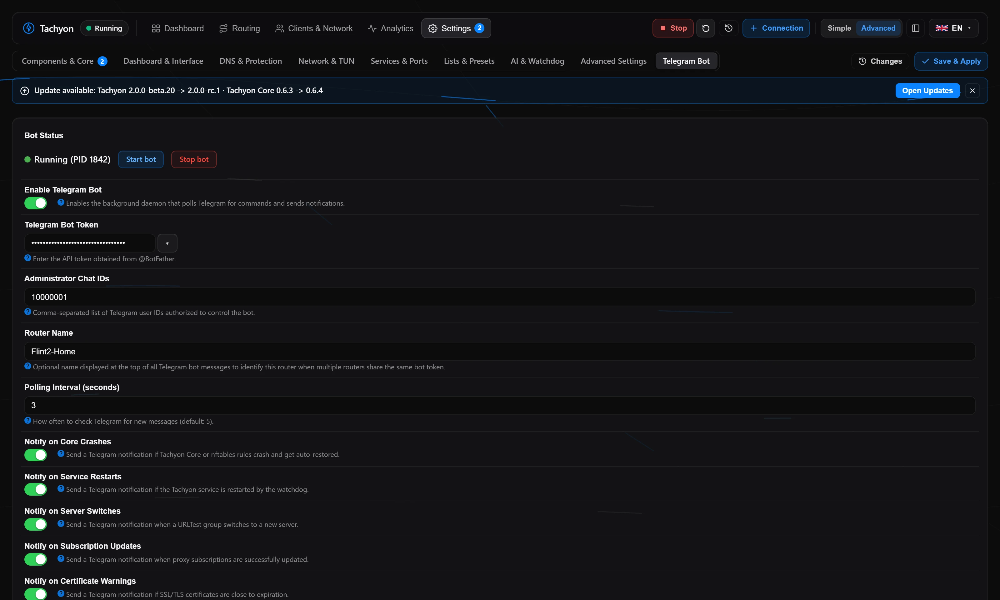

# Telegram Bot and Fleet Management

[Русский](../ru/10-telegram-bot.md) | [Back to Index](README.md)

Tachyon 2.0 embeds a native Telegram bot running directly inside `/usr/bin/tachyon` (with zero external interpreters or cron scripts). Configure it under `Settings -> Telegram Bot`.

## Initial Setup and Access Control

1. Create a bot token via `@BotFather` and paste it into **`Telegram Bot Token`** (`bot_token`).
2. Add your numeric Telegram user ID (or a comma-separated list) under **`Admin Chat IDs`** (`admin_ids`). Commands from unauthorized users are silently ignored.
3. Set **`Router Name`** (`router_name`) — prepended to outgoing bot messages to distinguish multiple routers in one chat.
4. Configure **`Polling Interval`** (`poll_interval`, default 5s) and optionally route Telegram API requests through a designated section (`bot_proxy_section`) with direct WAN fallback (`bot_direct_fallback`).
5. Enable **`Enable Telegram Bot`** and apply the configuration.

## Event Notifications and Quiet Hours

Granular real-time alerts can be toggled independently in settings or via `/notifications`:

- Engine restarts/crashes (`notify_crash`, `notify_restart`) and Watchdog recoveries.
- Failover / server switches (`notify_server_switch`, `notify_failover`) and WAN link events (`notify_wan`).
- Subscription updates (`notify_subscription`) and new component releases (`notify_update_available`, `notify_auto_update`).
- DNS leaks (`notify_dns_leak`), route alerts (`notify_route_alert`), `Smart Detect` events (`notify_smart_detect`), parental alerts (`notify_parental`), certificate alerts (`notify_cert`), and `honeypot` triggers (`notify_honeypot`).
- **Quiet Hours** (`/quiet`, `quiet_hours_enabled`, `quiet_hours_start` / `quiet_hours_end`) suppress alerts during your configured schedule window.

## Router Fleet Management (`managed_routers`)

Add peer OpenWrt routers running Tachyon to **`managed_routers`** using their address, port, and API token. Use **`/routers`** in Telegram to switch the bot's active control target across your fleet or inspect fleet-wide status summaries.

## Complete Telegram Bot Command Reference

### Navigation and System Overview
| Command | Description |
|---|---|
| `/start`, `/menu`, `/help` | Open interactive control keyboard |
| `/status`, `/core` | System, software versions, memory, CPU load, and core uptime summary |
| `/cancel` | Cancel active multi-step prompt and return to main menu |

### Routing, Nodes, and Inbound Servers
| Command | Description |
|---|---|
| `/sections` (`/sec`, `/rules`) | List routing sections, toggle states, and switch active nodes |
| `/sources` (`/subs`, `/outbounds`) | Inspect outbound sources and trigger subscription updates |
| `/ping` | Run latency probes across active outbound nodes |
| `/failover` | Show balancer and priority failover tier status |
| `/servers` (`/srv`) | View and manage hosted inbound servers |
| `/fptn` | Quick FPTN parameter/token shortcut |

### Engine and Live Session Control
| Command | Description |
|---|---|
| `/start_core` | Start the `tachyon-core` process |
| `/stop_core` | Stop the `tachyon-core` process |
| `/restart` (`/reload`) | Recompile config and reload or restart `tachyon-core` |
| `/close_conns` | Close all active connections |
| `/trim_ram` | Trim core DNS/memory caches immediately |
| `/watchdog` | Toggle background Watchdog monitoring |

### Diagnostics, DNS, and Desync Fuzzer
| Command | Description |
|---|---|
| `/doctor` | Run system diagnostics (`run_local_doctor`) |
| `/ai_doctor` | Trigger AI Doctor log and config audit |
| `/fix` | Access automated Quick Fix actions |
| `/trace` | Simulate route selection (`route_explain`) for a domain or IP |
| `/dns` | Inspect and toggle DNS configuration |
| `/leak` | Run DNS / IPv6 / WebRTC leak verification |
| `/fuzzer` | Run packet desynchronization strategy fuzzer |
| `/logs` | View recent daemon and core log lines |
| `/support` | Build and upload a redacted `support_bundle` directly to chat |

### LAN Devices, Family, and Guests
| Command | Description |
|---|---|
| `/devices` | List LAN devices, bandwidth, and rule assignments |
| `/wol` | Send a Wake-on-LAN Magic Packet to a LAN device |
| `/parental` | Manage family profiles and daily quotas |
| `/schedules` | View and toggle schedule windows |
| `/guest` | View and toggle Guest Mode |

### Backups, Updates, and Bot Preferences
| Command | Description |
|---|---|
| `/snapshots`, `/backup` | List saved configuration snapshots or trigger a manual backup |
| `/lkg`, `/rollback` | Inspect Last Known Good (LKG) snapshot and roll back immediately |
| `/updates`, `/update_lists` | Check component updates and refresh `.trs` rule-set lists |
| `/routers` | Switch target router or check fleet status |
| `/notifications` (`/notify`), `/quiet` | Configure event alerts and quiet-hours schedule |
| `/toggles` (`/features`) | Toggle global router features |
| `/bot_settings`, `/lang`, `/name` | Manage bot settings, switch UI language (`ru`/`en`), or rename router |

---

[Previous: Monitoring, Diagnostics, and AI](09-monitoring-diagnostics-ai.md) | [Back to Index](README.md) | [Next: Updates, Channels, and System Settings](11-updates-settings.md)
