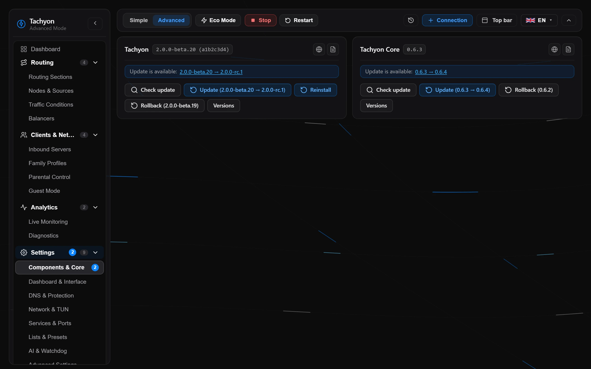
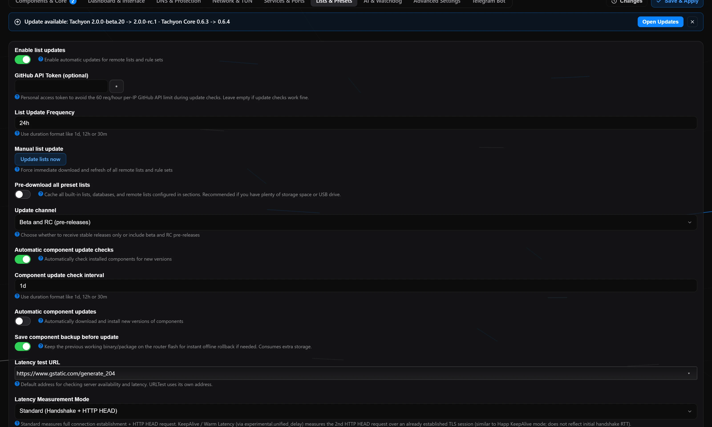
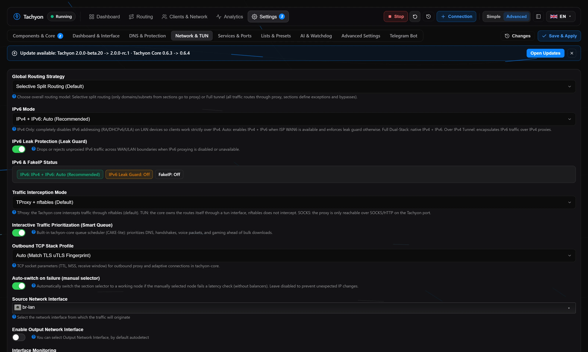

# Updates, Channels, and System Settings

[Русский](../ru/11-updates-settings.md) | [Back to Index](README.md)

Tachyon 2.0 separates version management for **`Tachyon`** and **`Tachyon Core`**, supports explicit release channel selection aligned with staged pre-release testing, and safeguards router NAND flash longevity.

## Component Updates and Offline Rollback

Open `Settings -> Components & Core` to inspect installed versions, pending updates, and local rollback backups.

### Component Card Actions

- **`Check for Update`**: queries GitHub Releases according to the configured release channel and refreshes local update state.
- **`Update (...)`**: downloads the matching architecture package (`ipk`/`apk`) or `tachyon-core` binary, verifies its `SHA-256` checksum, stores the current working binary as a local backup (when enabled), and restarts services cleanly.
- **`Rollback (...)`**: instantly restores the previously saved working component version directly from flash without internet connectivity.
- **`Versions`**: lists recent releases and pre-releases for manual installation of a specific tag.
- **`Reinstall`**: refreshes installed Tachyon package files in place.

## Release Channel Selection and Update Notifications

Every Tachyon family component follows a staged release pipeline: **pre-releases (`beta`, then `rc`) are published first for validation before promotion to `stable`**.

Open `Settings -> Lists & Presets` to configure update checks and channel policy:

- **`Update channel` (`component_update_channel`)**:
  - `auto` — tracks the tier matching the currently installed version (pre-releases track pre-releases; stable installs track stable).
  - `stable` — receive final stable releases only.
  - `beta` — include `beta` and `rc` pre-release builds.
- **`Automatic component update checks` (`component_update_check_enabled`)** and **`Check interval`** (`component_update_check_interval`, e.g. `1d` or `12h`).
- **`Automatic component updates`**: optional background installation of verified releases.
- **`Save component backup before update` (`component_backup_enabled`)**: retains the previous binary/package for offline rollback when storage permits.
- **Visible Update Alerts**: whenever any component has a newer version on the active channel, the UI displays a dismissible top notification banner with a direct **`Open Updates`** action, alongside update-count badges on `Settings` and `Components & Core` in the sidebar.

## Network, IPv6, Flash Wear Protection, and Advanced Settings

Under `Settings -> Network & TUN`, you configure core packet interception and system resilience parameters:

### Core Subsystems

- **Traffic Interception Mode (`proxy_mode`)**:
  - `tproxy` (*default*): transparent `nftables`-driven redirection (`inet TachyonTable`) avoiding user-space TUN encapsulation overhead.
  - `tun`: dedicated L3 TUN device (`tun0`, `mixed` stack, configurable MTU and `172.19.0.1/30` subnet, optional `tun_kill_switch`), useful when `kmod-nft-tproxy` is unavailable or strict interface isolation is desired.
- **IPv6 Mode (`ipv6_mode`) and `Leak Guard` (`ipv6_leak_guard`)**:
  - `off` — IPv4-only on LAN clients.
  - `auto` (*recommended*) — enables Dual-Stack when WAN6 is healthy and drops unprotected WAN/LAN IPv6 traffic otherwise.
  - `dual_stack` / `tunnel_over_v4` — enforces native Dual-Stack or IPv6-over-IPv4 proxy encapsulation.
- **WebRTC Leak Protection (`webrtc_leak_protect`)**: protects against STUN/TURN peer IP discovery inside browser sessions.
- **Watchdog (`enable_watchdog`)** and **Smart Detect (`smart_detect`)**: monitors `tachyon-core` and `nftables` health with auto-recovery, and tracks domains experiencing repeated connection failures (`suggest` or automatic modes).
- **Last Known Good (LKG) & Snapshots**: captures verified configuration snapshots prior to changes (`tachyon rollback` or UI Changes menu).
- **NAND Flash Wear Protection (`flash_wear_protection`)**:
  - Runtime telemetry, caches, Flight Recorder, Blackbox dumps, and logs remain strictly on `tmpfs` (`/var/run/tachyon/` and `/tmp/`).
  - Persistent writes to `/etc/tachyon/` pass through `write_json_if_changed`, skipping disk writes when serialized content is byte-identical.

---

[Previous: Telegram Bot and Fleet Management](10-telegram-bot.md) | [Back to Index](README.md) | [Next: Troubleshooting and FAQ](12-troubleshooting-faq.md)
