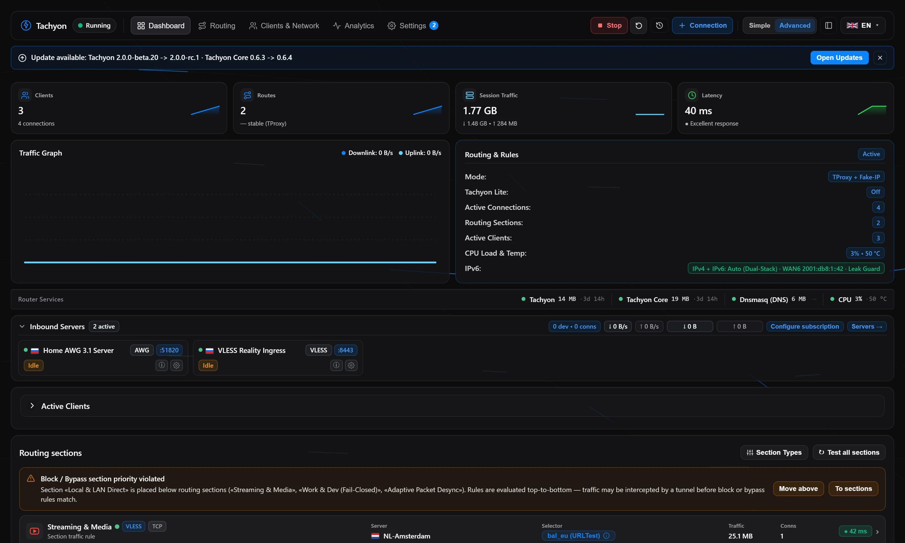

# Tachyon 2.0 Documentation

Language: [Русский](../ru/README.md) | **English**

**Tachyon 2.0** is a network routing, DNS filtering, tunneling, and adaptive packet delivery orchestration platform for OpenWrt routers.

## Version 2.0 Architecture

Branch `2.0` runs as a single native Rust service (`/usr/bin/tachyon`) paired with the built-in packet routing engine `tachyon-core` (`/usr/bin/tachyon-core`).

| Component | Path | Purpose |
|---|---|---|
| `tachyon` daemon and CLI | `/usr/bin/tachyon` | Route orchestration, `nftables` rules, DNS integration, Telegram bot, Agent REST API, MCP server, standalone web server, and LuCI `ubus` bridge |
| `tachyon-core` routing engine | `/usr/bin/tachyon-core` | Packet forwarding (TProxy / TUN), outbound and inbound transports, FakeIP, DoH/DoT/DoQ, balancers, and native packet desynchronization |
| Primary configuration store | `/etc/tachyon/tachyon.json` | Unified JSON store for global settings, sections, conditions, outbound sources, balancers, inbound servers, profiles, schedules, and Telegram settings |
| UCI compatibility view | `/etc/tachyon/config_sections.json` | Configuration projection consumed by LuCI web views |
| Generated engine config | `/etc/tachyon-core/config.json` | Compiled `tachyon-core` runtime configuration regenerated on startup and apply |
| Rule sets | `.trs` by default | Native binary `.trs` rule-set format (`tachyon-lists`), with `.srs` fallback compatibility for user-supplied links |

## Table of Contents

| # | Chapter | Summary |
|---|---|---|
| 01 | [Installation and 1.x Migration](01-installation.md) | OpenWrt requirements (`opkg` and `apk`), `install.sh` flags, migrating from Tachyon 1.x via `import-legacy`, release channels |
| 02 | [Quick Start](02-quickstart.md) | Accessing LuCI and the standalone UI, Dashboard tour, Quick Connection Wizard, route verification |
| 03 | [Outbound Sources and Protocols](03-outbounds-protocols.md) | Subscriptions, share URIs (`VLESS`, `Hysteria2`, `WDTT`, etc.), `AmneziaWG 2.0/3.0/3.1`, `WARP`, `FPTN`, `TrustTunnel`, `AnyTLS`, `NaiveProxy` |
| 04 | [Routing Sections, Conditions, .trs Lists, and Balancers](04-routing-sections-balancers.md) | Section priority, Fail-Closed / Kill-Switch, boolean conditions (`AND/OR/NOT`), `.trs` rule sets, all 14 balancer modes |
| 05 | [DNS, FakeIP, Hosts, and AdGuard Home](05-dns-hosts-adguard.md) | DoH/DoT/DoQ, Bootstrap & Fallback DNS, local/Turbo cache, FakeIP, DNS interception, DNS Speed Test, and ad filtering |
| 06 | [Inbound Servers and Tailscale](06-inbound-servers-tailscale.md) | Hosting VPN/proxy servers on the router, server subscription URLs and QR codes, automatic firewall ports, built-in Tailscale |
| 07 | [Packet Desynchronization and Fuzzer](07-desync-fuzzer.md) | Native packet desynchronization in `tachyon-core`, split/fooling controls, `adaptive` presets, auto-tuning for middlebox characteristics |
| 08 | [Devices, Parental Control, Guest Mode, and QoS](08-devices-parental-guest-qos.md) | LAN device registry, family profiles, SafeSearch, DoH/DoT blocking, schedules, guest isolation, Smart Queue (SQM), and TCP BBR |
| 09 | [Monitoring, Diagnostics, and AI](09-monitoring-diagnostics-ai.md) | Live sessions and DNS block stats, System Doctor, IPv6/WebRTC leak checks, AI Doctor with local RAG, Flight Recorder |
| 10 | [Telegram Bot and Fleet Management](10-telegram-bot.md) | Bot token setup, `admin_ids`, event notifications, multi-router `fleet_routers`, full command reference |
| 11 | [Updates, Channels, and System Settings](11-updates-settings.md) | Release channel selection (`auto`, `stable`, `beta` with `rc`), update notifications, backups/rollback, flash wear protection, TProxy vs TUN, IPv6 Dual-Stack |
| 12 | [Troubleshooting and FAQ](12-troubleshooting-faq.md) | Section quarantine recovery, DNS/FakeIP/IPv6 diagnostics, LKG rollback, RAM/Flash optimization, `support_bundle`, 1.x-to-2.0 FAQ |
| 13 | [CLI and Configuration Reference](13-cli-and-config.md) | All `/usr/bin/tachyon` subcommands, `/etc/tachyon/tachyon.json` schema, runtime paths in `/var/run/tachyon/` |
| 14 | [Agent REST API and MCP Server](14-api-and-mcp.md) | `/api/agent/v1/*` endpoints, OpenAPI spec, connecting MCP clients over `stdio` and HTTP |

## Management Interfaces

- **LuCI**: `Services -> Tachyon` inside the standard OpenWrt web interface.
- **Standalone Web UI**: port `1680` (default path `/tachyon`, configurable via `settings.listen_addr` and `settings.listen_port`).
- **CLI and local tooling**: `/usr/bin/tachyon` over SSH.
