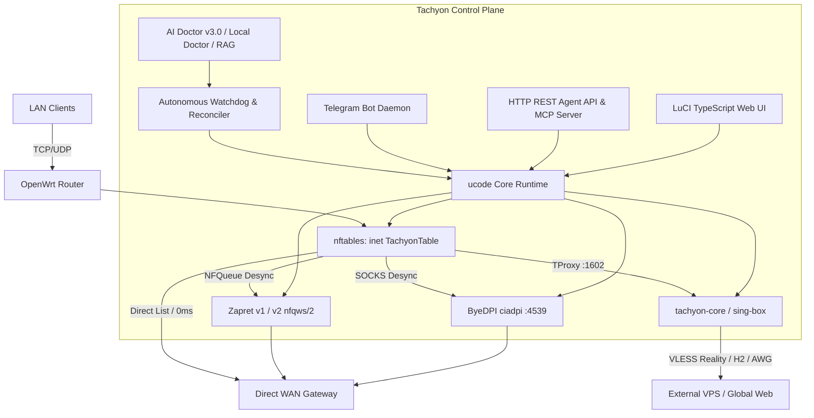

# 01. System Architecture & Core Concepts

## 1. High-Level Overview

**Tachyon** is an enterprise-grade, lightweight traffic orchestration, multi-protocol proxying, and packet desynchronization platform built natively for **OpenWrt** (supporting 23.05, 24.10, 25.x, and SNAPSHOT).



---

## 2. Core Architectural Pillars

### 2.1. Native ucode Runtime (Zero Heavy Runtimes)
* All control plane logic, UCI manipulation, config generation, health checks, and JSON APIs are written in **ucode**, OpenWrt's native C-like scripting language.
* **Benefits**:
  * Consumes $\approx$ 1–3 MB RAM (contrasted with 30–60 MB for Python/Node).
  * Executes directly in C-speed with native bindings to `libuci`, `libubus`, `libblobmsg`, and posix syscalls (`fs`, `math`, `socket`).
  * Runs on routers with as little as 128 MB RAM.

### 2.2. Deterministic State, Flash-Wear Protection & Atomic Transactions
* All file writes funnel through `write_file()`, `write_json_file()`, and `copy_file()` in `core/common.uc`, which check `content_unchanged()` before touching NAND flash and use atomic temp-file + `fs.rename()` replacement.
* Multi-step mutations (UCI, generated configs `/etc/tachyon-core/config.json`, init scripts, firewall tables) execute inside `core/transaction.uc` (8-phase `PLAN -> PREFLIGHT -> SNAPSHOT -> MUTATE -> VALIDATE -> ACTIVATE -> VERIFY -> COMMIT` engine with LIFO rollback) and are guarded by Last Known Good (`service/known_good.uc`) and declarative drift repair (`service/reconciler.uc`).

### 2.3. Dual Control Interfaces: LuCI & Headless Telegram/REST/MCP
1. **LuCI Web UI**: Modern TypeScript SPA (`fe-app-tachyon`) compiled into LuCI JS assets (`luci-app-tachyon`).
2. **Interactive Telegram Bot**: Embedded polling daemon (`service/telegram.uc`) with inline keyboards for server switching, rule updates, and instant diagnostics.
3. **HTTP REST Agent API & MCP Server**: Secure CGI endpoint (`/cgi-bin/tachyon-agent/`) with OpenAPI 3.0.3 spec and JSON-RPC 2.0 Model Context Protocol (`service/agent_mcp.uc`) with built-in privacy redaction (`service/support_bundle.uc`) so connected LLMs never see plaintext secrets.

### 2.4. Core Service Contract (`core/process.uc`)
Doctor, status, watchdog, lifecycle and the init-script generators share one contract: procd name `tachyon-core`, init script `/etc/init.d/tachyon-core`, UCI package `tachyon-core`, binaries `/usr/bin/tachyon-core` and `/usr/bin/sing-box`, and the pid files under `/var/run`. Process liveness is verified using triple identity (`pid` + `/proc/<pid>/stat` `starttime` + `/proc/sys/kernel/random/boot_id`) to prevent PID recycling false positives.

---

## 3. Directory Layout & Repository Anatomy

```
tachyon/
├── tachyon/files/                     # Core backend package root
│   ├── etc/
│   │   ├── config/tachyon             # Main UCI configuration (chmod 600)
│   │   ├── init.d/tachyon             # Procd service init script
│   │   └── uci-defaults/              # Post-installation default configs
│   ├── usr/
│   │   ├── bin/tachyon                # Main CLI entrypoint wrapper
│   │   └── lib/tachyon/               # Modular ucode libraries (70+ modules)
│   │       ├── core/                  # Low-level helpers, exec, process, transaction, jobs, events
│   │       ├── service/               # Lifecycle, Watchdog, Reconciler, Known-Good, APIs, MCP, Telegram
│   │       ├── diagnostics/           # AI Doctor, Local Doctor, RAG, Fuzzer, Route Explain, Quick Fixes
│   │       ├── tachyon_core/          # Core config generator, outbounds, routes, DNS, balancers
│   │       ├── providers/             # Zapret v1/v2, ByeDPI, NFQueue, WDTT, OlcRTC, FPTN, Tailscale
│   │       ├── nft/                   # nftables ruleset compiler & applier (inet TachyonTable)
│   │       ├── dns/                   # dnsmasq & DNS routing coordinator, speed test
│   │       ├── components/            # Updater, package catalog, hosts, engine state
│   │       ├── config/                # Validator, migration engine, connections, UCI schema
│   │       ├── subscription/          # Subscriptions fetcher, cache & universal URI parser
│   │       └── torrserver/            # TorrServer direct routing helper
├── luci-app-tachyon/                  # OpenWrt LuCI package
│   ├── htdocs/luci-static/resources/view/tachyon/ # Compiled frontend JS bundle
│   ├── root/etc/uci-defaults/         # LuCI menu registration
│   └── po/                            # Translations (ru, en)
├── fe-app-tachyon/                    # Frontend TypeScript source
│   ├── src/                           # TypeScript SPA source
│   ├── tsup.config.ts                 # Builds and patches LuCI baseclass
│   └── package.json                   # Dependencies (vitest, typescript, tsup)
├── tests/                             # Comprehensive test suite (100+ shell tests)
├── build.sh                           # Release packager (ipk + apk)
├── install.sh                         # One-liner end-user installer
└── docs/                              # Technical documentation & Knowledge Base
```

---

## 4. Key Runtime Processes & Daemons

| Process | Role | Execution Model |
|---|---|---|
| `tachyon-core` / `sing-box` | Core proxying and packet tunneling engine (TProxy `:1602`, DNS `127.0.0.42:53`, Clash API `127.0.0.1:9090`) | Managed by procd (`/etc/init.d/tachyon-core`), identity verified via `core/process.uc` |
| `nfqws` / `nfqws2` | Local TCP/UDP packet desynchronizer (Zapret v1 NFQueue `200+`, Zapret v2 NFQueue `201+` with Lua) | Spawned into background per configured rule |
| `ciadpi` | Local SOCKS5 desync proxy (ByeDPI) | Spawned on `127.0.0.1:4539` (Fuzzer sandbox: `11089`) |
| `watchdog.uc` | State supervision, Reconciler drift repair, LKG observation, OOM guard, Smart Detect | Background periodic daemon (every 5–15s) |
| `telegram.uc` | Telegram Bot Long-Polling Daemon | Procd-supervised background worker |
| `agent_api.uc` / `agent_mcp.uc` | HTTP REST Agent API & MCP Server | Invoked on-demand via `uhttpd` CGI |
