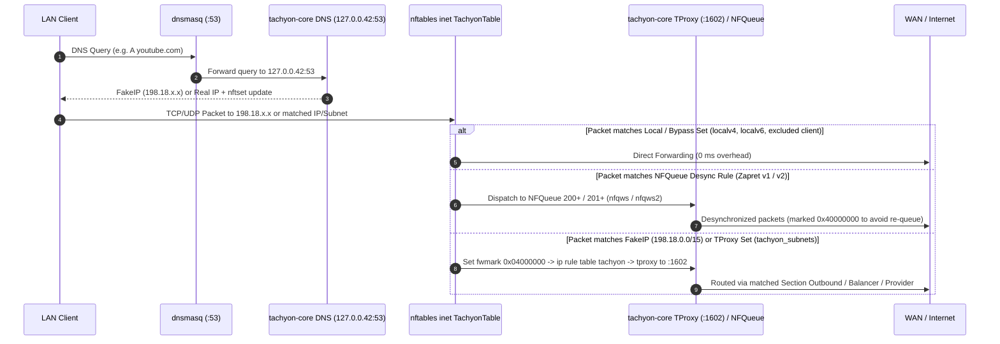

# 03. Networking, nftables & Traffic Routing

## 1. Packet Journey & Routing Lifecycle

Tachyon intercepts traffic at the OpenWrt kernel level using **nftables** (`inet TachyonTable`), **FakeIP / DNS interception** (`127.0.0.42:53`), and policy routing (`ip rule` + routing table `tachyon`, ID `205` in `/etc/iproute2/rt_tables`).



---

## 2. nftables Table Structure (`inet TachyonTable`)

Tachyon encapsulates all its firewall rules inside a dedicated table `inet TachyonTable` (generated by `nft/apply.uc`). This ensures complete isolation from OpenWrt's system `inet fw4` firewall.

### 2.1. Key Sets & Chains

1. **Core Sets in `inet TachyonTable`**:
   * `localv4` / `localv6`: RFC1918 private, loopback, link-local, and multicast ranges that always bypass interception.
   * `tachyon_subnets` / `tachyon_subnets6`: Destination IPv4/IPv6 CIDR subnets routed into TProxy `:1602`.
   * `tachyon_ports` / `tachyon_ip_ports`: Port and IP+Port specific interception sets.
2. **Pre-routing & TProxy Chain**:
   * Intercepts incoming LAN packets on `settings.source_network_interfaces` (default `br-lan`).
   * Excludes bypassed LAN client IPs/MACs and TorrServer direct ports.
   * Redirects FakeIP (`198.18.0.0/15` / `fc00::/18`) and matched destination sets to `tproxy to :1602 meta mark set mark | 0x04000000 accept`.
3. **Output & NFQueue Chains**:
   * Handles router-originated traffic and dispatches packets matching `zapret` / `zapret2` sections to kernel NFQueue (`queue num 200..299 bypass`).
   * Packets emitted by `nfqws` / `nfqws2` carry `NFT_COMMON_MARK = 0x40000000` so they are never queued a second time.

### 2.2. Firewall Marks & Ports Contract (`core/constants.uc`)

| Constant / Resource | Value | Meaning |
|---|---|---|
| `NFT_TABLE_NAME` | `TachyonTable` | Dedicated `inet` nftables table |
| `RT_TABLE_NAME` | `tachyon` (ID `205`) | Policy routing table in `/etc/iproute2/rt_tables` |
| `NFT_FAKEIP_MARK` | `0x04000000` | Packet mark triggering policy routing lookup in table `tachyon` for TProxy `:1602` |
| `NFT_COMMON_MARK` | `0x40000000` | Bypass mark set by `nfqws` / `nfqws2` on desynchronized packets |
| `FUZZER_SANDBOX_MARK` | `0x08000000` | Isolated socket mark routed to NFQueue `298` / `299` during Strategy Fuzzer runs |
| `TProxy Listen Port` | `1602` | `tachyon-core` / `sing-box` TCP+UDP transparent proxy inbound |
| `Core DNS Listen` | `127.0.0.42:53` | `tachyon-core` DNS resolver and FakeIP allocator (`198.18.0.0/15`) |
| `Clash API Listen` | `127.0.0.1:9090` | Local Clash REST API for group selection, RTT probes, and telemetry |
| `ByeDPI SOCKS Port` | `127.0.0.1:4539` | Local SOCKS5 listener for `ciadpi` (sandbox port `11089`) |

---

## 3. DNS Architecture & Bootstrap Deadlock Prevention

### 3.1. DNS Resolution Pipeline (`dns/apply.uc` + `tachyon_core/dns.uc`)

```
[LAN Client DNS Query :53]
            │
            ▼
    [dnsmasq on Router]
            │
            ├─► Forwards upstream to tachyon-core DNS (127.0.0.42:53)
            │
            ▼
  [tachyon-core DNS Engine]
            │
            ├─► Domain in Hosts / Block section ──► Static IP or RCODE 3 (NXDOMAIN)
            ├─► Domain in Direct / Local rules  ──► Direct Bootstrap DNS (e.g. 77.88.8.8)
            └─► Domain in Proxied / FakeIP rule ──► Allocates FakeIP (198.18.x.x) & resolves via Remote DoH/DoT
```

### 3.2. Bootstrap DNS Deadlock Prevention & Failover
* To connect to an outbound proxy server specified by hostname (e.g. `node.example.com`), `tachyon-core` must first resolve that hostname without routing the DNS query through the not-yet-connected proxy.
* Tachyon uses `settings.bootstrap_dns_server` (default `77.88.8.8` / `8.8.8.8`) directly over WAN for outbound server resolution and DoH hostname bootstrapping.
* `tachyon_core/dns_failover.uc` and `diagnostics/doctor.uc` continuously verify bootstrap and upstream DNS health; if a deadlock is detected, `tachyon apply_quick_fix fix_bootstrap_dns` resets the bootstrap resolver automatically.

---

## 4. Policy Routing, Route Explain & Emergency Recovery

### 4.1. Policy Routing Rules
Tachyon provisions policy routing into table `tachyon` (`205`):
```sh
ip -4 rule add fwmark 0x04000000/0x04000000 table tachyon
ip -4 route add local 0.0.0.0/0 dev lo table tachyon
```

### 4.2. Tracing Any Packet Path (`tachyon route_explain`)
To inspect why a specific domain or IP takes a given route:
```sh
tachyon route_explain <client_ip_or_empty> <target_domain_or_ip> [port] [tcp|udp] [--json]
```
`diagnostics/route_explain.uc` evaluates client exclusions, DNS / FakeIP resolution, `inet TachyonTable` sets, `ip rule` state, and the exact `section` + `condition` + `outbound_source` + `balancer` matched.

### 4.3. Emergency Native Internet Restoration
When `tachyon apply_quick_fix restore_native_internet` is executed:
1. `dnsmasq` is restored to stock OpenWrt upstream forwarders (`tachyon restore_dnsmasq`).
2. `inet TachyonTable` is atomically removed (`nft delete table inet TachyonTable`).
3. Policy routing rules (`ip -4/-6 rule del fwmark 0x04000000/0x04000000 table tachyon`) and routes (`ip route flush table tachyon`) are cleared.
4. `tachyon` service is stopped and `dnsmasq` is restarted, restoring native direct WAN connectivity in under 200 ms.
