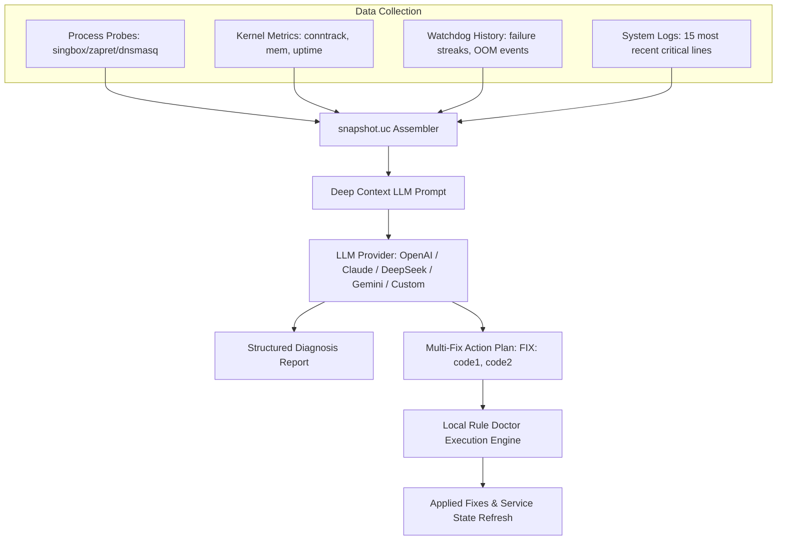

# 05. AI Stack, AI Doctor & Autonomous Self-Healing

## 1. Overview of Tachyon AI Stack

Tachyon provides a dual-layer AI and autonomous resilience stack:
1. **Autonomous Layer (Local Rule Doctor & Watchdog)**: Runs locally on the router every 5–15 seconds, detects network drops, memory leaks, DNS deadlocks, and time desync without requiring internet access or API tokens.
2. **Cognitive Layer (AI Doctor v3.0)**: Deep diagnostics powered by LLMs (OpenAI, Anthropic Claude, DeepSeek, Gemini, or local Ollama/OpenRouter models) with contextual prompt enrichment and automated Multi-Fix generation. The modules do not embed the v3.0 string; that is the name used by the README. The behavior below is what `diagnostics/doctor.uc` and `diagnostics/repairs.uc` implement.
3. **Agent Integration Layer (HTTP REST Agent API & OpenAPI 3.0)**: Programmatic interface for autonomous AI agents (Cursor, Claude Code, AutoGPT, ChatGPT Custom GPTs, N8N, Dify).

### Smart Detect modes

Smart Detect remains a local watchdog function, independent of LLM/RAG. Its `smart_detect_mode` setting selects **Default** (upstream logs/HEAD/120-second confirmation) or opt-in **Plus** (stalled LAN web connections, full GET comparison and PSL main-domain rules). Missing/unknown values use Default. Both preserve the upstream DNS/runtime guard and learned domains. See [Smart Detect modes](../SMART_DETECT.md) for routing behavior, limits and verification.

---

## 2. AI Doctor Architecture (v3.0)



---

## 3. Local Rule Doctor & 25 Quick Fix Codes

`diagnostics/runtime.uc` delegates to `apply_quick_fix()` in `diagnostics/repairs.uc`. Aliases: `start_steer` runs the same branch as `start_singbox`, and `restart_steer_dns` runs the same branch as `restart_singbox_dns`.

| Code | Target Subsystem | Action Performed |
|---|---|---|
| `start_singbox` | Core / Steer | Runs `restore_dnsmasq` and restarts `/etc/init.d/tachyon-core`. On Steer, restarts `/etc/init.d/steer`. |
| `rebuild_rules` | nftables | `/etc/init.d/tachyon reload`. |
| `fix_dnsmasq` | dnsmasq | Restarts dnsmasq. |
| `fix_resolv_symlink` | DNS | Points `/etc/resolv.conf` at an existing `resolv.conf.auto` (`/tmp/resolv.conf.d/resolv.conf.auto`, otherwise `/tmp/resolv.conf.auto`). |
| `start_watchdog` | Watchdog | Restarts `/etc/init.d/tachyon`. |
| `restart_singbox_dns` | Core DNS | Restarts `/etc/init.d/tachyon-core`. On Steer, reloads dnsd and dnsmasq. |
| `fix_uci_config` | UCI | Restores `/etc/backup/tachyon_config`, otherwise `/etc/config/tachyon.bak`. |
| `fix_wan_interface` | Networking | `ubus call network.interface.wan up`, `ifup wan`, and a route-cache flush. |
| `fix_gateway` | Networking | `/etc/init.d/network restart`. |
| `clear_dns_cache` | DNS | Restarts dnsmasq and flushes the route cache. |
| `update_subscriptions` | Subscriptions | `tachyon subscription_update_async`. |
| `reset_firewall` | Firewall | `/etc/init.d/firewall restart`, then `/etc/init.d/tachyon reload`. |
| `restart_network` | Network | `/etc/init.d/network restart`. |
| `restart_zapret` | DPI providers | Stops and disables standalone zapret, zapret2 and byedpi, then starts the Tachyon provider runtimes. |
| `optimize_memory` | Memory | Drops the page cache, removes `/tmp/tachyon-core/*.tmp`, restarts tachyon-core. |
| `switch_to_doh` | DNS | Sets `dns_type=doh`, commits, and reloads Tachyon. |
| `heal_network_stack` | Network | Relinks `/etc/resolv.conf`, restarts dnsmasq and Tachyon, brings WAN up. |
| `enable_safe_bypass` | Routing | Sets `recovery_bypass=1`, commits, and reloads Tachyon. |
| `restore_native_internet` | Emergency | Stops Tachyon, deletes `inet TachyonTable` and the policy routes, restarts dnsmasq. |
| `fix_system_time` | NTP | `ntpd -q` against the built-in servers, then restarts sysntpd. |
| `flush_conntrack` | Kernel | Sets `nf_conntrack_max=65536` and runs `conntrack -F`. |
| `fix_bootstrap_dns` | Resolver | Sets `bootstrap_dns_server=77.88.8.8`, commits, and reloads Tachyon. |
| `restart_providers` | Providers | Starts the WDTT, OlcRTC and FPTN runtimes. |
| `optimize_mtu` | Tunnels | Runs `tachyon discover-awg-mtu`, then reloads Tachyon. |
| `upgrade_to_singbox_extended` | Core package | `component_action_async sing_box install_extended`. |

---

## 4. HTTP REST Agent API & OpenAPI 3.0.3

Tachyon exposes a standardized REST API hosted under `/cgi-bin/tachyon-agent/` via OpenWrt's native `uhttpd`.

### 4.1. Authentication Model
* **Read-Only Endpoints**: Accessible within LAN without authentication (or secured via firewall).
* **Write Endpoints**: Require Bearer token authentication:
  ```http
  POST /cgi-bin/tachyon-agent/ai-doctor/fix
  Authorization: Bearer <agent_api_token>
  Content-Type: application/json

  {"fix": "clear_dns_cache,start_singbox"}
  ```

### 4.2. OpenAPI 3.0.3 Specification
* The live OpenAPI JSON schema is available at:
  ```
  GET /cgi-bin/tachyon-agent/openapi.json
  ```
* This schema allows instant import into **ChatGPT Custom GPT Actions**, **N8N HTTP Request Nodes**, **Dify**, and **Flowise**.

### 4.3. Full Endpoint Index

| Method | Endpoint | Auth Required | Description |
|---|---|---|---|
| `GET` | `/health` | No | Lightweight JSON health status probe. |
| `GET` | `/snapshot` | No | Full system snapshot (interfaces, memory, proxy status). |
| `GET` | `/diagnose` | No | Local Rule Doctor diagnosis report. |
| `GET` | `/logs` | No | Returns last 100 lines of Tachyon system log. |
| `GET` | `/config` | No | Returns sanitized UCI configuration. |
| `GET` | `/tools` | No | OpenAI Function Calling / MCP tool definitions. |
| `GET` | `/openapi.json` | No | OpenAPI 3.0.3 specification JSON. |
| `POST`| `/heal` | **Bearer** | Triggers manual Watchdog self-healing cycle. |
| `POST`| `/ai-doctor/fix` | **Bearer** | Applies one or more quick-fix codes. |
| `POST`| `/restart` | **Bearer** | Restarts specified service (`singbox`, `watchdog`, `dnsmasq`). |
| `POST`| `/reload` | **Bearer** | Soft-reloads configuration and routing tables. |
| `POST`| `/config/set` | **Bearer** | Updates specific UCI options. |
| `POST`| `/section/toggle` | **Bearer** | Enables or disables a routing rule section. |
| `POST`| `/domain/add` | **Bearer** | Appends domain pattern to target rule list. |
