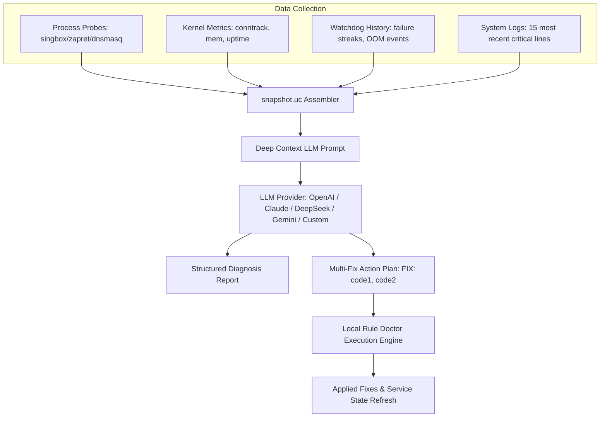

# 05. AI Stack, AI Doctor & Autonomous Self-Healing

## 1. Overview of Tachyon AI Stack

Tachyon provides a dual-layer AI and autonomous resilience stack:
1. **Autonomous Layer (Local Rule Doctor & Watchdog)**: Runs locally on the router every 5–15 seconds, detects network drops, memory leaks, DNS deadlocks, and time desync without requiring internet access or API tokens.
2. **Cognitive Layer (AI Doctor v3.0)**: Deep diagnostics powered by LLMs (OpenAI, Anthropic Claude, DeepSeek, Gemini, or local Ollama/OpenRouter models) with contextual prompt enrichment and automated Multi-Fix generation. The modules do not embed the v3.0 string; that is the name used by the README. The behavior below is what `diagnostics/doctor.uc` and `diagnostics/repairs.uc` implement.
3. **Agent Integration Layer (HTTP REST Agent API & OpenAPI 3.0)**: Programmatic interface for autonomous AI agents (Cursor, Claude Code, AutoGPT, ChatGPT Custom GPTs, N8N, Dify).

### Smart Detect modes

Smart Detect remains a local watchdog function, independent of LLM/RAG. Its `smart_detect_mode` setting selects **Default** (upstream logs/HEAD/120-second confirmation) or opt-in **Plus** (stalled LAN web connections, full GET comparison and PSL main-domain rules). Missing/unknown values use Default. Both preserve the upstream DNS/runtime guard and learned domains. See [Smart Detect modes](../SMART_DETECT.md) for routing behavior, limits and verification.

---

## 2. AI Doctor Architecture (v3.0)



---

## 3. Local Rule Doctor & 25 Quick Fix Codes

`diagnostics/runtime.uc` delegates to `apply_quick_fix()` in `diagnostics/repairs.uc`.

| Code | Target Subsystem | Action Performed |
|---|---|---|
| `start_singbox` | Core | Runs `restore_dnsmasq` and restarts `/etc/init.d/tachyon-core`. |
| `rebuild_rules` | nftables | `/etc/init.d/tachyon reload`. |
| `fix_dnsmasq` | dnsmasq | Restarts dnsmasq. |
| `fix_resolv_symlink` | DNS | Points `/etc/resolv.conf` at an existing `resolv.conf.auto` (`/tmp/resolv.conf.d/resolv.conf.auto`, otherwise `/tmp/resolv.conf.auto`). |
| `start_watchdog` | Watchdog | Restarts `/etc/init.d/tachyon`. |
| `restart_singbox_dns` | Core DNS | Restarts `/etc/init.d/tachyon-core` and reloads dnsmasq. |
| `fix_uci_config` | UCI | Restores `/etc/backup/tachyon_config`, otherwise `/etc/config/tachyon.bak`. |
| `fix_wan_interface` | Networking | `ubus call network.interface.wan up`, `ifup wan`, and a route-cache flush. |
| `fix_gateway` | Networking | `/etc/init.d/network restart`. |
| `clear_dns_cache` | DNS | Restarts dnsmasq and flushes the route cache. |
| `update_subscriptions` | Subscriptions | `tachyon subscription_update_async`. |
| `reset_firewall` | Firewall | `/etc/init.d/firewall restart`, then `/etc/init.d/tachyon reload`. |
| `restart_network` | Network | `/etc/init.d/network restart`. |
| `restart_zapret` | DPI providers | Stops and disables standalone zapret, zapret2 and byedpi, then starts the Tachyon provider runtimes. |
| `optimize_memory` | Memory | Drops the page cache, removes `/tmp/tachyon-core/*.tmp`, restarts tachyon-core. |
| `switch_to_doh` | DNS | Sets `dns_type=doh`, commits, and reloads Tachyon. |
| `heal_network_stack` | Network | Relinks `/etc/resolv.conf`, restarts dnsmasq and Tachyon, brings WAN up. |
| `enable_safe_bypass` | Routing | Sets `recovery_bypass=1`, commits, and reloads Tachyon. |
| `restore_native_internet` | Emergency | Stops Tachyon, deletes `inet TachyonTable` and the policy routes, restarts dnsmasq. |
| `fix_system_time` | NTP | `ntpd -q` against the built-in servers, then restarts sysntpd. |
| `flush_conntrack` | Kernel | Sets `nf_conntrack_max=65536` and runs `conntrack -F`. |
| `fix_bootstrap_dns` | Resolver | Sets `bootstrap_dns_server=77.88.8.8`, commits, and reloads Tachyon. |
| `restart_providers` | Providers | Starts the WDTT, OlcRTC and FPTN runtimes. |
| `optimize_mtu` | Tunnels | Runs `tachyon discover-awg-mtu`, then reloads Tachyon. |
| `upgrade_to_singbox_extended` | Core package | `component_action_async sing_box install_extended`. |

---

## 3.1. Hybrid RAG Engine (`diagnostics/rag.uc`) & Knowledge Base

Both AI Doctor (`diagnostics/doctor.uc`) and the Strategy Fuzzer AI generator (`diagnostics/fuzzer/ai.uc`) enrich their prompts using `/usr/lib/tachyon/rag_index.json` (compiled from `docs/knowledge-base/*.md` via `tools/rag_build_index.sh`):
- **Vector Similarity (`embed_query`):** When an OpenAI-compatible embedding provider (`openai`, `openrouter`, `gemini`, `ollama`, `lmstudio`, `custom`) is configured, computes cosine similarity against pre-computed 6-decimal float vectors.
- **Domain-Boosted Lexical Search (`lexical_search`):** Filters out English and Russian stop-words, weights Tachyon domain terms (`zapret2`, `nfqws2`, `multisplit`, `seqovl`, `tachyontable`, `fakeip`, `reconciler`, `known_good`, `outbound_source`, `outbound_group`, etc.), applies multi-term coverage bonuses, and merges the top chunks with vector results.
- **Direct Documentation Search (`search_docs`):** Exposed as `GET /tachyon/agent/v1/docs/search?q=<query>&limit=<k>` and MCP tool `tachyon_docs_search` so connected LLM agents can query the full knowledge base on demand.

---

## 3.2. Privacy & Zero-Secret-Leakage Architecture

Tachyon enforces multi-layer privacy redaction so that no private credentials, tokens, keys, or client identifiers are ever transmitted to external LLMs or exposed via REST/MCP responses:
1. **Central Redaction Pipelines (`service/support_bundle.uc` & `core/events.uc`):**
   - `redact_for_llm()` and `redact_string()` scrub:
     - Cloud & LLM API keys (`sk-*`, `AIza*`, `gsk_*`, `xai-*`), `Bearer` tokens, and `Authorization` headers;
     - Telegram Bot tokens (`<bot_id>:<AA...>`) and chat IDs (`telegram_chat_id`, `allowed_chats`, `admin_ids`);
     - Proxy & tunnel URIs (`vless://`, `vmess://`, `trojan://`, `ss://`, `ssr://`, `tuic://`, `hysteria2://`, `hy2://`, `wireguard://`, `wg://`, `awg://`, `fptn://`, `warp://`);
     - Standalone UUIDs, WireGuard/AmneziaWG/Reality keys (`private_key`, `public_key`, `preshared_key`, `pbk`, `sid`, `crypto_key`), passwords, HWIDs (`x_hwid_value`), and subscription URL query tokens;
     - Client MAC addresses (`[REDACTED_MAC]`).
2. **Pre-LLM Sanitization:**
   - `diagnostics/doctor.uc` sanitizes `res.report`, `local_res.report`, `watchdog_info`, `verify_info`, `log_snippet`, `problems`, and `user_query` before constructing the LLM prompt or writing `/tmp/ai_doctor_last.json`.
   - `diagnostics/fuzzer/ai.uc` sanitizes `user_prompt`, `target_url`, and `baseline.error` before invoking the LLM.
   - `diagnostics/rag.uc` sanitizes every `query` via `sanitize_query()` before sending it to external embedding endpoints.
3. **Masked Config & Redacted Diffs:**
   - `diagnostics/status.uc` (`tachyon-config-masked`) masks all sensitive UCI options (`ai_doctor_api_key`, `agent_api_token`, `telegram_token`, `clash_api_secret`, `fptn_*`, `olcrtc_*`, `wdtt_*`, `url`, `urls`, `proxy_url`, `custom_json`, `uuid`, `pbk`, `sid`, etc.).
   - `service/config_plan.uc` masks `old_value` and `new_value` as `"[REDACTED]"` for sensitive keys in UCI dry-run diffs.
4. **System Prompt Guardrails:**
   - Embedded instructions in `doctor.uc`, `fuzzer/ai.uc`, and `tachyon://knowledge/privacy-rules` explicitly forbid the LLM from asking users for plaintext keys, tokens, passwords, UUIDs, or unmasked `/etc/config/tachyon` dumps.

---

## 4. HTTP REST Agent API, OpenAPI 3.0.3 & MCP Server

Tachyon exposes a standardized REST API (`/cgi-bin/tachyon-agent/` and `/tachyon/agent/v1/`) and a JSON-RPC 2.0 MCP server (`/cgi-bin/tachyon-mcp` and `POST /tachyon/agent/v1/mcp`).

### 4.1. Authentication Model
* **Read-Only Endpoints**: Accessible within LAN (or with Bearer token when configured).
* **Write Endpoints**: Require Bearer token authentication:
  ```http
  POST /cgi-bin/tachyon-agent/ai-doctor/fix
  Authorization: Bearer <agent_api_token>
  Content-Type: application/json

  {"fix": "clear_dns_cache,start_singbox"}
  ```

### 4.2. OpenAPI 3.0.3 Specification
* The live OpenAPI JSON schema is available at:
  ```
  GET /cgi-bin/tachyon-agent/openapi.json
  ```

### 4.3. Full Endpoint Index

| Method | Endpoint | Auth Required | Description |
|---|---|---|---|
| `GET` | `/health` | No | Lightweight JSON health status probe. |
| `GET` | `/snapshot` | No | Full redacted system snapshot (interfaces, memory, proxy status, diagnostics). |
| `GET` | `/diagnose` | No | Local Rule Doctor diagnosis report and suggested repair codes. |
| `GET` | `/logs` | No | Returns redacted recent lines of Tachyon system log. |
| `GET` | `/config` | No | Returns masked UCI configuration (`tachyon-config-masked`). |
| `GET` | `/docs/search` | No | Searches the built-in RAG technical knowledge base (`?q=...&limit=5`). |
| `GET` | `/route/explain` | No | Traces packet/DNS routing path (`?target=...&client_ip=...&port=...&proto=...`). |
| `GET` | `/known-good` | No | Queries Last Known Good (`known_good.uc`) status (`?action=status`). |
| `GET` | `/ai-doctor/last` | No | Returns the last redacted AI Doctor report (`/tmp/ai_doctor_last.json`). |
| `GET` | `/tools` | No | OpenAI Function Calling / MCP tool definitions. |
| `GET` | `/openapi.json` | No | OpenAPI 3.0.3 specification JSON. |
| `POST`| `/ai-doctor` | **Bearer** | Triggers live LLM AI Doctor analysis (`{"query": "..."}`). |
| `POST`| `/ai-doctor/fix` | **Bearer** | Applies one or more quick-fix codes (`{"fix": "code1,code2"}`). |
| `POST`| `/heal` | **Bearer** | Triggers manual Watchdog self-healing cycle. |
| `POST`| `/restart` | **Bearer** | Restarts specified service (`singbox`, `watchdog`, `dnsmasq`). |
| `POST`| `/reload` | **Bearer** | Soft-reloads configuration and routing tables. |
| `POST`| `/config/plan` | **Bearer** | Dry-run validation, redacted diff, and impact analysis for candidate UCI changes. |
| `POST`| `/config/set` | **Bearer** | Updates specific UCI options (`section`, `option`, `value`). |
| `POST`| `/section/toggle` | **Bearer** | Enables or disables a routing rule section. |
| `POST`| `/domain/add` | **Bearer** | Appends domain to a section's atomic `condition` (`user_domains`). |
| `POST`| `/known-good` | **Bearer** | Captures, promotes, or rolls back Last Known Good state. |
| `POST`| `/support-bundle` | **Bearer** | Generates a SHA-256 verified, redacted diagnostic support bundle. |
| `POST`| `/mcp` | **Bearer** | JSON-RPC 2.0 Model Context Protocol endpoint (`tools/list`, `tools/call`, `resources/list`, `resources/read`, `prompts/list`). |
