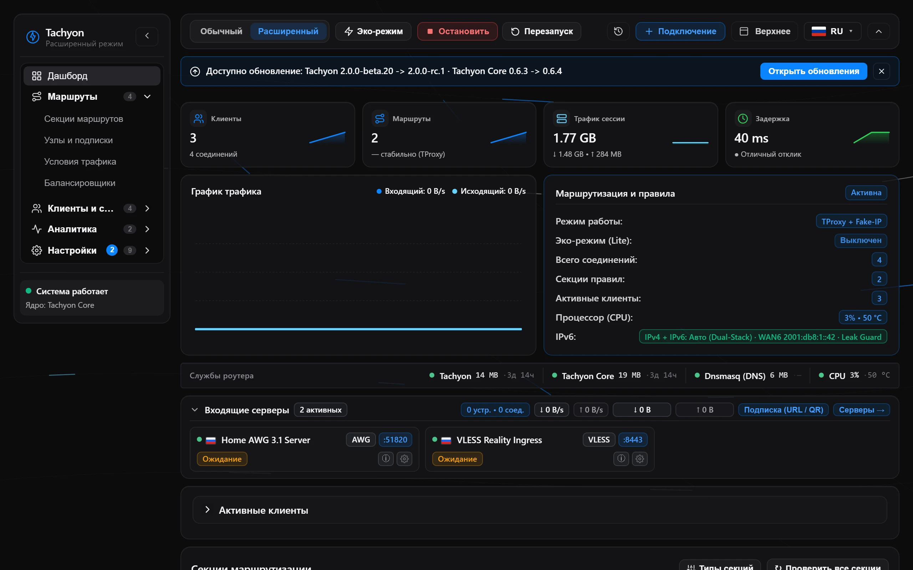
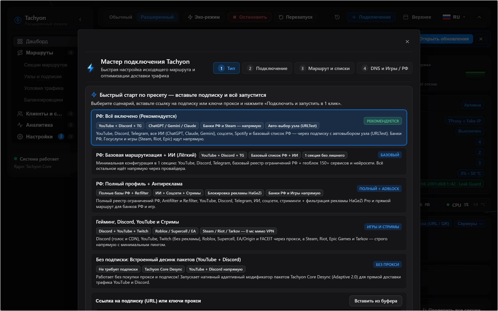

# Быстрый старт

[English](../en/02-quickstart.md) | [К оглавлению](README.md)

## Вход в веб-интерфейс

После установки интерфейса управления он доступен двумя способами:

- **Через LuCI**: откройте панель OpenWrt (`http://192.168.1.1`) и перейдите в меню `Services -> Tachyon`.
- **Напрямую через встроенный HTTP-сервер**: по адресу `http://192.168.1.1:1680/tachyon` (порт и путь задаются в разделе `settings`).

Учётные данные администратора совпадают с системным пользователем OpenWrt (`root`), при работе через автономный порт аутентификация настраивается в глобальных настройках.

## Обзор главного экрана (Дашборд)

Главный экран объединяет в одном окне телеметрию ядра, состояние сетевых контуров и активные секции маршрутизации.



### Верхняя панель и режимы отображения

- **Переключатель режима интерфейса (`Обычный` / `Расширенный`)**: скрывает или открывает тонкие технические настройки в разделах.
- **`Эко-режим` (Lite)**: снижает частоту фонового опроса графиков и телеметрии для экономии ресурсов процессора на недорогих роутерах.
- **`Остановить` / `Перезапуск`**: оперативное управление сервисом `tachyon` и ядром `tachyon-core`.
- **`+ Подключение`**: кнопка запуска мастера быстрого добавления маршрута или узла.
- **`Верхнее` / `Боковое`**: смена расположения навигационной панели, справа от неё — переключатель языка (`RU` / `EN`).
- **Уведомления об обновлениях**: при наличии новой версии компонента в верхней части экрана отображается заметный баннер с перечнем доступных версий и кнопкой `Открыть обновления`, а в боковом меню появляются счётчики доступных обновлений.

### Основные блоки дашборда

1. **KPI-плитки**: количество активных клиентов и соединений, число включённых маршрутов, накопленный объём трафика за сессию (`download` / `upload`) и текущая средняя задержка.
2. **График трафика и сводка правил**: текущий режим перехвата (`TProxy + Fake-IP` или `TUN`), статус Эко-режима, счётчик активных соединений, нагрузка CPU и температура, а также состояние контура `IPv4 + IPv6` (включая статус защиты от утечек `Leak Guard`).
3. **Службы роутера**: статус и потребление оперативной памяти процессами `Tachyon`, `Tachyon Core` и `Dnsmasq`, с указанием аптайма.
4. **Входящие серверы и активные клиенты**: сводка собственных входных серверов на роутере (с быстрой кнопкой генерации подписки и QR-кода) и список устройств локальной сети с активными потоками.
5. **Секции маршрутизации**: карточки правил с активным выходным узлом, задержкой и быстрым переключением в случае балансировщиков.

## Настройка через мастер подключения

Если вы настраиваете маршрутизатор с нуля или добавляете новую подписку, нажмите **`+ Подключение`** на верхней панели.



Мастер проведёт через 4 шага:

1. **Тип сценария**: готовые пресеты маршрутизации (сбалансированный профиль со списками популярных сервисов, базовый облегчённый профиль, игровой профиль с прямым выходом для игровых платформ, либо режим без прокси — с нативной пакетной десинхронизацией).
2. **Подключение**: вставка URL подписки или одной/нескольких share-ссылок (кнопка `Вставить из буфера`), либо выбор уже существующего источника из пула.
3. **Маршрут и списки**: подтверждение целевых наборов правил `.trs` и исключений прямого трафика.
4. **DNS и финальная проверка**: выбор зашифрованного DNS (DoH / DoT) и автоматический запуск с применением конфигурации.

## Ручная настройка первого маршрута за 3 шага

1. Откройте `Маршруты -> Узлы и подписки`, нажмите **`+ Добавить источник`** и вставьте URL подписки или ссылку `vless://` / `hysteria2://` / конфигурацию `AmneziaWG`.
2. Перейдите в `Маршруты -> Секции маршрутов`, нажмите **`+ Добавить секцию`**, выберите созданный источник и подключите нужное условие или пресет наборов `.trs`.
3. Нажмите `Сохранить и применить` в правом верхнем углу формы (или сохраните секцию в сетке) — конфигурация `tachyon-core` и правила `nftables` будут пересобраны автоматически.

## Проверка работы маршрутизации

Убедиться, как именно будет обработан конкретный домен или IP-адрес до реального запроса, можно двумя способами:

- В веб-интерфейсе: через **Rule Tracer** в разделе `Маршруты -> Условия трафика` или в разделе `Аналитика -> Диагностика`.
- В командной строке роутера по SSH:

```sh
tachyon explain example.com 192.168.1.10
tachyon route_explain 192.168.1.10 example.com 443 tcp
tachyon status
```

`explain` и `route_explain` покажут точную сработавшую секцию, совпавшее условие и целевой outbound-тег (либо причину, по которой трафик уйдёт напрямую через WAN).

---

[Предыдущая: Установка и миграция с 1.x](01-installation.md) | [К оглавлению](README.md) | [Следующая: Исходящие источники и протоколы](03-outbounds-protocols.md)
