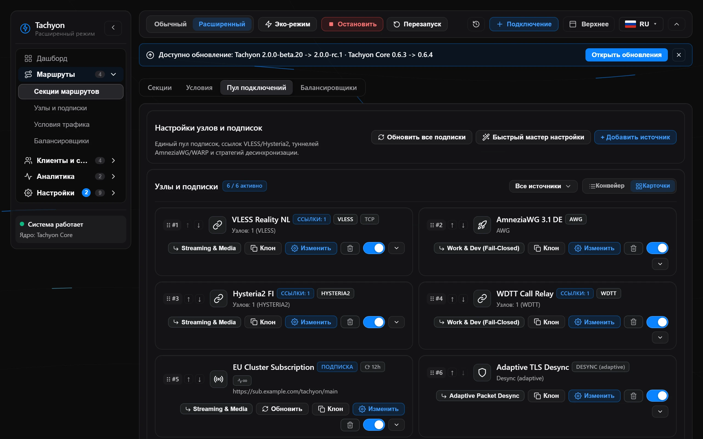
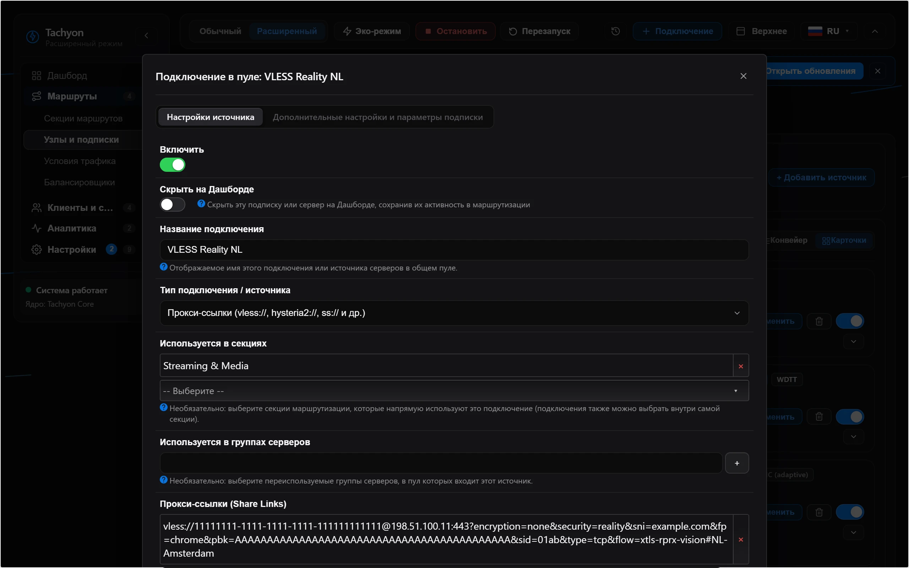

# Исходящие источники и протоколы

[English](../en/03-outbounds-protocols.md) | [К оглавлению](README.md)

В Tachyon 2.0 внешние подключения вынесены в **Layer 1: общий пул подключений (`outbound_source`)** в разделе `Маршруты -> Узлы и подписки`. Источник создаётся один раз и затем многократно переиспользуется в разных секциях маршрутизации и балансировщиках без дублирования ссылок и ключей.



## Поддерживаемые типы источников

Все доступные типы источников в окне настройки подключения (`source_type`):

| Тип (`source_type`) | Назначение и особенности |
|---|---|
| `subscription` | Удалённая подписка по HTTP/HTTPS (включая зашифрованные ссылки `happ://crypt*`). Поддерживает интервал автообновления (`1h`, `12h`, `1d`), выбор User-Agent, загрузку через конкретную секцию (`download_via_proxy_enabled`) и отображение метаданных трафика и срока действия |
| `proxy_links` | Ручной список share-ссылок (по одной на строку). Поддерживает `vless://`, `vmess://`, `trojan://`, `ss://`, `hysteria2://` (`hy2://`), `tuic://`, `socks://`, `http://`, `ssh://`, `wireguard://`, `wdtt://`, `csqtt://`, `qwdtt://` |
| `awg` | Нативный клиент **AmneziaWG** версий **2.0**, **3.0** и **3.1** (импорт `.conf` или ручной ввод ключей, эндпоинта, MTU и обфускационных параметров `Jc`, `Jmin`, `Jmax`, `S1`–`S4`, `H1`–`H4`, `I1`–`I5`) |
| `warp` | Клиент Cloudflare WARP на уровне ядра (автогенерация или ввод зарегистрированных ключей, выбор эндпоинта и MTU) |
| `fptn` | Поддержка туннелей **FPTN** по токену доступа и параметрам шлюза |
| `openvpn` | Клиент OpenVPN (`.ovpn`-профиль, сертификаты, аутентификация по логину/паролю) |
| `anytls` | Протокол **AnyTLS** с управлением сессиями поверх TLS |
| `naive` | Протокол **NaiveProxy** (HTTP/2 и HTTP/3 поверх стека Chrome-подобного TLS) |
| `mieru` | Транспорт **Mieru** (мультиплексированный TCP/UDP-туннель) |
| `snell` | Протокол **Snell** (v3/v4, PSK и обфускация) |
| `sudoku` | Транспорт **Sudoku** |
| `masque` | Туннелирование **MASQUE** поверх HTTP/3 (RFC 9298 / Connect-IP) |
| `openconnect` | Совместимость с корпоративными шлюзами **OpenConnect / AnyConnect** |
| `shadowtls` | Обёртка **ShadowTLS** поверх легитимного TLS-рукопожатия заданного SNI |
| `trusttunnel` | Протокол **TrustTunnel** |
| `desync` | Нативная пакетная десинхронизация `tachyon-core` (локальный модификатор исходящих пакетов без внешнего сервера — см. [главу 07](07-desync-fuzzer.md)) |

## Добавление и редактирование источника

При нажатии **`+ Добавить источник`** или **`Изменить`** открывается единая карточка с двумя вкладками: `Настройки источника` и `Дополнительные настройки и параметры подписки`.



### Основные поля источника

- **Включить**: активирует источник и добавляет его узлы в сгенерированную конфигурацию `tachyon-core`.
- **Скрыть на Дашборде**: оставляет узел рабочим в правилах маршрутизации, не загромождая обзорные карточки главного экрана.
- **Название подключения**: произвольное отображаемое имя в пуле и на дашборде.
- **Тип подключения / источника**: определяет набор отображаемых ниже полей протокола.
- **Используется в секциях / группах серверов**: обратная привязка — источник можно сразу подключить к нужной секции или группе прямо из этого окна.

### Особенности настройки ключевых протоколов

#### Подписки (`subscription`)

- При добавлении нескольких URL все узлы группируются с сохранением принадлежности к источнику.
- **Автоподбор User-Agent (`auto_user_agent`)**: ядро по очереди пробует совместимые профили клиентов, если сервер подписки отдаёт разные форматы в зависимости от заголовка `User-Agent`.
- **Загрузка через выбранную секцию (`download_via_proxy_enabled`)**: позволяет обновлять подписку не напрямую через WAN, а через рабочий резервный маршрут (например, другую секцию).
- На карточке источника отображаются остаток квоты, использованный трафик, дата истечения и кнопка принудительного обновления **`Обновить`**.

#### Протокол WDTT (`wdtt://`, `csqtt://`, `qwdtt://`)

Поддержка ретрансляционного транспорта на базе вызовов через URI:

```text
wdtt://password@host:3478?mode=csqtt&media=vk&vk_auth_mode=cookie#WDTT-Relay
```

Основные параметры строки запроса:
- `mode`: транспортный режим (`wdtt`, `csqtt`, `qwdtt`).
- `media`: медиа-провайдер (`vk` и совместимые).
- `vk_auth_mode`: режим авторизации провайдера (например, `cookie`).

#### AmneziaWG (`awg` 2.0 / 3.0 / 3.1)

Для стабильной работы через промежуточные сетевые узлы поддерживаются расширенные параметры протокола:
- Стандартные параметры WireGuard: `wg_endpoint`, `wg_local_address`, `wg_peer_public_key`, `wg_private_key`, `wg_preshared_key`, `wg_mtu`.
- Версия обфускации (`awg_version`: `2.0`, `3.0`, `3.1`) и параметры заголовков/мусорных пакетов (`awg_jc`, `awg_jmin`, `awg_jmax`, `awg_s1`–`awg_s4`, `awg_h1`–`awg_h4`, а также специальные пакеты `awg_i1`–`awg_i5` для версии 3.x).

---

[Предыдущая: Быстрый старт](02-quickstart.md) | [К оглавлению](README.md) | [Следующая: Секции, условия, списки .trs и балансировщики](04-routing-sections-balancers.md)
