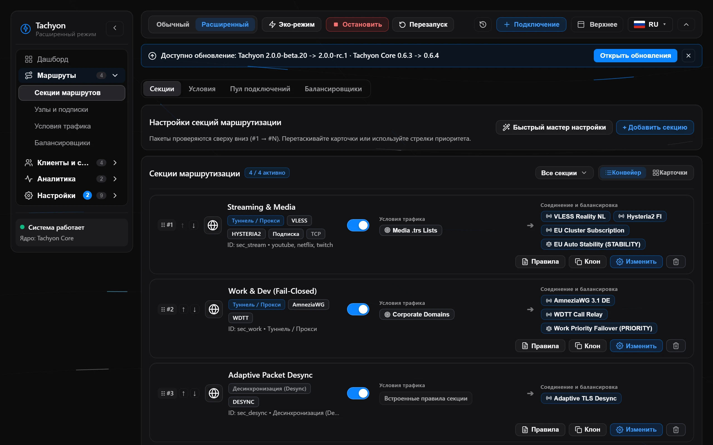
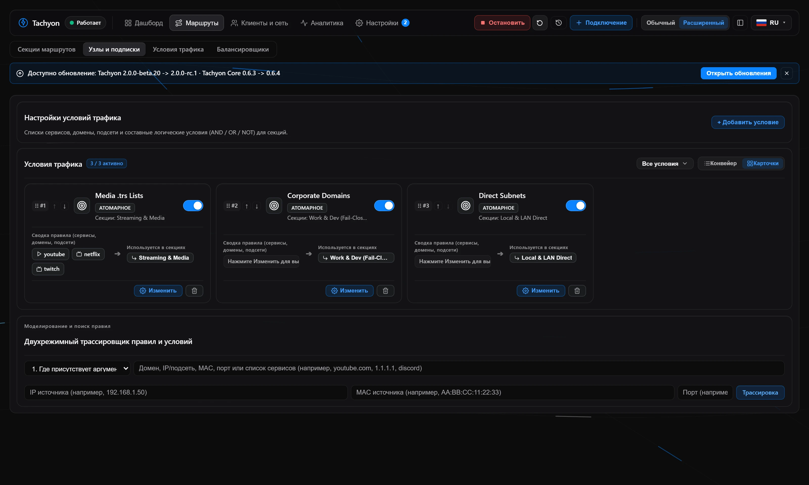
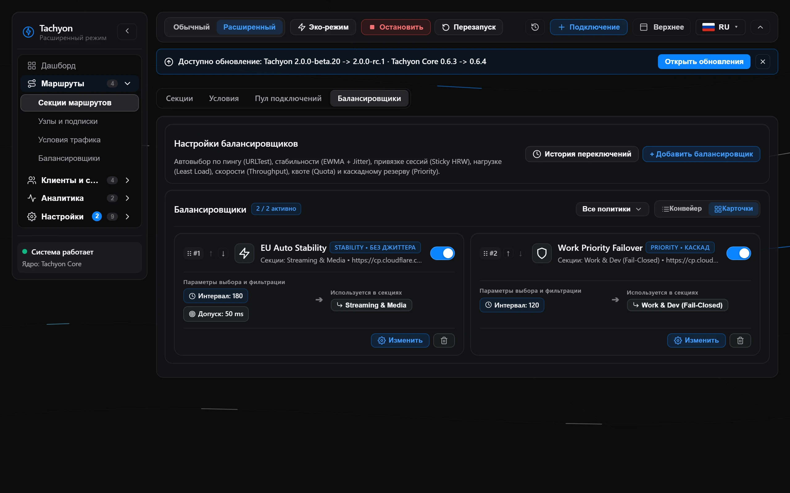

# Секции, условия, списки .trs и балансировщики

[English](../en/04-routing-sections-balancers.md) | [К оглавлению](README.md)

Логика маршрутизации в Tachyon 2.0 построена на разделении четырёх независимых слоёв:

```text
Условия трафика (Что?) ──▶ Секция маршрутизации (Приоритет + Действие) ──▶ Балансировщик (Как выбрать узел?) ──▶ Пул подключений (Куда?)
```

Такой подход позволяет менять серверы и подписки, не переписывая списки доменов, и комбинировать несколько политик выбора узла на одном пуле.

## Секции маршрутизации и приоритет



Пакеты и соединения проверяются строго **сверху вниз (`#1 -> #N`)**. Срабатывает **первая** подходящая включённая секция. Переупорядочивать секции можно перетаскиванием за иконку слева от номера или кнопками стрелок `↑` / `↓`.

### Типы действий секции (`action` / `connection_type`)

| Действие | Поведение |
|---|---|
| `proxy` | Направление подходящего трафика через выбранный источник или балансировщик |
| `desync` | Обработка трафика встроенным движком пакетной десинхронизации `tachyon-core` без внешнего прокси-сервера |
| `direct` / `bypass` | Прямой выход через основной WAN (или явно указанный интерфейс), минуя туннелирование |
| `block` / `reject` | Сброс соединений (полезно для изоляции телеметрии, рекламы и нежелательных портов) |
| `dns` | Специализированное правило перенаправления DNS-запросов на указанный DNS-сервер |
| `group` | Групповой маршрутизатор, объединяющий несколько других секций |

### Fail-Closed и Kill-Switch для секции

Для критических маршрутов (например, рабочих ресурсов) в настройках секции доступны две опции:

- **`fail_closed`**: при недоступности всех настроенных исходящих узлов трафик секции **не** откатывается на прямой WAN, а сбрасывается.
- **`kill_switch`**: блокирует передачу пакетов для сопоставленного трафика в случае остановки или перезапуска туннельного контура.

## Условия трафика и форматы списков

Вкладка `Маршруты -> Условия трафика` позволяет создавать переиспользуемые правила отбора трафика.



### Атомарные и составные условия

- **Атомарное условие (`atomic`)**: объединяет в себе наборы правил, списки пользовательских доменов/поддоменов/ключевых слов, IP/CIDR-подсети, диапазоны портов, транспортные протоколы (`tcp`/`udp`), гео-коды, а также привязку к конкретным LAN-устройствам или семейным профилям.
- **Составное булево условие (`AND` / `OR` / `NOT`)**: позволяет строить сложные логические выражения из уже созданных атомарных условий (например: «Устройства из профиля *Office* `AND` список *Corporate* `AND NOT` локальные подсети»).

Проверить срабатывание любого условия или цепочки секций до реального подключения можно через встроенный **Rule Tracer** (в двух режимах: проверка конкретного домена/IP/порта/устройства и полная симуляция по всему конвейеру секций).

### Формат списков `.trs` (стандарт Tachyon)

По умолчанию Tachyon 2.0 использует собственный компактный бинарный формат наборов правил **`.trs`**:

```text
https://raw.githubusercontent.com/Dushnilin/tachyon-lists/main/release/tachyon/<name>.trs
```

> [!IMPORTANT]
> Формат `.trs` является основным для всех предустановленных пресетов, мастера подключения, UI-контролов и автообновления списков. Формат `.srs` поддерживается **только как режим совместимости** для сторонних пользовательских ссылок и локальных файлов.

Репозиторий списков и частота автообновления задаются в разделе `Настройки -> Обновления списков`. Чтобы не изнашивать NAND-флеш роутера, механизм `content_unchanged()` пропускает запись на диск, если загруженный `.trs`-файл побайтно совпадает с локальной копией.

## Балансировщики (14 алгоритмов выбора)

Вкладка `Маршруты -> Балансировщики` отделяет политику выбора от конкретного списка узлов.



### Базовые типы и режимы балансировки

В конфигурации балансировщика различаются два базовых типа: **`urltest`** (автоматический выбор среди равноправных узлов), **`priority`** (каскадное резервирование по уровням) и ручной **`selector`**. В ядре `tachyon-core` поддерживаются все **14 режимов**:

| Режим (`mode`) | Тип | Логика выбора и сценарий применения |
|---|---|---|
| `urltest` / `least_test` | URLTest | Классический выбор узла с наименьшей задержкой в рамках допуска (`tolerance` мс) |
| `stability` | URLTest | Оценивает **EWMA-задержку**, **джиттер** и **штраф за потери пакетов**, избегая нестабильных узлов даже при низком разовом пинге |
| `priority` | Priority | Каскадный переход по упорядоченным уровням групп серверов: использует верхний доступный уровень, пока он здоров (`health_url`), и откатывается ниже только при сбое |
| `failover` | Priority | Жёсткое резервирование «основной узел -> запасные узлы» с заданным порогом отказов и интервалом проверки восстановления |
| `sticky` | URLTest | Привязка потоков через консистентное хэширование (Rendezvous HRW) по ключу **`sticky_hash`**: `source_ip`, `domain`, `dest_ip`, `dest_port` или `process`. Исключает «скачки» IP во время авторизации или видеозвонков |
| `least_load` | URLTest | Распределение новых соединений на узел с наименьшим количеством текущих активных потоков |
| `weighted` | URLTest | Взвешенная балансировка пропорционально `1 / RTT²` (быстрые узлы получают больше потоков, но загружаются и резервные) |
| `passive` | URLTest | Пассивный контроль качества реального трафика: помещает в временный карантин узлы, обрывающие потоки на старте (`< 64 KiB`) |
| `hedged` | URLTest | Спекулятивная гонка (hedged requests): при зависании TLS/TCP-рукопожатия параллельно открывается резервное соединение |
| `throughput` | URLTest | Ориентация на измеренную реальную пропускную способность узла |
| `quota` | URLTest | Учёт переданного трафика в рамках настроенной квоты (`quota_mib`) с ротацией по мере расходования |
| `round_robin` | URLTest | Последовательный циклический перебор живых узлов |
| `selector` | Selector | Ручное закрепление выбранного узла на дашборде (или через Telegram-бот / API) |

### Основные параметры балансировщика

- **`testing_url` / `testing_urls` (или `health_url` / `health_urls`)**: одиночный или мульти-URL адрес проверки доступности (`https://cp.cloudflare.com/generate_204`, `https://www.gstatic.com/generate_204`).
- **`check_interval` и `tolerance`**: частота проверок и гистерезис переключения в миллисекундах (предотвращает лишние переключения при разнице пинга меньше порога).
- **`idle_timeout`**: время бездействия, после которого фоновые проверки замедляются.
- **`interrupt_exist_connections`**: разрывать ли активные потоки при переключении выбранного узла.
- **`pick_fastest` и `switch_to_faster_same_priority`** (для `priority`): выбор быстрейшего узла внутри активного уровня резерва или возврат на более быстрый узел того же уровня.
- **Фильтрация узлов**: белый/чёрный списки стран, подстроки имён и регулярные выражения (`regex`).
- **История переключений**: доступна кнопкой **`История переключений`** в шапке вкладки для анализа причин смены активного узла.

---

[Предыдущая: Исходящие источники и протоколы](03-outbounds-protocols.md) | [К оглавлению](README.md) | [Следующая: DNS, FakeIP, Hosts и AdGuard Home](05-dns-hosts-adguard.md)
