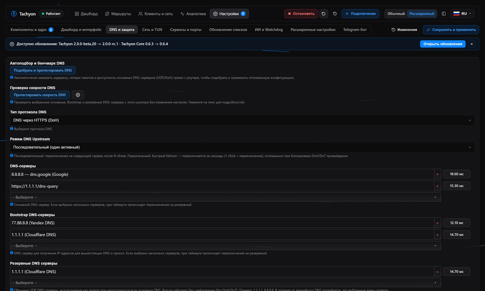
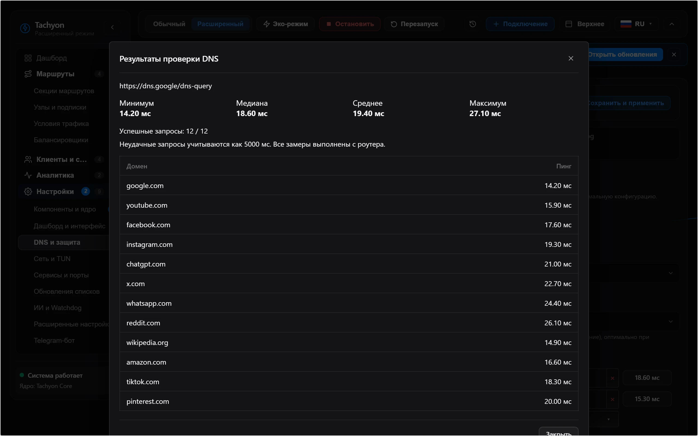

# DNS, FakeIP, Hosts и AdGuard Home

[English](../en/05-dns-hosts-adguard.md) | [К оглавлению](README.md)

Надёжное разрешение имён без утечек и лишних задержек критично для маршрутизации на уровне доменных имён. В `Настройки -> DNS и защита` задаются параметры DNS-резолвера, шифрованных транспортов и встроенной подсистемы `FakeIP`.

## Типы DNS-транспортов и Upstream-режимы

Поддерживаемые протоколы исходящих DNS-серверов (`dns_type`):

- **DoH (`doh`)**: DNS через HTTPS (`https://dns.google/dns-query`, `https://1.1.1.1/dns-query`, корпоративные DoH-узлы).
- **DoT (`dot`)**: DNS поверх TLS (`tls://...`, порт `853`).
- **DoQ (`doq`)**: DNS поверх QUIC.
- **UDP (`udp`)**: классический незашифрованный DNS для локальных резолверов или доверенных маршрутов.

Для повышения отказоустойчивости настраиваются:
- **`DNS-серверы` (`dns_servers`)**: основные резолверы и выбор режима **`Режим DNS Upstream`** — *Последовательный* (переключение на резервный после серии сбоев) или *Параллельный* (одновременный быстрый failover).
- **`Bootstrap DNS` (`bootstrap_dns_servers`)**: прямые IPv4/IPv6 адреса (`77.88.8.8`, `1.1.1.1`, `8.8.8.8`) для первоначального разрешения доменных имён самих DoH/DoT-серверов.
- **`Fallback DNS` (`dns_fallback_servers`)**: резервные резолверы на случай полной недоступности основного пула.

## Кэширование и FakeIP

- **Локальный кэш DNS (`dns_local_cache`)** и **Turbo-кэш (`dns_turbo_cache`)**: хранят ответы в оперативной памяти, минимизируя повторные обращения к внешним резолверам и сокращая задержку открытия страниц.
- **FakeIP (`fakeip_enabled`)**: при активации `tachyon-core` выдаёт клиентам виртуальные адреса из изолированных диапазонов `198.18.0.0/15` (IPv4) и `fc00::/18` (IPv6) без ожидания внешнего DNS-ответа для проксируемых доменов. Дальнейшее сопоставление маршрутов происходит мгновенно на уровне ядра по внутренней таблице соответствий.
- **Исключения FakeIP**: локальные и служебные домены или подсети можно добавить в исключения, чтобы клиенты всегда получали для них реальные IP-адреса.
- **Перехват всех DNS-запросов (`dns_intercept_all`)**: принудительно заворачивает сторонние запросы на 53 порт с клиентских устройств (Smart TV, телефоны с жёстко заданным DNS) в контур Tachyon через правила `nftables`, предотвращая расхождение таблиц маршрутизации и утечку DNS-запросов мимо заданного резолвера.

## Проверка скорости DNS и автоподбор

На вкладке `DNS и защита` доступны два встроенных инструмента измерения задержек непосредственно с маршрутизатора:

1. **Подобрать и протестировать DNS** (`dns_benchmark`): оценивает набор популярных DoH/UDP-резолверов с роутера (RTT и процент потерь) и предлагает оптимальную пару основного, bootstrap и fallback DNS.
2. **Протестировать скорость DNS** (`dns_speed_test`): замеряет настроенные вами серверы по контрольному набору из 12+ доменов (`google.com`, `youtube.com`, `wikipedia.org` и др.). Клик по плашке миллисекунд рядом с сервером открывает подробную таблицу распределения (минимум, медиана, среднее, максимум, число успешных запросов).

## Блокировка рекламы, Hosts и AdGuard Home

- **Встроенный движок Hosts (`hosts_enabled`, `hosts_block_ads`)**: загружает списки нежелательных доменов, рекламы и трекеров без запуска отдельного тяжёлого процесса; статистика заблокированных запросов доступна в `Аналитика -> Мониторинг сессий` (периоды `1 час`, `24 часа`, `7 дней`, `Всё время`).
- **Интеграция с внешним локальным DNS / AdGuard Home**: при работе AdGuard Home на том же роутере Tachyon корректно согласует цепочку `Dnsmasq / AdGuard -> tachyon-core`, сохраняя корректное определение имён и фильтрацию доменов для каждого клиента локальной сети.

---

[Предыдущая: Секции, условия, списки .trs и балансировщики](04-routing-sections-balancers.md) | [К оглавлению](README.md) | [Следующая: Входящие серверы и Tailscale](06-inbound-servers-tailscale.md)
