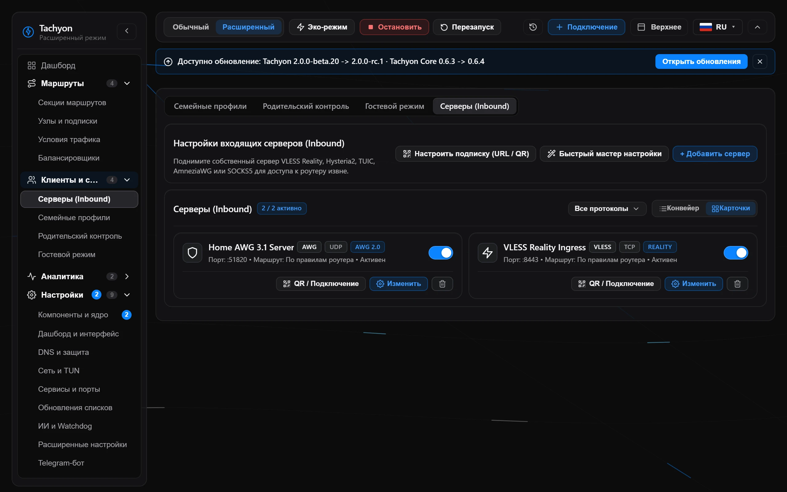

# Входящие серверы и Tailscale

[English](../en/06-inbound-servers-tailscale.md) | [К оглавлению](README.md)

Tachyon 2.0 позволяет не только маршрутизировать исходящий трафик роутера, но и принимать внешние зашифрованные подключения (**Inbound Servers**) для удалённого доступа к домашней сети, её ресурсам или выходным маршрутам роутера. Управление расположено в разделе `Клиенты и сети -> Серверы (Inbound)`.

## Поддерживаемые протоколы серверов (`server`)

В `tachyon-core` реализованы следующие входящие транспорты:

- **Туннели на уровне L3/UDP**: `AmneziaWG` (`awg` с поддержкой версий обфускации 2.0 / 3.0 / 3.1), `WireGuard`, встроенный `Tailscale`.
- **Прокси и современные транспорты**: `VLESS` (в том числе `Reality` + `Vision` / `gRPC` / `XHTTP`), `VMess`, `Trojan`, `Shadowsocks`, `Hysteria2`, `TUIC`, `AnyTLS`, `ShadowTLS`, `NaiveProxy`, `Mieru`, `Snell`, `OpenConnect`, `MASQUE`, `TrustTunnel`, `FPTN`, `MTProto`, `Mixed` / `SOCKS` / `HTTP`, пользовательский `json_inbound`.

## Создание сервера и открытие портов

1. Нажмите **`+ Добавить сервер`** (или воспользуйтесь быстрым мастером серверов в шапке).
2. Укажите отображаемое имя, протокол, интерфейс/адрес прослушивания (`0.0.0.0` или конкретный WAN), порт (`listen_port`, при необходимости диапазон `listen_port_range`) и внешний адрес/домен подключения (`public_host`).
3. Включите **`Открыть порт в межсетевом экране`** (`open_firewall_port`), чтобы Tachyon автоматически добавил разрешающие правила `nftables` для выбранного порта на интерфейсе WAN без ручной правки `/etc/config/firewall`.
4. При использовании **VLESS Reality** укажите целевой `sni` и сгенерируйте или вставьте ключевую пару; при использовании **AmneziaWG** задайте обфускационные параметры и подсеть клиентов.

## Серверные подписки и QR-коды

На карточке каждого активного сервера и в верхней панели доступны две функции быстрого подключения клиентских устройств:

- Кнопка **`QR / Подключение`** на карточке сервера формирует готовую клиентскую ссылку или `.conf`-файл и отображает QR-код для мобильных приложений.
- Кнопка **`Настроить подписку (URL / QR)`** в шапке активирует встроенный URL-эндпоинт подписки (`server_subscription_enabled`, токен `server_subscription_token`), который объединяет все активные входящие серверы роутера в одну автообновляемую ссылку для клиентов.

## Встроенный узел Tailscale

В настройках (`Настройки -> Сервисы и порты` и профиле входящих узлов) доступен нативный клиент/узел **Tailscale**:

- **`tailscale_enabled`**: запускает встроенный стек Tailscale в `tachyon-core` без установки отдельного тяжёлого пакета `tailscaled`.
- **`tailscale_web_access`**: управляет доступом к веб-интерфейсу Tachyon/LuCI с устройств внутри вашей tailnet-сети.
- Состояние подключения (`Running`), собственный DNS-адрес в tailnet (`*.ts.net`), список пиров, их онлайн-статус и счётчики RX/TX-трафика отображаются на дашборде и в разделе диагностики.

---

[Предыдущая: DNS, FakeIP, Hosts и AdGuard Home](05-dns-hosts-adguard.md) | [К оглавлению](README.md) | [Следующая: Десинхронизация пакетов и фаззер](07-desync-fuzzer.md)
