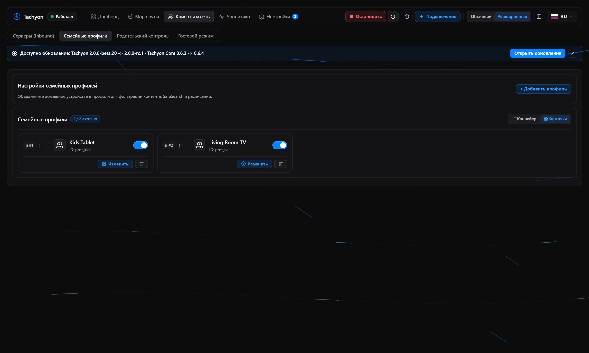
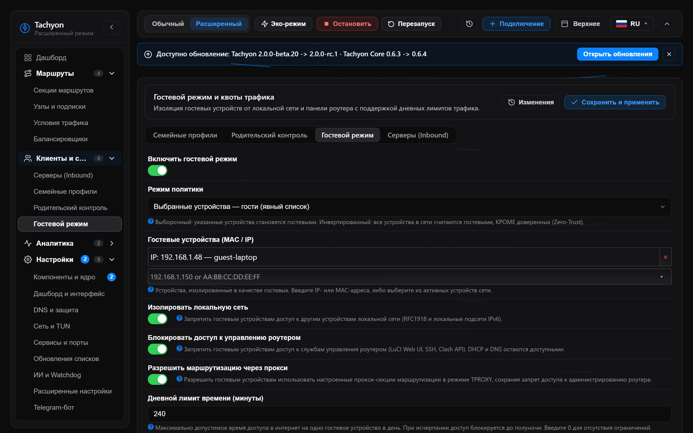

# Устройства, родительский контроль, гостевой режим и QoS

[English](../en/08-devices-parental-guest-qos.md) | [К оглавлению](README.md)

Меню `Клиенты и сети` объединяет учёт устройств локальной сети, семейные ограничения по контенту и времени, изолированный гостевой сегмент и средства управления полосой пропускания.

## Семейные профили и родительский контроль

В разделе `Клиенты и сети -> Семейные профили` устройства объединяются в логические группы (`ParentalProfile`), чтобы не дублировать правила на каждый телефон или планшет.

### Возможности семейного профиля (`profile`)

- **Привязка устройств (`device_ips`)**: выбор из обнаруженных LAN-устройств (по IPv4 или стабильному MAC-адресу `AA:BB:CC:DD:EE:FF`, устойчивому к смене DHCP-аренд) либо ручной ввод адресов.
- **Суточная квота времени (`daily_quota_minutes`)**: лимит активного использования сети в минутах в день (`0` — без ограничения); при исчерпании доступ блокируется до полуночи.
- **SafeSearch (`safe_search`)**: принудительное включение безопасного поиска для Google, Яндекс, Bing, DuckDuckGo и строгого режима на YouTube через DNS-перезапись.
- **Блокировка шифрованного DNS (`block_doh`)**: перекрывает порт `853` (DoT) и известные DoH/Private Relay эндпоинты для устройств профиля, не позволяя обойти семейную фильтрацию.
- **Список постоянно заблокированных сайтов**: круглосуточная блокировка конкретных доменов и готовых категорий для всех участников профиля.
- **Оповещения в Telegram**: уведомление родителей при исчерпании суточной квоты или попытке доступа к заблокированным ресурсам.

### Расписания (`schedule`)

Во вкладке `Клиенты и сети -> Родительский контроль` настраиваются временные окна (например, «Ночной режим для детей» с `22:00` до `07:00` по будням). Расписания могут либо полностью блокировать доступ в интернет, либо отключать конкретные секции маршрутизации для выбранных профилей или отдельных IP/MAC.

## Гостевой режим (`guest_mode`)

Вкладка `Клиенты и сети -> Гостевой режим` обеспечивает сетевую и ресурс-ориентированную изоляцию гостевых устройств без поднятия отдельного VLAN, если аппаратная конфигурация этого не требует.

### Основные параметры гостевого режима

- **Режим политики (`mode`)**:
  - *Выбранные устройства* (`selected`): гостями считаются только адреса из списка `guest_devices`.
  - *Инвертированный / Zero-Trust*: все устройства в сети изолируются как гостевые, за исключением доверенных из `trusted_devices`.
- **Изоляция LAN (`isolate_lan`)**: блокирует доступ гостевых клиентов к другим устройствам локальной сети (`RFC1918` и локальные IPv6-подсети).
- **Запрет доступа к управлению роутером (`block_router_admin`)**: закрывает гостям порты LuCI Web UI, SSH и Clash API, оставляя работающими только DHCP и DNS.
- **Разрешить прокси-секции (`allow_proxy`)**: определяет, могут ли гостевые устройства пользоваться настроенными TProxy-секциями или весь их трафик идёт исключительно через прямой WAN.
- **Ограничения полосы и квоты**:
  - Ограничение скорости в Мбит/с (`bandwidth_limit_mbps`).
  - Дневной лимит времени (`daily_time_limit`, в минутах) и дневной лимит трафика (`daily_traffic_limit`, в МБ).
  - Расписание активности окна доступа (`start_time` — `end_time`).

## Приоритизация трафика Smart Queue (SQM) и TCP BBR

В `Настройки -> Сеть и TUN` встроены механизмы предотвращения деградации отклика под нагрузкой (bufferbloat):

- **`smart_queue`**: встроенный планировщик очередей `tachyon-core` (CAKE-lite), который отдаёт приоритет DNS-запросам, TLS/TCP-рукопожатиям, голосовым и игровым потокам перед фоновыми скачиваниями. Настраиваются интерфейс (`sqm_interface`, например `wan`) и лимиты входящей/исходящей скорости (`sqm_download_kbps`, `sqm_upload_kbps`).
- **`tcp_bbr` и `tcp_profile`**: включение современного алгоритма управления перегрузкой TCP BBR и настройка профиля TCP-стека роутера для снижения потерь и стабильной скорости на каналах с высоким RTT.

---

[Предыдущая: Десинхронизация пакетов и фаззер](07-desync-fuzzer.md) | [К оглавлению](README.md) | [Следующая: Мониторинг, диагностика и ИИ](09-monitoring-diagnostics-ai.md)
