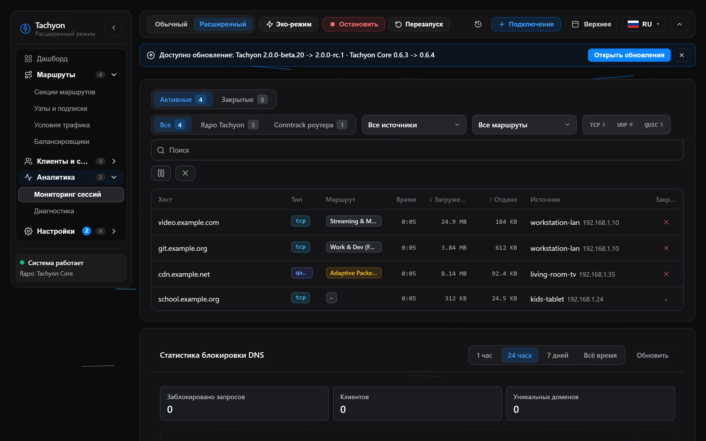
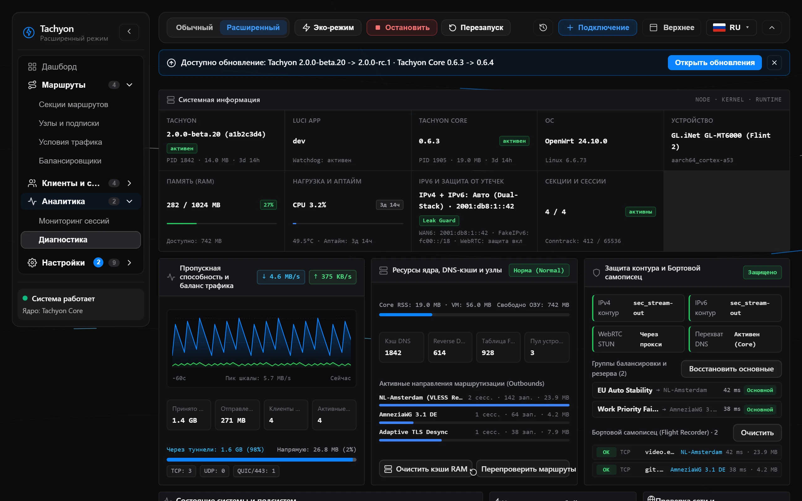

# Мониторинг, диагностика и ИИ

[English](../en/09-monitoring-diagnostics-ai.md) | [К оглавлению](README.md)

Раздел `Аналитика` включает инструменты наблюдения за текущими потоками, анализа заблокированных DNS-запросов, глубокой системной диагностики и автоматического разбора инцидентов с помощью ИИ.

## Мониторинг сессий (`Аналитика -> Мониторинг сессий`)

- **Активные и закрытые соединения**: таблица реального времени показывает целевой хост/SNI, протокол (`TCP`, `UDP`, `QUIC`), сработавший маршрут (секцию), длительность сессии, объём загруженных и отданных данных, а также исходное LAN-устройство (по хостнейму и IP).
- **Фильтры источников**: можно переключаться между общим списком (`Все`), потоками внутри `tachyon-core` (`Ядро Tachyon`) и прямыми потоками из таблицы ядра Linux (`Conntrack роутера`), фильтровать по устройствам, маршрутам, сети и строке поиска.
- **Управление потоками**: отдельные подозрительные или зависшие соединения можно принудительно закрыть кнопкой `×`, либо приостановить обновление таблицы кнопкой паузы для спокойного анализа.
- **Статистика блокировки DNS**: сводка за `1 час`, `24 часа`, `7 дней` или `Всё время` — число заблокированных запросов, уникальные клиенты, топ блокируемых доменов, правил и подключённых списков.

## Диагностика, ресурсы ядра и Бортовой самописец (`Аналитика -> Диагностика`)

### Карточки телеметрии в реальном времени

1. **Системная информация**: точные версии `Tachyon`, `LuCI App`, `Tachyon Core`, релиз OpenWrt и модель устройства, загрузка RAM (`used / total MB`), CPU, аптайм, количество активных секций, размер таблицы `conntrack` и статус контура `IPv6 + Leak Guard + FakeIPv6 + WebRTC`.
2. **Пропускная способность и баланс трафика**: 60-секундный график скоростей приёма/отдачи и соотношение трафика, прошедшего через туннельные секции, по сравнению с прямым выходом WAN.
3. **Ресурсы ядра, DNS-кэши и узлы**: точное потребление RSS и VM ядром `tachyon-core`, число записей в кэше DNS, обратном кэше и таблице FakeIP, количество активных устройств в пуле и статистика по каждому активно используемому направлению маршрутизации. Кнопки **`Очистить кэши RAM`** и **`Перепроверить маршруты`** доступны мгновенно.
4. **Защита контура и Бортовой самописец (`Flight Recorder`)**:
   - Проверка утечек по контурам `IPv4`, `IPv6`, `WebRTC STUN` и перехвата DNS.
   - Состояние групп балансировки и кнопка **`Восстановить основные`**.
   - Журнал последних трассировок соединений и ошибок рукопожатия (**Flight Recorder**).

### Системный Doctor и проверки подсистем

Нижняя часть экрана содержит кнопки запуска проверок:
- **`check_dns_available`**, **`check_fakeip`**, **`check_nft`**, **`check_tachyon_core`**, **`check_inbounds`**, **`check_dns_leak`**, **`check_ip_leak`**.
- Единый прогон **`Doctor` (`diagnose_json`)** и применение безопасных исправлений в один клик (**`Quick Fix` / `apply_quick_fix`**).

## AI Doctor и локальный RAG

При активации **`enable_ai_doctor`** (в `Настройки -> ИИ и Watchdog`) Tachyon собирает анонимизированный диагностический срез (статус служб, конфиг маршрутизации, ошибки карантина, логи ядра, результаты проверок DNS/IPv6/nftables) и проводит комплексный аудит состояния маршрутизатора:

- **Локальный режим и RAG (`enable_rag`)**: сопоставляет симптомы с базой знаний OpenWrt/Tachyon и формирует локальный индекс оценки состояния (`0–100`), список найденных проблем и конкретных быстрых исправлений без передачи чувствительных ключей.
- **Поддержка внешних LLM-провайдеров**: при указании OpenAI-совместимого провайдера, модели (`ai_doctor_model`, например `gpt-4o-mini`) и API-ключа формирует развёрнутое инженерное заключение на выбранном языке (`ai_doctor_lang`).

---

[Предыдущая: Устройства, родительский контроль, гостевой режим и QoS](08-devices-parental-guest-qos.md) | [К оглавлению](README.md) | [Следующая: Telegram-бот и управление парком роутеров](10-telegram-bot.md)
