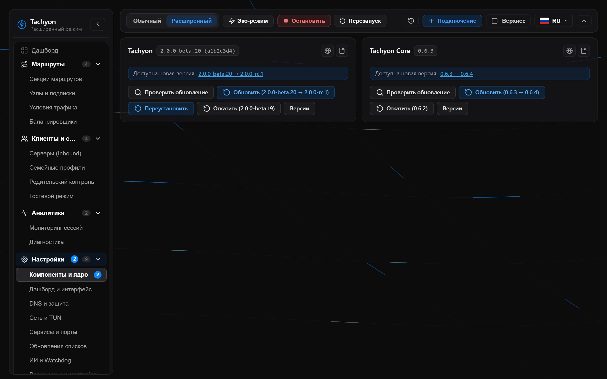
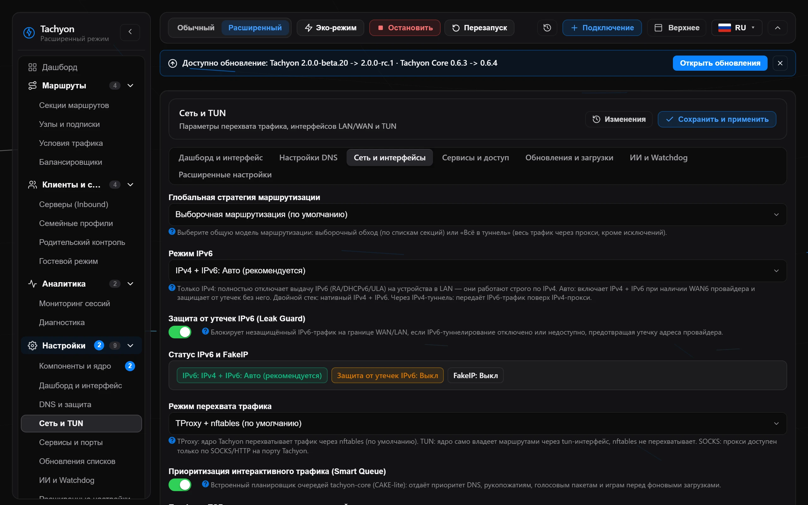

# Обновления, каналы и системные настройки

[English](../en/11-updates-settings.md) | [К оглавлению](README.md)

Tachyon 2.0 разделяет управление версиями пакета **`Tachyon`** и ядра **`Tachyon Core`**, поддерживает выбор канала обновлений с политикой поэтапного релиза и защищает NAND-флеш роутера от преждевременного износа.

## Центр обновлений и откат компонентов

Откройте `Настройки -> Компоненты и ядро`, чтобы увидеть установленные версии, доступные обновления и историю локальных резервных копий.

### Основные действия в карточках компонентов

- **`Проверить обновление`**: опрашивает GitHub Releases для выбранного канала обновлений и обновляет локальный кэш результатов.
- **`Обновить (...)`**: скачивает совместимый для вашей архитектуры пакет (`ipk`/`apk`) или бинарник `tachyon-core`, проверяет контрольную сумму `SHA-256`, сохраняет предыдущую версию на диск (если включено резервное копирование) и выполняет обновление с автоматическим рестартом служб.
- **`Откатить (...)`**: мгновенный локальный откат к предыдущей сохранённой рабочей версии компонента без необходимости доступа к интернету.
- **`Версии`**: открывает список последних релизов и пре-релизов выбранного компонента для ручной установки конкретной версии.
- **`Переустановить`**: восстанавливает файлы пакета Tachyon поверх текущей установки.

## Выбор канала обновлений и уведомления

Для всех компонентов Tachyon используется последовательный выпуск релизов: **сначала выходят пре-релизы (`beta`, затем `rc`) для предварительной проверки, и только после подтверждения стабильности публикуется `stable`**.

Перейдите в `Настройки -> Обновления списков` для настройки политики проверки и канала обновлений:

- **`Канал обновлений` (`component_update_channel`)**:
  - `auto` — автоматический подбор (ориентируется на тип текущей установленной версии: если стоит pre-release, проверяет pre-release; если stable — stable).
  - `stable` — получать только финальные стабильные релизы.
  - `beta` — включать предварительные сборки `beta` и релиз-кандидаты `rc`.
- **`Автоматическая проверка обновлений компонентов` (`component_update_check_enabled`)** и **`Интервал проверки`** (`component_update_check_interval`, например `1d` или `12h`).
- **`Автоматическое обновление компонентов`**: опциональное фоновое применение найденных обновлений.
- **`Сохранять резервную копию перед обновлением` (`component_backup_enabled`)**: сохраняет предыдущую версию для быстрого офлайн-отката (учитывает свободное место на flash).
- **Видимые уведомления**: при обнаружении новой версии хотя бы одного компонента UI отображает синий верхний баннер уведомления (с кнопкой закрытия до следующей новой версии и быстрым переходом в раздел обновлений), а также бейдж с числом доступных обновлений в боковом меню на пунктах `Настройки` и `Компоненты и ядро`.

## Сеть, IPv6, защита Flash и расширенные настройки

В разделе `Настройки -> Сеть и TUN` задаются фундаментальные параметры сетевого стека маршрутизатора:

### Ключевые подсистемы

- **Режим перехвата трафика (`proxy_mode`)**:
  - `tproxy` (*по умолчанию*): прозрачный перехват входящего и транзитного трафика на основе `nftables` (`inet TachyonTable`) с нулевыми накладными расходами на копирование пакетов в пользовательский TUN-интерфейс.
  - `tun`: создание L3 TUN-интерфейса (`tun0`, стек `mixed`, настройка MTU и подсети `172.19.0.1/30`, опциональный `tun_kill_switch`). Рекомендуется для специфических конфигураций интерфейсов или при отсутствии `kmod-nft-tproxy`.
- **Режим IPv6 (`ipv6_mode`) и `Leak Guard` (`ipv6_leak_guard`)**:
  - `off` — только IPv4 на клиентских устройствах.
  - `auto` (*рекомендуется*) — автоматически активирует Dual-Stack при наличии рабочего WAN6 и блокирует незащищённый IPv6-трафик через WAN/LAN в остальных случаях.
  - `dual_stack` / `tunnel_over_v4` — принудительный нативный Dual-Stack или проксирование IPv6 поверх IPv4-туннелей.
- **Защита WebRTC (`webrtc_leak_protect`)**: предотвращает раскрытие реального адреса через STUN/TURN-серверы внутри браузерных сессий.
- **Watchdog (`enable_watchdog`)** и **Smart Detect (`smart_detect`)**: фоновый контроль состояния `tachyon-core` и таблицы `nftables` с автовосстановлением, а также автоматическое обнаружение доменов со сбоями соединения (в режиме подсказок `suggest` или автодобавления).
- **Last Known Good (LKG) и снапшоты**: перед каждым применением изменений создаётся точка восстановления конфигурации (`tachyon rollback` или кнопка отката в меню `Изменения`).
- **Защита NAND-флеш (`flash_wear_protection`)**:
  - Оперативное состояние, кэши, телеметрия, Flight Recorder, Blackbox-дампы и журналы хранятся строго в `tmpfs` (`/var/run/tachyon/` и `/tmp/`).
  - Все записи на постоянную память (`/etc/tachyon/`) проходят через `write_json_if_changed`, исключающую перезапись идентичных файлов на микросхему flash.

---

[Предыдущая: Telegram-бот и управление парком роутеров](10-telegram-bot.md) | [К оглавлению](README.md) | [Следующая: Устранение неполадок и FAQ](12-troubleshooting-faq.md)
