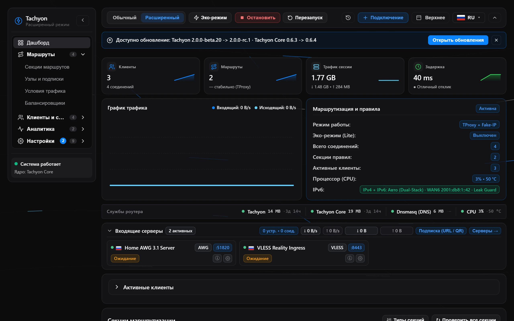

# Документация Tachyon 2.0

Язык: **Русский** | [English](../en/README.md)

**Tachyon 2.0** — система оркестрации сетевой маршрутизации, DNS-фильтрации, туннелирования и адаптивной доставки трафика для маршрутизаторов OpenWrt.

## Архитектура версии 2.0

Ветка `2.0` перенесена на единый нативный бинарный сервис на Rust (`/usr/bin/tachyon`) и работает совместно со штатным ядром передачи пакетов `tachyon-core` (`/usr/bin/tachyon-core`).

| Компонент | Расположение | Назначение |
|---|---|---|
| Демон и CLI `tachyon` | `/usr/bin/tachyon` | Оркестрация маршрутов, nftables, DNS-обвязки, Telegram-бот, Agent REST API, MCP-сервер, встроенный веб-сервер и ubus-мост для LuCI |
| Ядро маршрутизации `tachyon-core` | `/usr/bin/tachyon-core` | Обработка трафика (TProxy / TUN), исходящие и входящие протоколы, FakeIP, DoH/DoT/DoQ, балансировщики и пакетная десинхронизация |
| Основное хранилище | `/etc/tachyon/tachyon.json` | Единый JSON-реестр настроек, секций, условий, источников, балансировщиков, серверов, профилей, расписаний и Telegram-бота |
| Совместимость со срезом UCI | `/etc/tachyon/config_sections.json` | Представление конфигурации для модулей LuCI |
| Сгенерированный конфиг ядра | `/etc/tachyon-core/config.json` | Итоговая конфигурация `tachyon-core`, пересобираемая при запуске и применении правил |
| Наборы правил | `.trs` по умолчанию | Нативный бинарный формат `.trs` (`tachyon-lists`), с поддержкой `.srs` для сторонних ссылок |

## Содержание

| № | Раздел | Описание |
|---|---|---|
| 01 | [Установка и миграция с 1.x](01-installation.md) | Системные требования OpenWrt (`opkg` и `apk`), флаги `install.sh`, перенос с Tachyon 1.x через `import-legacy`, политика релизов |
| 02 | [Быстрый старт](02-quickstart.md) | Первый вход в LuCI и standalone-интерфейс, обзор дашборда, мастер быстрого подключения, проверка маршрута |
| 03 | [Исходящие источники и протоколы](03-outbounds-protocols.md) | Подписки, Share-ссылки (`VLESS`, `Hysteria2`, `WDTT` и др.), `AmneziaWG 2.0/3.0/3.1`, `WARP`, `FPTN`, `TrustTunnel`, `AnyTLS`, `NaiveProxy` |
| 04 | [Секции, условия, списки .trs и балансировщики](04-routing-sections-balancers.md) | Приоритет секций, Fail-Closed / Kill-Switch, составные условия `AND/OR/NOT`, списки `.trs`, все 14 режимов балансировки |
| 05 | [DNS, FakeIP, Hosts и AdGuard Home](05-dns-hosts-adguard.md) | DoH/DoT/DoQ, Bootstrap и Fallback DNS, локальный и Turbo-кэш, FakeIP, перехват DNS, DNS Speed Test и фильтрация рекламы |
| 06 | [Входящие серверы и Tailscale](06-inbound-servers-tailscale.md) | Развёртывание VPN/прокси-серверов на роутере, серверная подписка и QR, автоматическое открытие портов, встроенный Tailscale |
| 07 | [Десинхронизация пакетов и фаззер](07-desync-fuzzer.md) | Нативная пакетная десинхронизация в `tachyon-core`, параметры сплита и фулинга, пресеты `adaptive`, автоподбор под транзитные узлы |
| 08 | [Устройства, родительский контроль, гостевой режим и QoS](08-devices-parental-guest-qos.md) | Реестр LAN-устройств, семейные профили, SafeSearch, блокировка DoH/DoT, расписания, гостевая изоляция, Smart Queue (SQM) и BBR |
| 09 | [Мониторинг, диагностика и ИИ](09-monitoring-diagnostics-ai.md) | Живые сессии и статистика DNS-блокировок, системный Doctor, проверки утечек IPv6/WebRTC, AI Doctor с локальным RAG, Flight Recorder |
| 10 | [Telegram-бот и управление парком роутеров](10-telegram-bot.md) | Настройка токена, права `admin_ids`, уведомления, мульти-роутерное управление `fleet_routers`, полный справочник команд |
| 11 | [Обновления, каналы и системные настройки](11-updates-settings.md) | Выбор канала (`auto`, `stable`, `beta` с `rc`), уведомления, бэкапы и откат, защита NAND-флеш, TProxy vs TUN, IPv6 Dual-Stack |
| 12 | [Устранение неполадок и FAQ](12-troubleshooting-faq.md) | Карантин секций, диагностика DNS/FakeIP/IPv6, откат LKG и снимков, экономия RAM/Flash, сбор `support_bundle` |
| 13 | [Справочник CLI и конфигурации](13-cli-and-config.md) | Все подкоманды `/usr/bin/tachyon`, структура `/etc/tachyon/tachyon.json` и служебные каталоги в `/var/run/tachyon/` |
| 14 | [Agent REST API и MCP-сервер](14-api-and-mcp.md) | Эндпоинты `/api/agent/v1/*`, спецификация OpenAPI, подключение по `stdio` и HTTP к встроенному MCP-серверу |

## Доступность интерфейсов управления

- **LuCI**: меню `Services -> Tachyon` в стандартном веб-интерфейсе OpenWrt.
- **Автономный веб-интерфейс**: порт `1680` (по умолчанию путь `/tachyon`, привязка настраивается в `settings.listen_addr` / `settings.listen_port`).
- **CLI и локальные инструменты**: `/usr/bin/tachyon` на маршрутизаторе.
